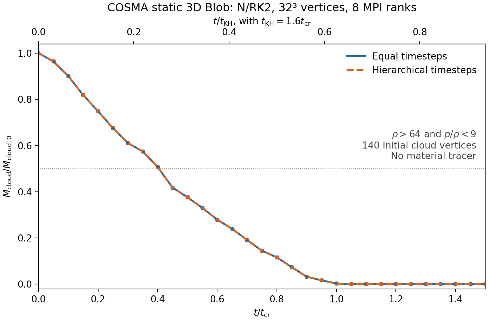
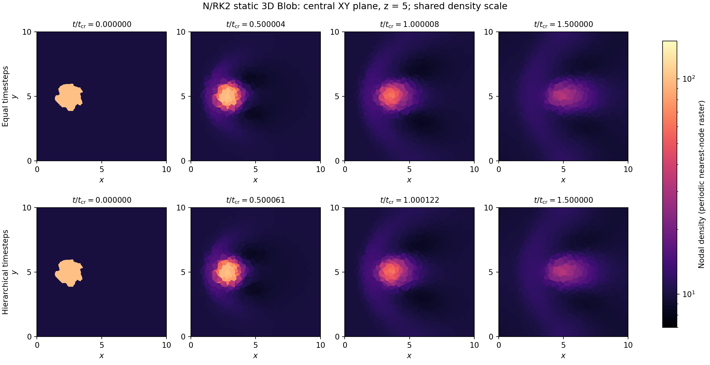
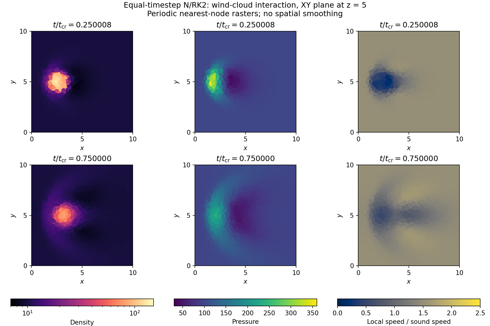
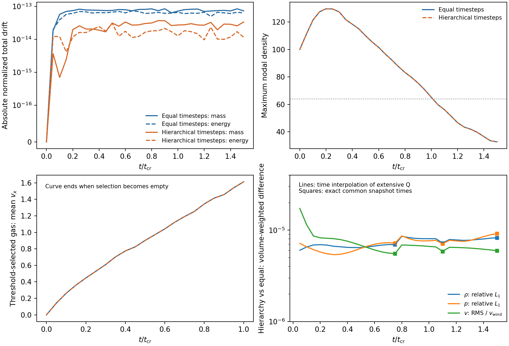

# COSMA static 3D Blob: independent analysis of the downloaded results

2026-10-20 — Codex (GPT-6), with Zhenyu Wu. Analysis on the local Mac;
simulations executed on COSMA on 2026-10-19. No new solver execution or
numerical change accompanies this report.

**Follow-up:** the [N1 implementation diagnosis](RD_3D_BLOB_N1_DIAGNOSIS_20261020.md)
finds matching physical ICs and spatial N operators, roundoff agreement with
a short native Heun replay, and a shared contact-reconstruction limitation.
It does not establish extra dissipation introduced by the current port. The
gap under the literal published time axis remains, with original-run and
post-processing provenance still required to explain it.

The two **N/lumped RK2** runs completed on eight MPI ranks. Saved states are
positive and conserve the five extensive quantities to below 9e-14 under the
normalization below. Hierarchical timesteps give nearly the same evolution as
equal timesteps and a shorter recorded wall time. However, the cloud loses
its density contrast very quickly. This is a useful long static-3D workflow
result, **not a quantitative reproduction of Morton's N1 Blob or a resolved
cloud-disruption calculation**. Both LDA/F1 runs fail through negative pressure.

## Evidence and source attribution

Zhenyu supplied `../cosma_runs/blob3d_mac_analysis_20261020_v1.tar.gz` and
`../cosma_runs/blob3d_scripts_20261020_v1.tar.gz`. Their SHA256 values are,
respectively:

```
26719c7efc00e1ae518121c908007299d9ea4f143159469146956cf7523f7256
a59c31c578eda0d33cf282de9f88493ade940468c3cdcddecc3505295df4335d
```

All 168 listed data-bundle files and 96 listed scripts-bundle files passed
their supplied SHA256SUMS. Extraction preserved the archives. Original
cluster directories are recorded in `bundle.json`:

- N: `/cosma/apps/do020/dc-wu8/arepo-rd/rd_3d_blob_20261019_v2/`.
- LDA: `/cosma/apps/do020/dc-wu8/arepo-rd/rd_3d_blob_20261019_lda_v1/`.

Both frozen-source manifests identify base commit
`35ecccd160834e45c921d77d9761d015fc4306d3` on the `feature/3d-moving-mesh`
development line. For **each** campaign, all 170
supplied hashes for `src/*`, `Makefile` and `defines_extra` match that Git
commit. Different N/LDA source-tar hashes arise from other campaign files;
the numerical sources match. This predates the Mac's uncommitted shared
element-interface integration in shared-log entry 20.

Build/runtime Config and generated-header copies match, their SHA256 values
match the build records, parameter copies match, and exit-status/binary-hash
records agree. The reported stack is GCC 14.1.0, OpenMPI 5.0.3, parallel HDF5
1.14.4 and MKL. All run wrappers record host `gc001.pri.cosma.local`, eight
ranks, and OMP/OPENBLAS/MKL thread limits of one.

The snapshots themselves have `Git_commit=unknown`. The downloaded package
does not contain the executables or full frozen source tar files; their
recorded hashes cannot be checked against their actual bytes here. It also
omits the full N runtime logs. Accordingly, snapshot calculations below are
independent, whereas N stage counts, timestep extrema and star ratios are
**provided native-log aggregates**. Both full compressed LDA failure logs are
available; their decompressed SHA256 values match the original-log records.

| Case | Slurm job | Exit | Saved states | Last saved t/t_cr | Recorded wrapper wall time |
| --- | ---: | ---: | ---: | ---: | ---: |
| N equal | 12187329 | 0 | 31 | 1.5 | 18639.88 s = 5.178 h |
| N hierarchy | 12187330 | 0 | 31 | 1.5 | 10194.70 s = 2.832 h |
| LDA equal | 12187332 | 1 | 1 | 0 | 379.66 s |
| LDA hierarchy | 12187333 | 1 | 1 | 0 | 206.77 s |

Binary SHA256 values, in that row order:

```
b5fe6665d5073d94e5e06e19d01fe083ef9f8cba6de140ed741429399a074f8e
06346865834cea1a6d7d7f13fd72ed306f05630af3ed8afb28c02308e01d10bb
2a00305db527ef320afca95bceeb3496e399c7e2073109b27304ea95367f1e70
21f6b79dbad54c2b724879fafa653560b65322672a9bbe061809389fa55d4037
```

## Actual setup and diagnostics

The periodic static box has side 10 and 32768 uniformly random vertices
(nominal 32³, seed 68315). The IC positions reproduce that seed exactly.
The radius-one cloud is centered at (2.5,5,5), with density 100 against wind
density 10. Initial pressure is 100, gamma=5/3, wind velocity is
(6.15,1e-7,1e-7), and cloud velocity is (1e-8,1e-7,1e-7). The actual wind Mach
number is 1.50644. There is no gravity, cooling, mesh motion or scalar tracer.

There are only **140 initial cloud vertices**, and the nominal diameter is
6.4 mean spacings. The initial median-dual cloud mass is 420.9728057637894;
the continuous-sphere value is 418.8790204786391, a 0.50% difference. Accurate
initial integrated mass does not establish adequate interface resolution.

The measured time normalization is

```
t_cr = 2 R sqrt(rho_cloud/rho_wind) / v_wind = 1.0283829789165462
t_KH = 1.6 t_cr                             = 1.645412766266474
t_end = 1.5 t_cr                            = 1.5425744683748193
                                             = 0.9375 t_KH
```

`CourantFac=0.01`; the equal N run reports 131072 completed stage-1 events,
with dt about 1.1768909213e-5. The hierarchy reports the same number of base
events and maximum **local star** interval ratio 8. Equal counts of base
events do not imply equal numbers of element evaluations. The hierarchy's
global occupied-bin range need not equal its local star ratio.

For snapshots, `Masses` stores extensive mass. The weights used here are
`V_i = Masses_i / Density_i`, the fixed median dual. Snapshot `Volume` is a
Voronoi volume and is not this weight: initial V_med/V_Voronoi ranges from
0.1322 to 2.5539. The IC's `Masses` instead stores input density, as required
by `READ_MASS_AS_DENSITY_IN_INPUT`.

The conserved nodal vector is
`Q_i = (m_i, m_i v_x, m_i v_y, m_i v_z, m_i[u_i + |v_i|²/2])`.
Total defects use each component's initial sum of absolute nodal values;
each momentum denominator is floored by the initial total mass. This avoids
dividing by almost-zero transverse momentum. ID-sorted initial totals are
approximately `(10378.8755251874, 61241.1017286653, .001037887552519,
.001037887552519, 338316.387802703)`.

Cloud mass uses the stated threshold `rho>64 AND p/rho<9`, summing extensive
masses. This selects current dense/cool gas, not original material. On a
static mesh, following the initially selected vertex IDs would not supply a
material tracer.

## Conservation, positivity and fixed geometry

Every supplied snapshot was read independently, sorted by unique ID and
checked for finite values. All four initial states agree exactly. Coordinates
remain byte-identical throughout both completed N runs. Median-dual weights
remain fixed within floating-point error, cover the box, and remain positive;
the stored Voronoi volumes are also positive. This is a saved-state dual-volume
check, not a new audit of every tetrahedron's orientation.

| Independent saved-state check | N equal | N hierarchy |
| --- | ---: | ---: |
| Maximum normalized mass drift | 8.430e-14 | 3.680e-14 |
| Maximum normalized x-momentum drift | 7.604e-14 | 2.780e-14 |
| Maximum normalized transverse-momentum drift | 1.608e-16 | 1.636e-16 |
| Maximum normalized energy drift | 7.261e-14 | 3.080e-14 |
| Minimum density across all saved times | 4.27288 | 4.26427 |
| Minimum pressure across all saved times | 30.97646 | 30.94698 |
| Minimum specific internal energy across all saved times | .452974 | .452459 |
| Maximum relative change of a median-dual weight | 8.882e-16 | 2.220e-16 |

Box coverage defect rounds to zero in both histories. Stored pressure equals
`(gamma-1) rho u` under the recomputation. Final minima (rho about 8.837,
p about 71.09) are less restrictive than the minima over the entire history.
Only 31 times are saved: the independent positivity statement applies to
those states. The completion/debug records provide additional native evidence,
but the omitted full N logs preclude a fresh per-stage audit here.

## Cloud evolution and the discrepancy that remains



| Approximate t/t_cr | N equal M_cloud/M_cloud,0 | N hierarchy M_cloud/M_cloud,0 |
| ---: | ---: | ---: |
| 0 | 1 | 1 |
| .25 | .675600 | .675582 |
| .5 | .376405 | .376413 |
| .75 (exact common time) | .145255 | .145270 |
| 1 | .00311844 | .00311836 |
| 1.05 | 0 | 0 |
| 1.5 (exact common time) | 0 | 0 |

Except for explicitly identified common times, this table gives nearby
outputs with slightly different actual times; CSV files retain those times.
For equal steps the 50% threshold lies between .400005 and .450005 t_cr;
linear interpolation of the sampled scalar curve estimates .404206 t_cr.
Hierarchy gives .404284 by the same interpolation. These estimates are not
resolved event times; the output spacing is about .05 t_cr.

The equal run first has zero selected mass at 1.05000687 t_cr, following a
nonzero sample at 1.00000763. For hierarchy the corresponding bracket is
(1.00012207,1.05010986] t_cr. Zero selected cloud mass does **not** mean all
overdensity or cold gas has vanished: final rho_max is 32.69/32.70 and the
temperature-only selected mass is about 742.1. At every saved time the
density-only mass equals the combined cloud mass, so crossing the density
threshold controls this diagnostic. Conserved box mass is retained.

The density peak initially compresses to about 130 and then falls below 64
near t_cr. Selected gas accelerates: mean vx is .528 at .25 t_cr, .901 at
.5, and 1.253 at .75 in the equal run. These are statistics of a changing
Eulerian selection, not velocities of a tagged material cloud.



The central slices show a compact compressed core that moves downstream and
broadens into a diffuse enhancement. A high-pressure upstream cap and a
low-pressure downstream region are visible in the pressure maps. The local
speed/sound-speed map shows the decelerated region around the cloud. There
is no persuasive resolved fragmentation or fine KH roll-up in these data.
Random-node asymmetry is visible between the XY and XZ planes.



All maps use periodic nearest-node sampling of the actual 3D nodal fields,
with no smoothing. They are not tetrahedral P1-Z reconstructions, material
maps, or 2D runs. The [three-plane figure](figures/rd_3d_blob_cosma_20261020/density_planes.png)
uses z=5 for XY, y=5 for XZ, and the density-maximum x for each YZ plane.

**Literature comparison:** Morton et al. define the same threshold and
t_KH=1.6 t_cr. They report N1 half-mass times around .70–.86 t_KH across
resolutions, and zero mass around 1.6 t_KH at their lowest resolution. Here those measures are about
.253 t_KH and (.625,.656] t_KH. Thus this run erodes the dense cloud much
earlier. Their discussion also identifies diffuse wakes and numerical
dissipation, but that qualitative similarity does not explain this quantitative
gap. See [§5.3.1 and Figure 20](https://arxiv.org/html/2204.01757v2#S5.SS3.SSS1).

Our method is N/lumped RK2, not N1; the random realization, exact wind speed,
and potentially boundary/setup details are not a controlled match. The
time conversion and median-dual weighting have been checked; the gap persists.
Strong numerical diffusion at this resolution is plausible, but its amount
and the contribution of the current spatial/temporal discretization have not
been isolated. Do not describe the disappearance time as a converged physical
cloud lifetime. Periodicity also matters for later evolution as disturbances
can circulate around the finite box.

## Hierarchical timesteps and observed cost

Only t/t_cr = 0, .75, 1.100006103515625 and 1.5 are **exactly** common saved
times. Equal-index output times otherwise differ by up to .0001602173 t_cr.
For the interpolated comparison, extensive Q from the equal run is linearly
interpolated to each hierarchy time, using the same fixed dual before deriving
primitive fields. This approximation cannot establish timestep convergence.

At the exact endpoint:

- Relative volume-weighted density L1 difference: **8.265e-6**.
- Relative volume-weighted pressure L1 difference: **9.165e-6**.
- Volume-weighted velocity RMS difference divided by wind speed: **5.960e-6**.
- Integrated absolute density difference divided by the initial cloud density
  excess mass (378.8755): **2.264e-4**, avoiding dilution by the background mass.

At the exact .75 t_cr output, the cloud-fraction difference is 1.573e-5 of
the initial cloud mass. Both methods display the same rapid erosion. The
large discrepancy with the intended physical benchmark is already present
with equal steps; the hierarchy is not its leading apparent cause.



The wrapper wall-time ratio is **1.8284**, or 45.31% less time for hierarchy
in this pair. This is an observed eight-rank comparison, not an MPI scaling
measurement or a repeated performance estimate: full profiling, repeated
allocations and load information are absent. The supplied gate summaries
also report earlier 1/2/4-rank agreement, but their raw gate snapshots were
not downloaded. There is only one rank count for the full 32³ evolution.

## LDA failure: separate from the completed N result

Both LDA cases terminate at synchronization 1872, inferred
t/t_cr=.02142333984375 (physical time approximately .02203139805). The
equal run's stage-0 line provides that time directly. Both fail the raw
corrector admissibility check, stage 1, at **ID 14151**:

| Method | Density at failure | Pressure at failure |
| --- | ---: | ---: |
| LDA equal | 2.7419081442 | -5.0089129e-5 |
| LDA hierarchy | 2.7064776250 | -.0330386856 |

This node initially belongs to the wind at (3.54384413,4.92726501,4.81506174),
radius 1.06259 from the cloud center, just beyond the downstream interface.
The last accepted equal-step pressure minimum is .0323505; failure follows
on the next corrector. The last native diagnostics report zero SVD fallback
and spatial conservation defects around 1e-15. The evidence identifies a
nonlinear positivity failure; it does not point to the previous cold-Sedov
singular-solve audit stop or uniquely to MPI/hierarchy.

The equal-step dt is 1.1768909213e-5, below the last reported spectral CFL
limit 1.3043246e-5 (ratio .9023). Thus a simple violation of that reported
bound is not the observed explanation. A linear spectral bound alone is
not a positivity proof for LDA/F1; the effect of a smaller CFL or a nonlinear
limiter has not been tested here. Only initial LDA snapshots were saved, so
their positive values/zero saved drift do not constitute an evolved LDA pass.

## Reproduction and next use

The independent reader/plotter is
[`tests/rd/analyse_3d_blob_bundle.py`](../tests/rd/analyse_3d_blob_bundle.py).
It recomputes the snapshot diagnostics, validates input/configuration/source
records, parses both raw failure logs, and checks the bundled CSV values.
Run from the repository root with numpy/scipy/h5py/matplotlib available:

```sh
OMP_NUM_THREADS=1 OPENBLAS_NUM_THREADS=1 python tests/rd/analyse_3d_blob_bundle.py \
  ../cosma_runs/blob3d_mac_analysis_20261020_v1 --out /path/to/new/analysis
```

It refuses to overwrite output files. Accepted local evidence is
`../local_runs/rd_3d_blob_cosma_analysis_20261020_v1/analysis_v4/`, with the
import manifest in its parent. Earlier analysis_v1/v2 contain respectively
a log-field punctuation parser error and a plotting-API error; v3 is a
completed intermediate figure set. These were analysis-only failures and
did not execute or change hydrodynamics. The final v4 figures were visually
inspected. Compact results and CSV files are retained alongside the figures
under `figures/rd_3d_blob_cosma_20261020/` for access after a repository pull.

This supplies a completed N static-3D long-run reference for future moving
work. For a physical Blob comparison, first align the standalone N1 baseline,
geometry/mass convention, boundaries, IC and time units, then compare 32³
and 64³ at matched times. A short actual-dt refinement at fixed resolution
would distinguish timestep effects from spatial diffusion before expensive
production runs. These are recommendations, not jobs submitted in this task.
The user's priority remains mesh/moving-3D, hierarchy and MPI; no HLLC-RD
implementation is added. Thesis integration remains subject to review and a
separate explicit request.
