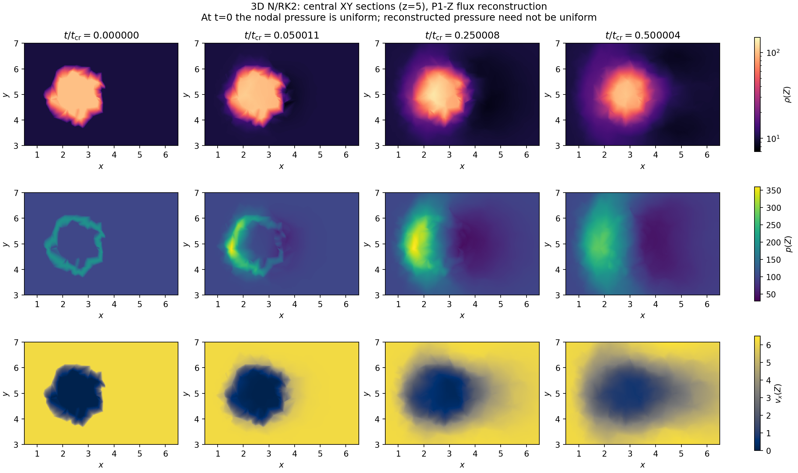
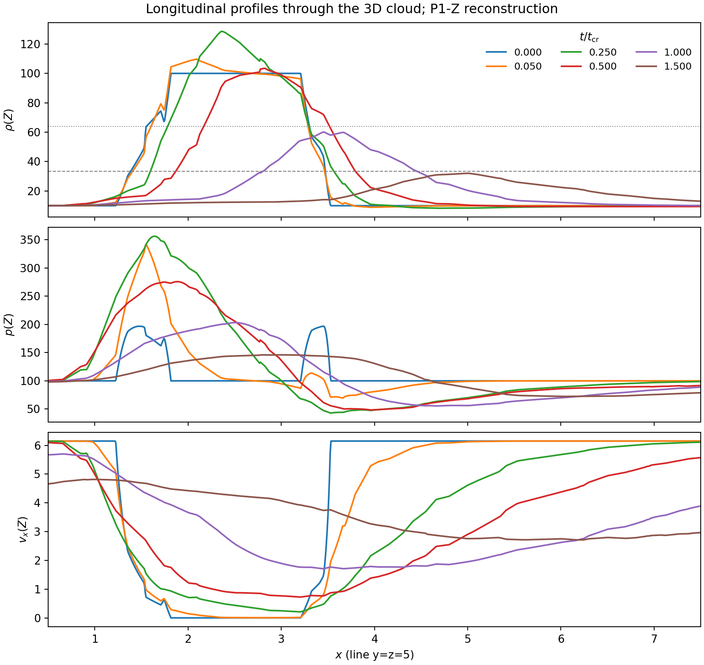
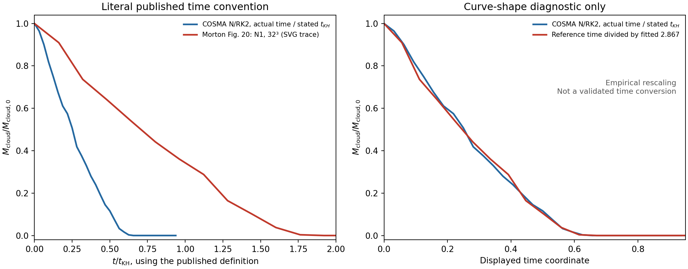
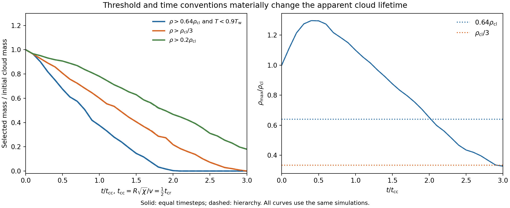

# Why does the downloaded Blob lose dense mass so early?

2026-10-20 — Codex (GPT-6), with Zhenyu Wu. Local Mac, branch
`feature/3d-moving-mesh`. Follow-up to the
[download analysis](RD_3D_BLOB_COSMA_ANALYSIS_20261020.md).

**The investigation does not find an extra factor or a different spatial N
operator in the current port.** Initial physical states agree with the
available predecessor; its actual C++ N kernel agrees with the current C
kernel on every initial tetrahedron. A native four-step run agrees with an
independent full-mesh Heun replay. The available evidence therefore does not
justify attributing the published factor-of-about-three lifetime difference
to the RK2 conversion or an identified AREPO implementation error.

There is a concrete shared limitation: the P1-Z representation does not
preserve an isobaric contact on general tetrahedra. It can generate pressure
structure between initially isobaric nodes and diffuse the interface. This
also occurs in the predecessor N1. It explains a mechanism for strong
numerical erosion at low resolution, but **does not isolate the difference
from the published mass curve**. That remaining comparison needs the original
run and post-processing provenance, particularly its time normalization.

## Source and execution scope

- COSMA numerical reference: `35ecccd160834e45c921d77d9761d015fc4306d3`.
  These kernels predate the uncommitted shared-interface refactor, which is
  preserved. No production solver file was edited for this investigation.
- Available predecessor: `/Users/zhenyuwu/rdsolver`, commit
  `adfbe55586fc926f1911dbecfbdb915c8f667c11`. The element header is unchanged
  from the preceding upstream merge. This is available source, **not a
  recovered executable/configuration that generated the 2023 figures**.
- Evidence: `../local_runs/rd_3d_blob_n1_audit_20261020_v1/`. Source archives,
  hashes, configuration copies, compiler commands, binary/linkage records,
  probe inputs/outputs, native logs/snapshots and intermediate attempts remain
  there. `portable_reproduction/` reruns the committed diagnostic scripts.
- Reproduction tools: [README](../tests/rd/blob_n1_diagnosis/README.md).
  They compile actual source, rather than treating a Python transcription of
  the N formula as the predecessor. Sources are frozen in external directories.
- All OMP/OpenBLAS threads are one; the short native control uses one MPI
  rank. At most two single-threaded numerical processes overlap. There is no
  cluster submission, full local Blob rerun, thesis edit, commit or push.

The compact JSON/CSV results and inspected figures are retained in
`dev_log/figures/rd_3d_blob_n1_diagnosis_20261020/`. Large binary probe arrays,
executables and snapshots stay outside Git.

## 1. Initial conditions: agreement with the available BLOB implementation

The original `setup3D.cpp` BLOB function was compiled and evaluated at **all
32768 downloaded coordinates**. Its conserved states match the initial
snapshot to floating-point accuracy: maximum absolute differences by component
are approximately `(1.42e-14, 1.42e-14, 3.39e-21, 3.39e-21, 1.71e-13)`.
The maximum component difference with the replay's fixed reference scales
is 1.71e-16. These are the same physical initial conditions.

| Quantity | Available predecessor BLOB | Downloaded IC |
| --- | --- | --- |
| Box and boundaries | 10³, periodic | same |
| Cloud center / radius | (2.5,5,5) / 1 | same |
| Cloud / wind density | 100 / 10 | same |
| Initial nodal pressure | 100 | same |
| Gamma | 5/3 | same |
| Wind vx | 1.5 × 4.1 = 6.15 | same |
| Cloud vx; common vy,vz | 1e-8; 1e-7,1e-7 | same |
| Initial cloud nodes / mass | depends on mesh realization | 140 / 420.972806 |

The present coordinates are uniformly random, NumPy seed 68315. The old CGAL
generator uses `rand()`, float coordinates quantized on a .001 grid, and a
separate triangulation workflow. Its paper-run seed/input is unavailable.
The density contrast, radius, pressure and wind have not accidentally been
changed in this preparation; the exact mesh realization is not a reproduction.
The published paragraph's 100/100 density inconsistency cannot override the
checked 100/10 BLOB code or establish what a missing analysis script used.

The current cloud has only 3.2 mean spacings per radius. Its integrated
initial mass differs from the continuous sphere by only .50%, but this does
not make its interface well resolved.

## 2. Geometry, spatial N residual and mass weights

A padded periodic SciPy/Qhull reconstruction gives **221713 tetrahedra**,
matching the native count. Its volume sum is 1000 and every reconstructed
median-dual volume agrees with snapshot `Masses/Density` within 2.665e-15
relative error. These are not Voronoi weights. The four-step native replay
below provides an additional operator check on this reconstructed geometry.

The apparent factor of two in the old source is **not a missing factor in
the port**:

```
old MAG = |edge1 × edge2| = 2 × triangular face area
old K   = (MAG/3) A_n = 2 × current K
old nodal N residual = 0.5 K_old^+ (Uhat_i - Uhat_in)
                    = current K^+ (Uhat_i - Uhat_in)
```

Both use the same Roe parameters, arithmetic mean in Z, five-component
spectral splitting and `Uhat = (dU/dZ)(Zbar) Z_i`. The factor cancels in the
inflow inverse/bracket as well. Both assign V_tetra/4 to each vertex's lumped
mass. The current reference subtraction removes uniform-field roundoff; it
does not add an N viscosity coefficient.

The C++ probe calls the unchanged predecessor `TRIANGLE` methods with a BLOB,
N, FIRST_ORDER configuration. The current probe calls the frozen production
geometry and `rd_euler_n_residual`. No floor is activated for these positive
input states.

| Direct spatial comparison | Tetrahedra | Maximum scaled nodal difference |
| --- | ---: | ---: |
| Independent random states/geometries | 1200 | 3.765e-14 |
| All initial interface tetrahedra + uniform sample | 1972 | 4.398e-13 |
| Four evolved snapshots, interface + fresh uniform samples | 5088 | 6.037e-13 |
| **Every initial tetrahedron** | **221713** | **1.790e-12** |

The scale is `max(1, max(abs(current nodal residual)))` for each element.
For the full mesh, old/new normal differences are <=1.638e-15, volume
differences <=3.065e-14 relative, and old MAG/(2 area) differences <=1.555e-15.
No current SVD is used in those full initial comparisons. These small
inverse/arithmetic differences provide no evidence for an order-one change
in spatial dissipation.

## 3. N1 versus the current N/lumped RK2 update

Let R(U) be the assembled spatial N residual and M the fixed diagonal median
dual. The predecessor FIRST_ORDER path is forward Euler:

```
N1:  U_new = U_old - dt M^-1 R(U_old).
```

The current predictor and local corrector terms reduce algebraically to
lumped Heun:

```
U_star = U_old - dt M^-1 R(U_old)
U_new  = U_old - 0.5 dt M^-1 [R(U_old) + R(U_star)].
```

Specifically, the `+0.5 dU` in `rd_state.c`, the summed lumped temporal
contribution in the corrector, and its `0.5 R(U_star)` combine to this form.
The predecessor's N2 formula in `triangle3D.h` reduces to the same expression.
This is a temporal change from N1; it does not replace the spatial N scheme.

An independent C assembly on the reconstructed **full 32³ mesh** was replayed
with the actual COSMA equal dt, 1.1768909213064722e-5, for four steps and for
eight half-steps. A separate native one-rank run uses the same IC and N/equal
configuration through physical time 4.707563685225889e-5. It completes, with
five outputs. A source/config-verified Mac binary was reused: all 168 source
files plus Makefile/defines_extra match the COSMA base; binary SHA256 is
`1fdd74e8813548387e93b628922a94100755b679cec2a48559b61e75398410ac`.

| Comparison at the short endpoint | Relative volume density L1 |
| --- | ---: |
| Native N/RK2 versus independently assembled Heun | 1.833e-16 |
| N1/FE versus Heun at the same dt | 1.063e-9 |
| N1/FE: dt versus dt/2 | 5.317e-10 |
| Heun: dt versus dt/2 | 1.421e-13 |

The N1/Heun density Linf difference divided by initial cloud density is
8.104e-8. Every saved native state matches the corresponding replay at
roundoff; the maximum conserved-component difference normalized by
`(100,615,615,615,1000)` is 1.564e-15. Thus the tested native assembly has no
duplicate-residual or time-update multiplier error. This very short control
is **not** a full cloud-lifetime or long-time N1/RK2 convergence test.

### Actual timestep selection is not fixed by the CFL label alone

On this mesh/state, reconstructing the old maximum-area/maximum-speed formula
with exact triangle areas and CFL .01 gives a global bound 9.9680494e-6.
The old angle-based area helper additionally uses an approximate pi. The
current directional Roe selector gives
1.3043246e-5, then the native hierarchy quantizes the equal step to
1.1768909e-5. Both selectors are limited by ID27334. Matching nominal CFL
therefore does not mean matching actual steps.

There is also a concrete defect in the available old `main3D.cpp`: inside the
post-step vertex loop, NEXT_DT is reset to the remaining runtime at every
vertex. It consequently retains the last vertex's candidate rather than the
minimum. Using the current ID-sorted input order, that last candidate would
be 4.1757804e-5, 4.189 times the reconstructed old global minimum. This was
inspected and independently recalculated; it was
not repaired or treated as proof of the paper's actual timestep history.
The old default flags/drift handling, floors and missing paper-run provenance
are further reasons not to treat a blind run of that checkout as a trusted
publication baseline. Future controls should select and record actual dt.

## 4. A shared source of contact erosion: P1-Z does not preserve isobaric data

The reconstructed sections use the same Roe parameter interpretation as the
spatial flux. With `Z=(sqrt(rho),sqrt(rho) v,sqrt(rho) H)`:

```
rho(Z) = Z0²
v(Z)   = Zmomentum / Z0
p(Z)   = (gamma-1)/gamma [Z0 ZH - |Zmomentum|²/2].
```

For equal nodal velocity and pressure p0, with density contrast chi, the
midpoint of a high/low edge has

```
p_mid / p0 = (2 + sqrt(chi) + 1/sqrt(chi)) / 4.
```

For chi=10 this is **1.369626**: p_mid=136.9626 although both endpoint
pressures are 100. With the actual cloud/wind velocity jump, the initial
central XY section reaches approximately **196.77** in p(Z), while **all
native nodal initial pressures remain 100**. This is a property of the
chosen reconstructed field, not a different pressure written into the IC.

An additional exact-rest, isobaric tetra test makes the distinction measurable.
For the unit right tetrahedron (volume 1/6), one or three dense vertices
produce maximum nodal mass residuals about 4.5175 and 5.5216; a true isobaric
stationary Euler contact has zero physical residual. A two/two split has
zero response to roundoff. With a tiny common velocity to avoid the old
inverse's exact-rest singularity, the actual predecessor and current nodal
residuals differ by at most 6.896e-14. The property is shared.

This interface representation can launch startup waves and contribute to
dense-gas erosion. Conserving the chosen P1-Z flux does not establish exact
contact preservation. It is a concrete numerical limitation worth isolating
in future contact/advection tests, but it cannot alone explain why the
available implementations appear different from the published curve.



These are XY sections at z=5 through the **3D simulation**, not new 2D runs.
They use barycentric P1-Z reconstruction on the periodic tetrahedra and shared
field scales. The apparent pressure ring at t=0 must be read as reconstructed
pressure, not as a nonuniform nodal initialization. The velocity and density
profiles show subsequent interface broadening and acceleration.



## 5. Recheck the reference curve before inferring extra dissipation

The original [Morton Figure 20](https://arxiv.org/html/2204.01757v2#S5.F20)
was inspected and its red 32³ N1 vector path extracted from the primary
`cloudMass.svg`, calibrating its axis ticks. These are plotted coordinates,
not original snapshot measurements. Its half-mass point is approximately
.70677 in the displayed t/t_KH, versus .25263 here using the stated time
definition. A least-squares shape comparison over mass fractions .05–.95
gives an empirical time stretch **2.867**. Dividing the reference's displayed
times by that fitted number makes the decline shapes quite close.



The right panel is **not a validated unit conversion or a correction to the
paper**. A time stretch could reflect a dynamical timescale difference as
well as an analysis normalization difference. The original post-processing
script, initial mesh, configuration and snapshot times are absent from the
available checkout/download, so these possibilities remain unresolved. The
reference's density images are also saturated below the dense-gas threshold;
their appearance cannot independently recover its threshold mass.
No Fig. 20 time/weight script was found in the local Hydro analysis checkout
or the available predecessor Python/notebook history.

Accordingly, the earlier numerical discrepancy remains real under the literal
published axes, but the inference “the current port is much more dissipative”
is not established. The matched operators and native replay make original
run/analysis provenance the next useful place to investigate.

Alternative estimators on **these same data** also fail to create a factor
of three: the half-mass estimates are .40421 t_cr with the correct median
weights, .40116 with Voronoi-volume weights, .38985 with equal nodal volumes,
and .42188 with selected-node counts. The latter three are sensitivity checks,
not replacements for the RD mass diagnostic.

## 6. Braspenning comparison: different sampling, threshold and clock

[Braspenning et al. (2023), Methods and §3.1](https://arxiv.org/html/2203.13915v2#S2)
use a Mach-1.5 periodic wind tunnel with length four times its width. Their
cloud has chi times the wind's node number density, and their dense-gas
criterion is rho>rho_cloud/3. Their t_cc=R sqrt(chi)/v is half the t_cr used
in the current campaign. They also discuss strong sensitivity to the density
threshold. These choices prevent a direct comparison of nominal n or raw
depletion-time numbers with the present uniform-random cube.

| Comparison at wind resolution n=32, chi=10 | Current setup | Braspenning setup |
| --- | --- | --- |
| Box in units of cloud radius | 10 × 10 × 10 | 40 × 10 × 10 |
| Node spacing inside cloud relative to wind | same mean spacing | smaller by 10^(1/3) |
| Approximate cloud nodes, derived from sampling | measured 140 | about 1373 |
| Cloud radius in mean internal spacings | 3.2 | about 6.89 |
| Dense-gas threshold | rho>64 and p/rho<9 | rho>33.333… |
| Crushing-time convention | 2 R sqrt(chi)/v | R sqrt(chi)/v |

The sampling estimates are derived geometric counts, not a count read from
their IC. Even at the same wind n, their cloud is much better sampled.
Changing the diagnostic here gives:

| Selection on current N/equal data | Half-mass interpolation, t/t_cr | First-zero bracket, t/t_cr |
| --- | ---: | --- |
| rho>64 and p/rho<9 | .40421 | (1.00001,1.05001] |
| rho>100/3 | .63688 | (1.45000,1.50000] |
| rho>20 | .94292 | not reached; .17985 remains at 1.5 |



The plot uses t_cc consistently: the current endpoint is 3 t_cc. The change
to rho_cloud/3 delays the half-mass diagnostic by about 58%, but does not
explain the discrepancy with Morton, whose stated threshold already matches
the original analysis. None of these selections tracks original material.
No published Braspenning curve has been substituted for a matched simulation.

## 7. LDA is not a demonstrated publication regression

Morton's Blob section presents N1 and says its second-order/blended results
are essentially identical; it supplies no separate pure-LDA Blob result.
The local LDA failures therefore establish a failure of the present unlimited
LDA/F1 configuration, not loss of a documented pure-LDA Blob pass. The old
code also clips inadmissible quantities, whereas the present run rejects raw
negative pressure. There is no controlled evidence that an old pure-LDA run
would remain positive without those interventions.

Keep the failure record, but do not make repairing pure LDA or adding 3D
HLLC-RD a prerequisite for the user's mesh/hierarchy/MPI priority.

## Assessment and the next discriminating test

The checked nodal IC, median mass, face factor, spatial N residual and native
Heun assembly do not reveal the suspected implementation discrepancy. The
inherited contact response is real; a full N1 run on the same 32³ mesh with
identical **actual** timesteps is still needed to measure its long-time
difference from RK2. It should use the independently controlled update, not
the unchecked historical timestep loop. Full runs belong on compute nodes.

In parallel, retrieve the exact inputs/configuration and the time/weight
calculation that produced Fig. 20. That would distinguish genuine dynamical
differences from a normalization/diagnostic mismatch. A fitted stretch alone
cannot make that decision. No unique explanation for the published gap has
yet been established, and no production coefficient was changed to force
agreement.

Validation includes a complete rerun of the portable diagnostics in a fresh
external directory. The first plotting attempt failed on Matplotlib's
`\frac12` parsing; the corrected plots and final layout are retained and
inspected. There was no failed hydrodynamic evolution in this investigation.
The earlier full N/LDA outcomes remain as recorded in shared-log entry 21.
