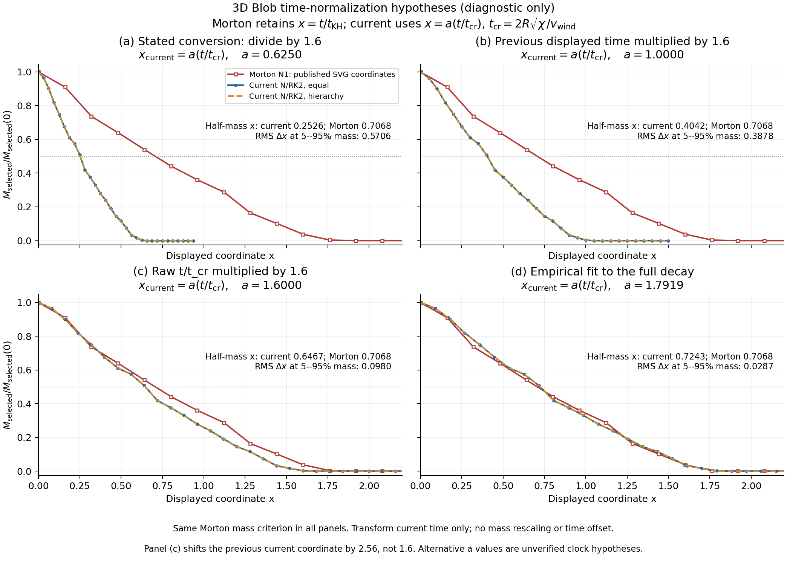

# Blob time-normalization hypotheses

2026-10-22 - Codex (GPT-6), with Zhenyu Wu; local Mac.

**Subsequent user direction:** entry 32 records that fitting is not meaningful
for the intended comparison. The selected presentation is now one panel with
equal/hierarchy and the two explicitly prescribed Morton x multipliers
1.6*2 and 1.6, without fitted parameters. The calculations below are retained
as historical exploratory diagnostics, not a justified clock correction.

**Multiplying the current diameter-based t/t_cr by 1.6 makes the decay curve
substantially closer to Morton's digitized 32^3 N1 curve. It is not an exact
match or proof of a normalization error.** The best single factor from the
full-decay diagnostic is about 1.792, and a factor of 2 also improves agreement.

## Coordinate definitions and the two meanings of multiplying by 1.6

Keep Morton's published Figure 20 coordinate x_ref=t/t_KH unchanged. For
current data, define tau=t_native/t_cr, with t_cr=2R*sqrt(chi)/v_wind, and
test x_current=a*tau. The [paper's equation 54 and Figure 20 paragraph](https://arxiv.org/html/2204.01757v2#S5.SS3.SSS1)
give t_KH=1.6*t_cr, so the stated physical conversion is a=1/1.6=0.625.

Multiplying the **previously displayed** current coordinate tau/1.6 by 1.6
gives x=tau, or a=1. Multiplying the **raw diameter-based tau** by 1.6 gives
a=1.6, an effective factor of **1.6^2=2.56** relative to the previous display.
Equivalently, if the publication had multiplied tau by 1.6 instead of
dividing it, its plotted x would require division by 2.56 to recover the
stated KH coordinate. This is a hypothesis about the historical plotting
process, not an adopted correction to the measured physical times.



## Quantitative result

Use the same Morton density/temperature cut and initial selected-mass
normalization throughout. Invert piecewise-linear mass histories at 19
uniform mass fractions from 0.05 through 0.95. Fit a through the origin to
their crossing times, without a time offset or vertical adjustment. RMS
below is the crossing-time difference in the unchanged reference x coordinate.
It is a descriptive metric, not a statistical uncertainty estimate.

| Current coordinate, equal run | a | Shift versus stated KH conversion | Half-mass x | Crossing-time RMS |
| --- | ---: | ---: | ---: | ---: |
| tau/1.6, stated formula | 0.625 | 1 | 0.252629 | 0.570578 |
| tau, previous display multiplied by 1.6 | 1 | 1.6 | 0.404206 | 0.387783 |
| 1.6*tau, multiplication hypothesis | 1.6 | 2.56 | 0.646729 | 0.098007 |
| 2*tau, another candidate | 2 | 3.2 | 0.808412 | 0.105639 |
| Fitted a*tau | 1.791855 | 2.866967 | 0.724278 | 0.028750 |

Morton's digitized half-mass coordinate is **0.706769**. Under a=1.6 the
current equal/hierarchy half-mass points are 0.646729 / 0.646854, respectively
8.495% / 8.477% earlier. Hierarchy's full-decay fitted factor is 1.791599.
The fit reproduces entry 22's empirical 2.866967 stretch after accounting
for the different starting coordinates; it is not a new independent result.

## What was checked, and what remains unresolved

- Plotting checkout: `feature/3d-moving-mesh`, HEAD `c92f0b5`; native COSMA
  snapshots retain frozen `35ecccd` provenance. All 62 raw snapshot header
  times match the saved analysis CSV exactly. Native normalization scripts
  also use the diameter-based t_cr. The earlier four-step independent Heun
  audit remains relevant but does not recover the publication runs.
- Input mass CSV and digitized-curve hashes match entry 29's verified copies.
  The primary SVG was rendered again: red solid N=32^3, x-axis t/t_KH and
  the 0/0.5 tick calibration are confirmed. Its half-mass coordinate agrees
  with the paper's approximate 0.70; no extraction factor of two is found.
- The available predecessor is `/Users/zhenyuwu/rdsolver`, clean at
  `adfbe55586fc926f1911dbecfbdb915c8f667c11`. `main3D.cpp` increments T by DT;
  `io3D.cpp` writes T directly to snapshot headers and logs. No 1.6 conversion
  is present in that output path. A search of all 67 historical Python blobs
  for cloud/Blob, relevant clock names, 0.64 and 1.6 finds no matching script.
  This available checkout/history does not supply the Figure 20 mass plotter.

The previous clock audit establishes consistency with the printed definitions.
It **does not exclude a mistake in the original figure-generation chain**.
The new overlap makes multiplication versus division worth investigating,
but neither 1.6 nor 2 is uniquely established by curve matching. Different
point realizations and N1 versus current N/RK2 also remain uncontrolled.
Do not relabel or replace the production comparison with a fitted clock.

The most useful next evidence is the original Figure 20 plotting script or
an original snapshot with physical header time paired to its plotted x.
That directly distinguishes x=t/t_KH, x=t/t_cr and x=1.6*t/t_cr. No message to
authors, new cluster query, hydrodynamic run or solver modification accompanies
this diagnostic.

## Reproduction and artifacts

Script: [plot_time_hypotheses.py](../tests/rd/blob_n1_diagnosis/plot_time_hypotheses.py).
External archive: `../local_runs/rd_3d_blob_time_hypotheses_20261022_v2/`.
The initial label-placement version v1 is retained. Compact figure, metrics,
crossing times, source audit, header/hash provenance and verification:
`dev_log/figures/rd_3d_blob_clock_hypotheses_20261022/`.
Both PNG and the final PDF's separate Poppler render were visually inspected.
The original SVG render and copies of the input CSVs remain outside Git.

```sh
OMP_NUM_THREADS=1 OPENBLAS_NUM_THREADS=1 python tests/rd/blob_n1_diagnosis/plot_time_hypotheses.py \
  --input dev_log/figures/rd_3d_blob_reference_20261022_v2 \
  --bundle /absolute/path/to/blob3d_mac_analysis_20261020_v1 \
  --legacy-root /absolute/path/to/rdsolver \
  --output /absolute/path/to/new_clock_diagnostic_directory
```
