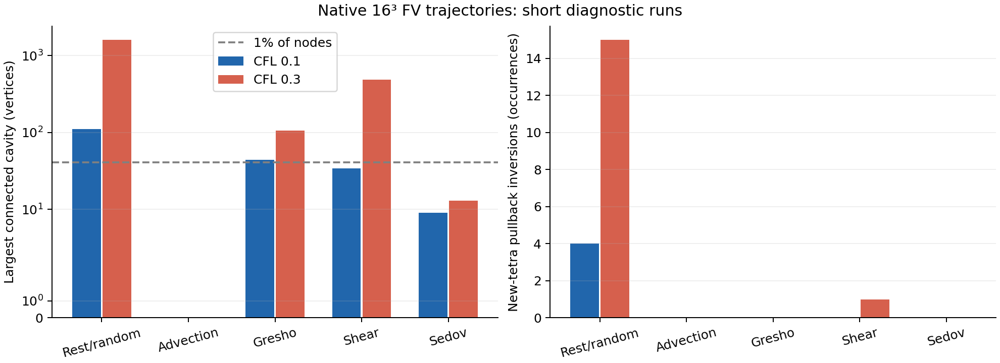
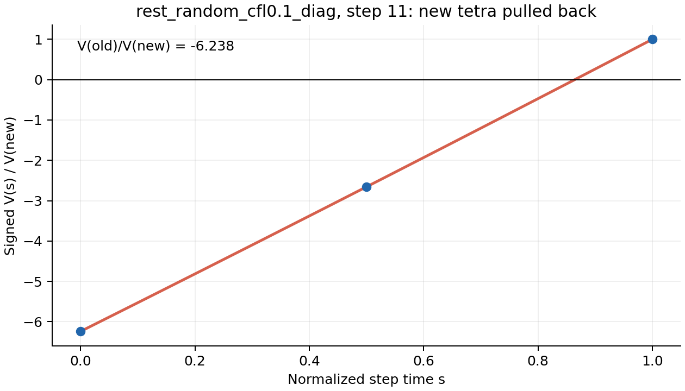

# 3D moving mesh：原生 FV 轨迹的网格几何诊断（M2）

作者：Codex（GPT-6），2026-10-11。用户要求继续准备 3D moving mesh，诊断涉及的网格几何变化。
开始分支 `feature/ale-flip-conservation-hierarchy`，基准 HEAD `90624a4`。
本轮在已有两个未跟踪的 simplex registry 草稿上核查、修正并补齐原生诊断；
入口草稿与 SHA256 保留于 `../local_runs/rd_3d_geometry_entry_20261011/`。

> **Interpretation update, 2026-10-18 (Codex, following Claude's review):**
> The cavity counts, 1599-vertex maximum and winding statistics below use the
> registry's **vertex-connected** merge rule. They do not establish an
> intrinsically large face-connected reconnection. Independent analysis of the
> archived first pairs finds largest face regions of 13 vertices for random
> CFL .3 and 20 for shear CFL .3, all nonwinding; later pairs remain unmeasured.
> Shared-node transfer coupling remains. A new native random run capped at
> `h=2^-12` still has two old-forward and one new-pullback invalid intervals
> over 64 steps. This is a fixed-ceiling FV control, not a dynamic RD-CFL test.
> See the [English progress review](RD_3D_MOVING_PROGRESS_REVIEW_20261018.md)
> and shared-log entries 5–6. The original measurements and authorship below
> are retained; their geometric interpretation is narrowed by these reviews.

## 结论与下一实施边界

**三维 moving RD 不能直接假定：新连接回拉后保持正向，或者连接变化总是小而局部的腔体。**
十个 16³ 短程标准 FV 诊断共 134 步、8274 个连接变化腔体：
新四面体回拉倒置共 20 个元素区间，旧连接前推的区间倒置共 23 个；
同键朝向反转 3 次。随机网格即使在 CFL=.1 仍有 4 次回拉倒置，
CFL=.3 时最大腔体有 1599 个顶点（39.038%），且有绕周期的腔体。

新连接的 `(V_old + V_new)/2` 有 5 个元素区间非正（随机网格 .1/.3 为 2/3），
但所有观测节点的 Campoli 时间质量均为正。
**只检查节点 divisor/temporal mass 无法排除不合适的元素时间几何。**
本轮没有选定倒置修复或绕周期腔体的 transfer 策略，未实现 moving RD adapter。
建议下一步先做固定连接、受控变形的 M3；在移植实际重连 transfer 前，
分别确定元素区间准入与绕周期腔体的处理。降低流体 CFL、取绝对体积、
删除倒置元素或直接沿用小腔体假设，都没有由本轮得到合法性证明。



## 1. 原生诊断如何采样

新增显式开关 `RD_3D_GEOMETRY_DIAGNOSTICS` 与
`examples/rd_3d/Config_FV_geometry.sh`。
它只支持 fresh gas-only、非宇宙学、周期 full mesh、equal adaptive steps、
单 MPI rank 的标准 moving Voronoi FV。编译排除 RD、static mesh、refinement
与 reflective boundary；当前不提供 restart/MPI/hierarchy/lazy 的诊断语义。

- 在 rebuild + exchange 后读取网格；在 mesh velocity 的 regularization 前后
  记录速度，并把最终、实际用于 drift 的 `VelVertex` 按 ID 保存。
  domain decomposition 改变本地索引后，仍用 ID 对齐。
- 只读 `P`、`SphP`、tessellation：不修改流体状态、时间步、bin、连接或速度。
  opening 时间到 closing 时间的差就是实际 `h`，不是参数的 timestep cap。
- 仅统计存活的 tetra：AREPO 的删除标志是 `DT[t].t[0] < 0`，顶点槽仍会保留。
  最小 ID 的 primary vertex 认领一个周期 image；每次 opening 独立检查
  signed tetra volume 是否覆盖 `boxSize_X*boxSize_Y*boxSize_Z`。
- 完整键是有序四 ID 加相对镜像整数偏移。closing 统一到 opening primary
  coordinates 的线性轨迹；跨边界 wrapping 不应制造连接变化。
  ID-only aliases 是合法不同镜像，完整键重复则停止。
- 同键但 orientation 反转单独计数，并作为两条有向 simplex chain 的
  removed/inserted 记录纳入腔体，不能直接抵消。
- 腔体是变化 simplex 的顶点连通分量；相交于同一顶点的多次变化会合并。
  这是更新相关的连接变化腔体，**不是 AREPO 插入过程的逐次 flip 日志**。
  `5:2->3`、`5:3->2`、`6:4->4` 是观测到的腔体形状，不能由此断言
  该步只执行了一次相应的 bistellar flip。

纯 C 模块 `rd_simplex_registry.{c,h}` 对每条线性轨迹的 signed volume
构造三次多项式，检查两个端点与导数二次多项式在 (0,1) 的所有实根。
orientation 相对于该 snapshot 自己的时间固定，回拉后不能重新取正号。
近零分类采用 `256*DBL_EPSILON*span^3` 的诊断误差裕量；
它不等同于 exact orientation predicate。本轮没有 uncertain 事件，倒置
远大于该裕量。oracle 的 hidden-inversion 反例仍通过；本轮原生数据中，
没有出现 old/mid/new 全正而区间最小值负的事件。

周期图遍历传播镜像整数势。非零 winding cycle 表示无法给整个腔体选一个
一致的 Euclidean unfolding；该腔体不输出欧氏一阶矩检查（CSV 写 NaN），
仍检查 signed volume。最大一阶矩缺陷只针对无 winding 腔体。
绕周期时如何定义 receiver-only affine correction 尚待决定。

`geometry_steps.jsonl` 保存每步总量、分位数与节点质量，
`geometry_cavities.csv` 保存所有腔体，`geometry_invalid.jsonl` 保存所有
倒置/不确定元素的完整 x/w/ID/orientation。首步 old/new registry 另存为
`geometry_first_pair.bin`：little-endian native ABI，header 为三个 uint32
(no,nn,sizeof(record)) 与 double h，随后是两个 record 数组；arm64 record
为 280 bytes，布局由 `test_simplex_registry.Record` 描述。它不是 restart 格式。

## 2. 实际设置与结果

实际 4096 generators，周期 unit cube，gamma=5/3，物理时间无额外归一化。
除随机初值外为 seed928、每轴 ±.12/n jitter 的 16³ 网格；随机为
seed20261011 的独立 unit-cube uniform coordinates。
`OMP_NUM_THREADS=OPENBLAS_NUM_THREADS=1`，原生诊断顺序运行，每例 3 张快照。
标准 quasi-Lagrangian mesh velocity 加 CM/soundspeed/face-angle regularization，
`CellShapingSpeed=.5`、`CellMaxAngleFactor=2.25`。

- 初始静止随机网格：rho=p=1、u=0，t=.015625；起初由 regularization 驱动。
  之后 FV 自身产生的状态/速度变化也包含在轨迹中，不称为全程纯几何运动。
- 平流：rho=1+.1 product sin(2πx_d)，p=1，velocity=(.3,-.2,.4)，t=.015625。
- Gresho：采用既存 SWIFT-family gamma5/3 分段旋转速度/压力，z-invariant，
  t=.03125；没有重新声称它是同采样/分辨率的 SWIFT comparison。
- KH-like shear：rho=1+f(y)，vx=f(y)-.5，vy=.05 sin(4πx)，vz=0，p=2.5，
  f=.5[tanh((y-.25)/.025)-tanh((y-.75)/.025)]，t=.03125。
- Sedov：p_background=1e-6，距中心最近的 15 个节点热能 E=1，t=.001。
  先做 FV uniform probe，用实际 Voronoi mass（rho=1）归一化 injection，
  **不是 median-dual volume**。此极短 pilot 不提供 Sedov 解精度或强激波
  moving-RD positivity 的验证。

CFL 取 .1/.3；cap=min(.02, end/2)。二进制时间网格实际产生如下 h。
不同 CFL 的流体和网格轨迹也会改变，不能把它们当作同一条连续轨迹的纯 dt sweep。
Tetra 个数在 27306--28444 范围内，平流没有观测到重连。
计数都是元素区间的 occurrence；一个物理 tetra 可以跨多步重复出现。

| 初值 / CFL | 步数 | 实际 h 范围 | 腔体数 | 最大 vertices | p99 vertices | 新回拉倒置 | 旧区间倒置 | winding 腔体 |
|---|---:|---|---:|---:|---:|---:|---:|---:|
| rest_random / 0.1 | 18 | 0.00048828125--0.0009765625 | 2212 | 110 | 36.89 | 4 | 7 | 0 |
| rest_random / 0.3 | 8 | 0.001953125--0.001953125 | 836 | 1599 | 133.65 | 15 | 16 | 2 |
| advection / 0.1 | 8 | 0.001953125--0.001953125 | 0 | 0 | 0.00 | 0 | 0 | 0 |
| advection / 0.3 | 2 | 0.0078125--0.0078125 | 0 | 0 | 0.00 | 0 | 0 | 0 |
| gresho / 0.1 | 32 | 0.0009765625--0.0009765625 | 1703 | 44 | 21.00 | 0 | 0 | 0 |
| gresho / 0.3 | 16 | 0.001953125--0.001953125 | 1109 | 106 | 52.00 | 0 | 0 | 0 |
| shear / 0.1 | 32 | 0.0009765625--0.0009765625 | 1689 | 34 | 20.00 | 0 | 0 | 0 |
| shear / 0.3 | 8 | 0.00390625--0.00390625 | 702 | 488 | 92.85 | 1 | 0 | 3 |
| sedov / 0.1 | 8 | 0.000125--0.000125 | 16 | 9 | 8.85 | 0 | 0 | 0 |
| sedov / 0.3 | 2 | 0.0005--0.0005 | 7 | 13 | 12.70 | 0 | 0 | 0 |

Cavity p99 使用所有腔体大小的线性插值 percentile。每步 `q` 的五点分布是
(min, floor empirical p01, p10, p50, max)；不同分位数采用的 convention 已分开。
最大单步 touched fraction 在随机 CFL=.3 为 54.224%，它是所有腔体的
顶点并集比例，不等于最大单腔体比例。Gresho 的最大腔体44/106个节点，
剪切34/488个节点；因此不能仅为5--6个顶点设计容器或 transfer 的上限。

随机网格 CFL=.1 第11步的一个新 tetra：`V_old/V_new=-6.23813`。
新端点有效不能保证 pullback 或 temporal geometry 有效。



## 3. 面积向量、GCL 与 signed chain 检查

质量定义 `q=V/(sum face area)^(3/2)`，endpoint V 取正向。
此定义下 regular tetra 的 q 是 **.05170027**；计划中引用的 .0068
与这个明确公式不一致，不沿用该数字。新端点 q 的最小值为 3.48944e-5，
说明真实 trajectories 含有很薄的 tetra。中间时间 q 可带负号，属于 signed
geometry 诊断而不是通常的正质量指标。

时间平均 face vector 与 midpoint face vector 的差为
`cross(h*(w_b-w_a), h*(w_c-w_a))/24`（符号按有向面）。
报告的 norm 相对值以 old/mid/new 中最大的该 face area 归一化。
随机 CFL=.3 的最大修正为 .00377676（约 .378%）；Gresho/剪切/Sedov 的
最大值分别为 9.63e-6 / 2.59e-5 / 1.10e-5。这不是流体误差估计，
但表明真实变形里 quadratic correction 不能由“中点就足够”自动略去。

GCL 以独立的 two-point Gauss face sweep 对比 endpoint volume difference，
归一化 scale=max(abs(V0),abs(V1),span^3)。所有元素最大缺陷为5.971e-17；
midpoint sweep 缺陷最大1.436e-5。这检验几何积分恒等式，
不证明 nonlinear upwind splitting、CFL、完整 nodal RK2 affine accuracy。

signed volume/moment 检查没有丢弃倒置，也没有取绝对值作为几何体积：
box coverage 最大缺陷1.044e-14，腔体 signed volume 最大相对缺陷2.825e-15，
无 winding 腔体的一阶矩最大相对缺陷2.903e-15。相对尺度分别为
同腔体两条 chain 的 sum abs(V) 和该尺度乘 box 最大边长。
节点拓扑质量差 `dm=sum new-pulled V/4 - sum old V/4` 的 signed sum
保持舍入级；局部 dm 并不为零。完整统计在 `results.json` 和每步 JSONL。

这里 signed-chain identities 在有倒置时仍可能成立；它们与正几何、
正 temporal mass、正流体状态是不同性质，不能用守恒抵消来消除倒置问题。

## 4. 验证与档案

最终档案：`../local_runs/rd_3d_geometry_20261011_v4/`。
保存 source.tar、tracked/untracked hash、Config、generated header、binary
SHA256、linkage、build log、全部 IC/params/run status、原生轨迹诊断和
独立检查。主报告在 solver source 冻结后写入；最终分析脚本增加了
正确的 hidden-event 定义及元素 temporal-mass 分类，并单独记录哈希。

- 全套 frozen `make check_rd` 通过；新 C registry 测试包含800个区间、
  cubic 内部极小值、周期镜像、完整键重复、ID alias、35组 Delaunay cavity。
  interval 相对缺陷最大4.469e-15，cavity identity 最大2.578e-16。
- 原生首步两侧每例各150个元素，以 NumPy determinant coefficients 与
  polynomial root solver 重核；另重核全部43条 invalid chain event，
  最大归一化 volume-minimum 差1.573e-14。
- 两个原生首步 old/new periodic full key set 与独立27-image SciPy
  Delaunay **完全相同**：随机27735/27669，平流28419/28419。
  独立 BFS mirror-potential 图检查另覆盖随机两个CFL、平流及剪切 .3，
  cavity vertices/removed/inserted/winding 与 C 完全相同。
- 14 次最终 native attempts 全部完成：10个诊断、1个 injection probe、
  3个诊断OFF对照。OFF的随机/Gresho/Sedov .3 在三张快照、各9个
  particle datasets 按ID排序后与ON **逐字节相同**。
  这验证这三条轨迹上的诊断非侵入性，不作为所有配置的普遍证明。
- 共享源的二维回归：LDA/B 的 Yee48，dt=1/256、256步到t=1，
  与 §233 controlled replay_new 的5张快照、各11个 particle datasets
  **逐字节相同**。源和 build 参数保存在 `regression2d/`。
  不是重跑完整二维 N/HLLC/hierarchy campaign；二维新增hook在这些Config中禁用。

失败记录全部保留：v1 build 因 registry header guard 未注册停止；
v2 因 diagnostic `Nodes` 与 AREPO tree `Nodes` 冲突编译失败；
v3 的 FV runs 完成，但诊断把 deleted tetra 的保留槽计入，probe coverage
误差 .96373，使既定1e-11几何检查失败。这些是诊断 setup/implementation
失败，不是 moving-RD 的数值失败；v3 cavity/inversion统计不用于物理解读。
v4 改用正确的 t[0] 标记并增加 opening coverage gate，阈值没有放宽。
纯C阶段另发现同键朝向反转不能从 signed chain diff 中删除，已修正。

复现（在最终已提交源上；新档案路径不能已存在）：

```sh
OMP_NUM_THREADS=1 OPENBLAS_NUM_THREADS=1 /Users/zhenyuwu/miniconda3/envs/21cmfast/bin/python \
  tests/rd/run_3d_geometry_pilot.py all ../local_runs/NEW_geometry_archive
OMP_NUM_THREADS=1 OPENBLAS_NUM_THREADS=1 /Users/zhenyuwu/miniconda3/envs/21cmfast/bin/python \
  tests/rd/analyse_3d_geometry_pilot.py ../local_runs/NEW_geometry_archive
```

纯 C registry 不绑定 AREPO。原生 build helper 仍是 LocalMac/otool workflow；
Linux scheduler/build provenance adaptation 尚未在这里完成。
保留 unscaled Euler baseline；本轮没有改变2D arithmetic、production solve、
默认Config、thesis、standalone solver或cluster状态，没有push。
