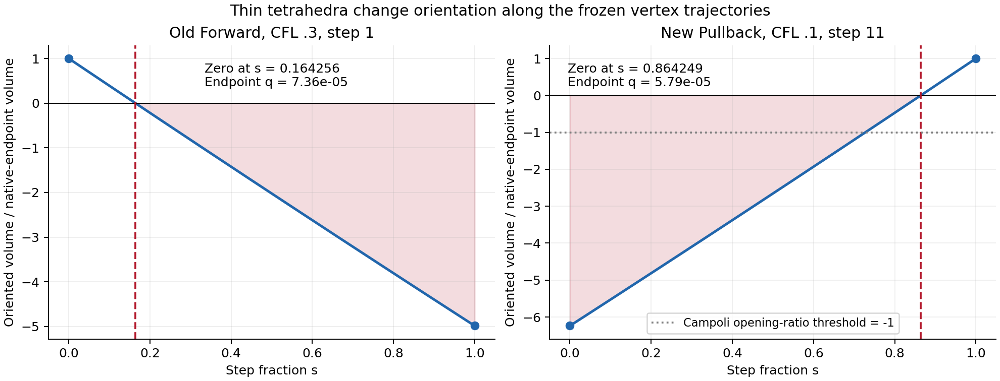

# Cause of nonpositive 3D moving-tetra volumes

Author: Codex (GPT-6), with Zhenyu Wu, 2026-10-14 (Asia/Shanghai).
Execution host: local Apple Silicon Mac. Branch:
`feature/ale-flip-conservation-hierarchy`; analysis starting revision `cb504ac`.
Native evidence uses the frozen diagnostic implementation at `57e1ae3`.
This investigation changes analysis and documentation only.

## Finding

The observed negative volumes are **orientation changes of a fixed tetrahedral
vertex tuple along a finite drift interval**. They arise when carrying the old
connectivity forward or pulling the new connectivity backward across geometry
changes. They do not establish negative native Voronoi cell volumes or an
inverted tetrahedron in the endpoint Delaunay mesh.

Thin tetrahedra are sensitive to relative generator motion. In the random,
initially stationary gas, mesh regularization supplies the dominant motion;
a controlled native replay removes all observed inversions when that correction
is disabled. One shear-flow event occurs with zero regularization correction,
so regularization is not the only possible driver. The common mechanism is
thin tetrahedra, relative motion and a timestep/connectivity choice that does
not enforce interval orientation preservation.

## 1. Which volume is negative?

The registry sorts vertices into a canonical key and fixes an orientation at
the native endpoint where that tetrahedron is captured. With that orientation
held fixed, it follows the linear vertex trajectories. For step fraction
`s in [0,1]`, the oriented volume is

```text
V(s) = orientation * det(e1 + s*d1, e2 + s*d2, e3 + s*d3) / 6,
di = h * (wi - w0).
```

This is a cubic polynomial. The orientation must remain fixed during its
evaluation; reorienting the tetrahedron independently at each time would hide
the crossing.

| Quantity | Meaning | Observation in the ten original physics pilots |
|---|---|---|
| Old connectivity at its opening endpoint | Native old Delaunay tetra, canonically oriented | Positive by the endpoint orientation convention; no uncertain intervals |
| New connectivity at its closing endpoint | Native new Delaunay tetra, canonically oriented | Positive by the endpoint orientation convention; no uncertain intervals |
| `old_endpoint_negative` | **Old** tetra extrapolated to the **closing** time | 23 negative records; the name does not mean a negative old-time endpoint |
| `new_pullback_negative` | **New** tetra pulled back to the **opening** time | 20 negative records |
| New-element Campoli volume `(V0+V1)/2` | Temporal mass geometry for the proposed new-connectivity update | Five negative records, all in the random cases |
| Nodal Campoli masses | Sums of new-element signed endpoint volumes divided by four, then averaged | All measured nodal temporal masses positive |

All 43 invalid records have exactly one orientation-changing root in the
step. The 23 old records have `V0>0, V1<0`; the 20 new records have `V0<0, V1>0`.
There are no hidden, positive-endpoint/negative-interior events in these pilots.
That observed property does not eliminate the need for the full cubic check:
the existing manufactured oracle contains a hidden inversion.

The records include three old/new pairs for common keys whose orientation
reverses. Thus 43 side-specific records correspond to 40 distinct
case/step/ID-tuple combinations, not 43 independent flips. The pilot has no
ID-only image aliases. All 17 invalid records in the archived first mesh pairs
are explicitly verified to belong to removed/inserted or orientation-reversed
connectivity. Later full mesh pairs were not archived; the later records retain
their coordinates and velocities for direct sign/root verification.
All 30 saved native FV physics snapshots also have positive Voronoi volumes;
the minimum over those snapshots is `2.30934557e-5`. This snapshot check does
not resolve native cell volumes continuously inside each drift interval.

## 2. The signs survive independent, high-precision checks

The new [audit script](../tests/rd/diagnose_3d_nonpositive_volumes.py) recomputes
all 43 events using a direct 60-digit Decimal determinant of the saved binary64
coordinates and velocities. It evaluates endpoints, midpoint, the reported
minimum and points bracketing an independently calculated polynomial root.
The closing trajectory is evaluated directly as
`x_close + (s-1)*h*w`, avoiding a rounded binary64 reconstruction of `x_old`.

- Every stored negative sign is reproduced, and every root bracket changes sign.
- Negative minima exceed the C diagnostic's error estimate by at least
  `6.11679e8`. The maximum normalized Decimal/NumPy polynomial difference is
  `1.78292e-13`.
- At the reconstructed coplanarity times, the shortest edge over all events
  is `0.00989771` in the unit box. The collapse is not a collision of generators:
  four distinct points become coplanar while their edges remain finite.
- Old native-endpoint quality spans `7.35992e-5` to `.00152900`; new
  native-endpoint quality spans `5.78503e-5` to `.00328883`. Here
  `q=|V|/(sum face areas)^(3/2)` and a regular tetrahedron has `q=.05170027`.

This verifies the stored geometry's signs, not a certified orientation
predicate for every possible native mesh. Endpoint positivity by canonical
orientation alone is not a mesh-validity proof. The original M2 independent
periodic Delaunay audit also matches the complete old/new key sets for the
random/advection first pairs; trajectory/image checks and box/cavity coverage
checks provide additional evidence against periodic-image or indexing errors.
See the [M2 report](RD_3D_MOVING_GEOMETRY_DIAGNOSTIC_20261011.md).

The historical v3 deleted-tetra-slot bug is excluded from this investigation.
All input data come from v4, whose `DT[t].t[0]` deletion filter, opening box
coverage and immutable binary/source provenance were previously checked.

## 3. A thin tetrahedron crosses zero before either chosen timestep ends

The earliest old-chain crossing in the first random step uses IDs
`[13, 2632, 3236, 3658]`. Its opening geometry has:

| Property | Value |
|---|---:|
| Volume | `1.27429328e-7` |
| Quality q | `7.35991691e-5` |
| Smallest altitude | `5.67933313e-5` |
| Shortest / longest edge | `.00952314 / .13633294` |
| Equivalent Voronoi radii of its four generators | `.0329531` to `.0476321` |
| First zero time with the frozen opening velocities | `.000320812720` |

The tetrahedron's altitude is roughly 580--839 times smaller than those
Voronoi radii. Small motion on a cell-radius scale can therefore cross its
opposite-face plane.

The first-step velocity fields agree to binary64 round-off for the original
CFL=.1/.3 random cases (maximum component difference `1.11022e-16`; the opening
coordinates are byte-identical). At that opening state the fluid velocity is zero; the mesh RMS speed
and regularization RMS correction both equal `.4620527007`, and the maximum
correction is `.6454972244`. The latter is `.5*sqrt(5/3)`, consistent with the
sound-speed-based correction at `CellShapingSpeed=.5`.

| Original CFL | Actual first h | Coplanarity fraction of this h | Max relative displacement from mean translation / opening minimum altitude |
|---|---:|---:|---:|
| .1 | `.0009765625` | `.328512225` | `11.7813` |
| .3 | `.001953125` | `.164256112` | `23.5627` |

Reducing the requested CFL from .3 to .1 gives a factor-two first-step change
after time-bin quantization. Both actual steps exceed this geometric crossing
time. These figures concern the frozen opening velocity and old connectivity;
the root is not a measured native flip time and is not a guaranteed timestep
limit for every subsequently rebuilt new tetrahedron.



## 4. Native regularization controls isolate the dominant random-case driver

Three small fresh 16³ native runs reuse the exact frozen diagnostic binary,
unit-cube IC, gamma=5/3, `CellMaxAngleFactor=2.25` and end time `.015625`.
Only `CellShapingSpeed`, the stated CFL and artifact/output paths change.
Runs use one rank and one OMP/BLAS thread; no solver rebuild is involved.

| Case | Completed steps | Actual dt values | Old/new invalid records | Removed/inserted records |
|---|---:|---|---:|---:|
| Regularization .5, CFL .3 | 8 | `.001953125` | 16 / 15 | 10453 / 9996 |
| Regularization 0, CFL .3 | 8 | `.001953125` | 0 / 0 | 0 / 0 |
| Regularization 0, CFL .1 | 16 | `.0009765625` | 0 / 0 | 0 / 0 |

The .5/.3 replay matches the original .3 pilot **byte for byte** in all nine
particle datasets and all three snapshots after sorting by ID. The .3 control
retains the same actual timestep sequence, making it the clearest comparison.
The original .1 pilot has 18 steps with dt `.00048828125` / `.0009765625`;
the .1 control has a different later adaptive schedule and is supplementary.

Turning the correction off does not make the complete evolved velocity field
identically zero. The .3/.1 OFF runs have maximum mesh RMS speeds
`2.39479e-6` / `2.52529e-6`, final maximum generator displacements
`3.20418e-7` / `3.37364e-7`, and finite positive FV cell volumes. They remain
free of reconnection and volume-sign failures over this short duration.
These controls establish the correction's role in this random-gas pilot;
they do not validate disabling regularization as a general moving-RD remedy.

The shear exception is also important: CFL=.3, step 8, interval
`[.02734375,.03125]`, IDs `[3788,3789,4044,4045]`. At this step the recorded
regularization RMS is exactly zero. The new tetra has q=`.000133055` and
minimum altitude `.000114122`; its generator-relative motion crosses zero at
step fraction `.366353898`. This event needs no regularization correction.

## 5. Why the current criteria do not prevent this

The source shows three different geometric scales/operations:

1. [Mesh velocity](../src/mesh/set_vertex_velocities.c) starts from fluid
   velocity plus a pressure predictor. The configured regularization then
   moves generators toward Voronoi centroids, with its activation controlled
   by the Voronoi face-angle measure and its speed by the sound speed.
2. [Tree-based timesteps](../src/time_integration/timestep_treebased.c) and
   [hydro CFL](../src/time_integration/timestep.c) use the equivalent Voronoi
   radius, sound/relative signal speeds and the CFL factor. They do not use
   the minimum Delaunay-tetra altitude or the first zero of its cubic volume.
3. [Drift](../src/time_integration/predict.c) moves generators linearly;
   [mesh rebuilding](../src/main/run.c) constructs the next Delaunay mesh at
   the endpoint. That endpoint construction does not ensure that every new
   tetrahedron was positively oriented throughout its pullback interval.

The diagnosis is therefore a mismatch between the geometry assumptions of a
fixed-connectivity ALE update and the geometry permitted by standard FV mesh
motion/reconnection. Good Voronoi cells and finite sound-speed CFL do not, in
this implementation, impose positive interval volumes on every Delaunay
tetrahedron.

## 6. Negative Campoli volume follows directly from the pullback sign

For the worst new-tetra event (random CFL=.1, step 11), IDs
`[594,3100,3195,3669]`, the independently recomputed values are:

```text
V_old = -6.90953091e-8
V_new =  1.10762841e-8
V_old / V_new = -6.23813080
(V_old + V_new)/2 = -2.90095125e-8
```

This new tetra becomes positively oriented only after step fraction
`.864249393`. Its closing minimum altitude is `2.38360e-5`; the maximum
relative displacement over the interval is `.000659806`, about 27.68 times
that height. The negative temporal volume follows from `V_old < -V_new`.
It is not a Campoli arithmetic error, an Euler-solve scaling problem, or a
negative fluid density. The native FV pilot does not execute a moving-RD
Campoli update at all; this mass is measured for the proposed adapter.

Positive nodal temporal masses can coexist with these negative element
contributions because they sum other tetrahedra. Likewise, signed coverage
and cavity conservation identities can hold by cancellation. Neither check
establishes elementwise positive geometry.

## 7. Implication and remaining boundary

The cause is sufficiently established to guide the next design review.
Further preparation should distinguish a geometry limit for old-element
motion from a policy for accepting newly connected elements whose pullbacks
cross zero. Mesh quality/velocity choices and reconnection transfer must be
considered together. Merely lowering a global hydro CFL, turning off all
regularization, taking absolute volumes, or clipping the Campoli mass is not
a validated general repair.

Native moving 3D RD remains unimplemented. This investigation makes no change
to production velocities, timesteps, connectivity, volume signs, Euler
scaling, assertion thresholds, thesis files or cluster jobs. Larger seed,
resolution and long-time studies remain cluster work.

## Evidence and reproduction

- Original input archive: `../local_runs/rd_3d_geometry_20261011_v4/`.
- New native controls and their frozen artifact/provenance:
  `../local_runs/rd_3d_nonpositive_audit_20261014_v1/`.
- Final offline Decimal/root/topology audit, CSV/JSON and figures:
  `../local_runs/rd_3d_nonpositive_audit_20261014_v3/`.
  v3 includes the native-snapshot volume and first-velocity comparison checks.
  Earlier offline/figure versions remain archived; successful v1 native
  controls were not repeated for these analysis refinements.
- Local versions: Python 3.10.16, NumPy 2.0.0, h5py 3.14.0,
  Matplotlib 3.10.0. The native artifact's manifest retains the source tar,
  Config/header, binary hash, linkage and actual run status.

For a complete replay, choose a fresh output directory:

```bash
OMP_NUM_THREADS=1 OPENBLAS_NUM_THREADS=1 \
  /Users/zhenyuwu/miniconda3/envs/21cmfast/bin/python \
  tests/rd/diagnose_3d_nonpositive_volumes.py \
  --pilot /Users/zhenyuwu/arepo_rd/local_runs/rd_3d_geometry_20261011_v4 \
  --output /absolute/path/to/a/new/audit-directory --run-controls
```

Omit `--run-controls` to audit existing records only. The replay uses a Mac
binary and local input archive; it is not a portable Cuillin build recipe.
