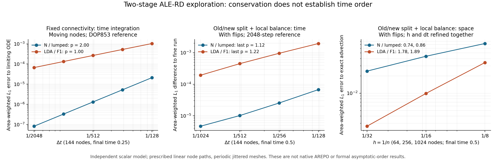

# 真正分开的 moving ALE-RD 两阶段：数值方法探索

作者：Codex。日期：2026-09-14。对应 log3 §51。
用户请求：探索能否改动数值方法，使 predictor 在移动/重建网格之前执行，
corrector 在其后执行，同时每个物理步只构造一次新 Delaunay 网格。

**结论：可以构造满足这种执行顺序、总量守恒和均匀流保持的候选，已有独立
标量及 Euler 实验支持。但它尚不能作为完整二阶、保持正性的生产方法。**
本轮没有改动 native C、Config、现有流程图或 thesis；当前 C 的 ALE begin
仍只记录步终点，两次扫描仍在 end。以下是一个待审核的新数值方案。

## 1. 真正需要解决的是连接关系，而不是预测节点坐标

在 equal timestep 下，begin 之前已经知道步长和节点速度。本机当前
`src/main/run.c` 先分配 timestep、计算 `set_vertex_velocities()`，再调用
`rd_step_begin()`。一步中的节点路径是

\[
\boldsymbol{x}_i(t)=\boldsymbol{x}_i^n+(t-t^n)\boldsymbol{\sigma}_i,
\]

其中 \(\boldsymbol{\sigma}_i\) 是这一整步固定的节点速度。
因此，不进行未来 Delaunay 构造，也可以计算旧三角形沿这条路径移动后的面积、
法向量和中点几何。未知的是未来的 **连接关系**：哪些旧三角形会消失，哪些新
三角形会出现。

本轮优先探索的选择是：begin 用旧连接关系计算 predictor；正常 drift 后只做一次
Delaunay 构造；end 用新连接关系计算 corrector；在发生翻边的局部区域补上一个
推导得到的几何质量修正。它改变了当前两阶段必须共用一个三角形集合的约束。
两个物理残差仍使用各自连接关系下的**步中点几何**，并非直接照搬 FV 的端点通量公式。

文献参照是 Campoli、Quemar、Bonfiglioli、Ricchiuto 的
[Shock-fitting and predictor-corrector explicit ALE Residual Distribution，§2.2](https://www.math.u-bordeaux.fr/~mricchiu/sf-draft.pdf)。
其连续移动单元上的 predictor/corrector 和端点质量平衡提供了出发点；下面采用的是
项目中已有的 **Campoli endpoint-mass 配对**，再推导跨连接关系的修正。
**本文的旧/新连接关系混合及修正项不是该文已证明的算法。**
也不能把文献的形式精度结论套到本项目的具体 F1 实现上。

## 2. 符号与候选 update

沿用 Chapter 3 的 \(U_i\)、\(S_i\)、\(\phi_i^T\)、\(m_{ij}^T\) 记法。
这里 \(U_i\) 是节点上的守恒量**密度**；Euler 时为
\((\rho,\rho v_x,\rho v_y,E)\)，\(E\) 为总能量密度。
\(Q_i=S_iU_i\) 才是节点对应的质量、动量、总能量等广延量。
\(n\) 与 \(n+1\) 表示步起点和终点，\(\Delta t=t^{n+1}-t^n\)。

设旧、新 Delaunay 连接关系分别为 \(\mathcal T_{\rm old}\)、
\(\mathcal T_{\rm new}\)。四种面积都由每个相邻三角形贡献其面积的三分之一：

| 记号 | 连接关系 | 节点位置 | 是否为该时刻实际采用的网格面积 |
| --- | --- | --- | --- |
| \(S_i^n\) | 旧 | 起点 | 是 |
| \(\bar S_i^{n+1}\) | 旧 | 终点 | 否；旧三角形向前移动后的面积 |
| \(\widetilde S_i^n\) | 新 | 起点 | 否；新三角形沿已知路径拉回后的面积 |
| \(S_i^{n+1}\) | 新 | 终点 | 是 |

带横线和波浪线的量只需要计算几何，不需要额外构造 Delaunay 网格。
本推导要求两套连接关系在所用几何上都是有效、同向的三角剖分，并保持相同区域边界。

定义节点总残差

\[
R_i^{\rm old}(U)=\sum_{T\in\mathcal T_{\rm old},\ i\in T}\phi_i^{T,\rm old}(U),
\qquad
R_i^{\rm new}(U)=\sum_{T\in\mathcal T_{\rm new},\ i\in T}\phi_i^{T,\rm new}(U).
\]

其中 \(\phi_i^T\) 分配的是 ALE advective residual：三角形上的物理通量边界积分
减去 \(\int_T\boldsymbol\sigma_h\cdot\nabla U_h\,dA\)。
\(U_h\)、\(\boldsymbol\sigma_h\) 是该三角形上的线性插值；几何取步中点。
Euler 实验用三点 Gauss 积分计算 \(F(U_h)\) 的边界积分。
这里的残差不是直接等同于移动控制体上的完整守恒通量；几何体积项由质量配对共同处理。

### 2.1 begin：旧连接关系上的真实 predictor

\[
U_i^*=U_i^n-\frac{\Delta t}{\bar S_i^{n+1}}R_i^{\rm old}(U^n).
\tag{1}
\]

定义 \(\delta U_i=U_i^*-U_i^n\)，即 predictor 对节点密度的改变量。
保存 \(U^n\)、\(U^*\) 或 \(\delta U\)、\(R^{\rm old}(U^n)\)，以及旧连接关系和
必要的面积。在程序走到 drift / create_mesh 之前，式 (1) 已经真正计算完成。

### 2.2 中间：移动节点，只构造一次新网格

按既定 \(\boldsymbol\sigma_i\) 移动节点，正常调用一次 `create_mesh()`。
对新三角形计算向后恢复的起点、步中点和终点几何，不再调用第二次网格构造。

### 2.3 end：新连接关系上的 corrector，再补几何总量差

首先计算暂定状态 \(\widehat U_i^{n+1}\)：

\[
\widehat U_i^{n+1}=U_i^*
-\frac{1}{S_i^{n+1}}\left[
 \sum_{T\in\mathcal T_{\rm new},\ i\in T}\sum_{j\in T}m_{ij}^{T,\rm new}\delta U_j
 +\frac{\Delta t}{2}\left(R_i^{\rm old}(U^n)+R_i^{\rm new}(U^*)\right)
\right].
\tag{2}
\]

式 (2) 的第二次物理残差和时间质量项都在**新连接关系**上计算。
对新三角形定义
\(b_T=(|T(t^n)|+|T(t^{n+1})|)/2\)，两端使用同一套新连接关系。
实验中 F1 取 \(m_{ij}^{T,\rm new}=b_T\beta_i^T/3\)，
\(\beta_i^T\) 为用 \(U^*\) 求得的 LDA 分配系数/矩阵；
N 取 lumped 形式 \(m_{ij}^{T,\rm new}=b_T\delta_{ij}I/3\)。
\(\delta_{ij}\) 是 Kronecker 符号，\(I\) 是单位矩阵，标量时为 1。

只用式 (2) 会产生总量缺口。取一个完整的改变连接关系的局部区域 \(P\)：
收齐删除和新增三角形，把有共同节点的区域合并；\(i\in P\) 表示这些三角形的所有节点。
定义该区域的修正向量

\[
C_P=\frac12\sum_{i\in P}
 \left[(\widetilde S_i^n-S_i^n)
      +(S_i^{n+1}-\bar S_i^{n+1})\right]U_i^n.
\tag{3}
\]

注意 \(C_P\) 的单位是广延量，而不是密度，也不是残差；Euler 时包含全部四个分量。
本轮原型将它按新节点面积分配：

\[
w_i=\frac{S_i^{n+1}}{\sum_{j\in P}S_j^{n+1}},\qquad
Q_i^{n+1}=S_i^{n+1}\widehat U_i^{n+1}-w_iC_P.
\tag{4}
\]

于是 \(U_i^{n+1}=Q_i^{n+1}/S_i^{n+1}\)。这等价于区域内每个节点密度减去同一个
向量 \(C_P/\sum_{j\in P}S_j^{n+1}\)。区域外保持式 (2) 的结果。
权重使用节点的**完整 median-dual 面积**，而不是仅改变的三角形份额。

式 (3) 由旧状态和几何直接计算，**不是测到全域误差后任意全域扣除**。
式 (4) 是 corrector 的局部代数修正，不需要第三次物理残差扫描。
但它确实是一个新的数值算子，不能以“只是代码优化”来描述。

## 3. 为什么这项修正能补上守恒缺口

考虑本轮测试的二维周期区域、线性节点路径、连续 P1 插值和一致边界积分。
任意节点状态 \(U\) 满足

\[
\Delta t\sum_iR_i^{\rm old}(U)
 =\sum_i(\bar S_i^{n+1}-S_i^n)U_i,
\quad
\Delta t\sum_iR_i^{\rm new}(U)
 =\sum_i(S_i^{n+1}-\widetilde S_i^n)U_i.
\tag{5}
\]

原因是物理边界通量在周期全域相消，mesh-advection 积分通过分部积分给出
面积变化项；二维线性轨迹的面积是时间二次式，步中点的面积变化率积分是精确的。
F1 / lumped 质量的列和给出

\[
\sum_i\sum_{T\ni i}\sum_{j\in T}m_{ij}^{T,\rm new}\delta U_j
 =\frac12\sum_j(\widetilde S_j^n+S_j^{n+1})\delta U_j.
\tag{6}
\]

将式 (5)、(6) 代入式 (2) 的全域面积加权和，所有 \(\delta U\) 项抵消，剩下

\[
\sum_iS_i^{n+1}\widehat U_i^{n+1}-\sum_iS_i^nU_i^n
 =\frac12\sum_i\left[(\widetilde S_i^n-S_i^n)
 +(S_i^{n+1}-\bar S_i^{n+1})\right]U_i^n
 =\sum_PC_P.
\tag{7}
\]

式 (4) 在各区域的权重和为 1，正好消掉这个总量差。这一证明逐个守恒分量成立，
并不依赖 predictor 的特殊形式。区域可以发生物理通量交换；这里消去的是
**拓扑转换导致的额外缺口**，不是要求每个区域各自没有质量流入流出。

若 \(U_i^n\) 为常数，残差为零。每个完整区域在起点和终点各自具有相同总面积，
故式 (3) 为零，均匀流保持成立。若没有翻边，四个面积两两相同，修正项自动为零，
退化为本项目固定连接关系上的 Campoli 两扫描 GL/F1 或 lumped 更新。

这些是守恒和均匀状态结论，**不是稳定性、正性或时间二阶证明**。
非周期边界需要把规定的外边界通量留在式 (5)、(7)，本轮没有实现该推广。
本轮也没有证明/实现同一修正用于当前 Arpaia 中点质量形式；不能只加上式 (3)
而省去 endpoint-mass 配对的改变。Arpaia 既有的端点总量缺陷见 log3 §§10、27。

## 4. 实际实验与不成立的简化

所有实验均为本机独立 Python / NumPy / SciPy 模型；**不是 AREPO native 结果**。
Euler 算子包含 P1-U Gauss3 物理通量、平均节点速度平流项、Roe 谱分解和 LDA/F1。
N 的向量分配另做了 contour-sum reconciliation，没有逐行移植 native 的
parameter-vector Uhat、element-frame、奇异矩阵 fallback 或完整 limiter。
Roe 负特征矩阵之和的条件数超过 \(10^{10}\) 即拒绝；尚未覆盖
\(\boldsymbol\sigma\simeq\boldsymbol v\) 下的 rank-deficient 情形。

### 4.1 可复现设置

周期单位方盒，初始 \(n\times n\) Cartesian 节点分别施加
\([-0.18/n,0.18/n]\) 随机扰动，种子为 `20260914+n`。这是 **jittered Cartesian，
不是 glass**。周期网格采用 3×3 平铺点集，一次 Qhull Delaunay 调用后按三角形质心
选取单位盒内的周期代表，验证三角形数为节点数两倍、唯一 ID 三元组、总面积 1。

令初始节点标签坐标为 \((x_{i,0},y_{i,0})\)，全部测试步中固定

\[
\boldsymbol\sigma_i=
\left(0.3+0.15\sin(2\pi y_{i,0}),\quad
      0.1+0.10\sin(2\pi x_{i,0})\right).
\]

因此各时间步长梯度具有相同的连续节点路径和终点坐标，排除了流体反馈导致的网格差异。
纯平移对照取 \(\boldsymbol\sigma=(0.3,0.1)\)。
标量平流速度 \((1,0.4)\)，初值 \(1+0.2\sin(2\pi x)+0.1\cos(2\pi y)\)，
另测全 1 状态。Euler 取 \(\gamma=1.4\)，背景流速 \((1,0.4)\)：
均匀流；相同密度波、常压 1 的 entropy wave；核心半径 0.07、强度参数 3 的
周期 Yee 型涡旋。涡旋尾部约 \(10^{-10}\)，256 节点不能充分解析该小涡核，
故它仅用于非线性 Euler 可行性检查，不作为 thesis Yee 精度基准。

误差 \(L_1=\sum_iS_i^{\rm final}|U_i-U_{i,\rm reference}|\)，区域面积为 1；
Euler 精度表取密度分量。守恒指标为全过程各守恒分量相对初始总量的最大漂移：
质量、两个动量分量以初始总质量归一化，能量以初始总能量归一化。
均匀流指标为全过程所有节点、所有守恒密度分量的绝对最大误差。

### 4.2 真正旧/新两阶段 + 局部修正

主组为 256 节点、512 三角形，\(\Delta t=1/256\)，64 步至 \(t=0.25\)。
每例都有 48 个发生拓扑改变的步，累计删除 170 个旧三角形，最大连接区域含 7 个节点。
每例共 65 次 Delaunay 调用，其中 1 次初始化；64 次 predictor 和 64 次 corrector。
没有另一次预测网格构造。

| 模型 / 测试 | 方法 | 最大归一化总量漂移 | 最大均匀状态误差 |
| --- | --- | ---: | ---: |
| 标量 / uniform | N、LDA/F1 | \(2.22\times10^{-16}\) | \(1.55\times10^{-15}\) |
| 标量 / smooth | N、LDA/F1 | \(3.33\times10^{-16}\) | — |
| Euler / uniform | N | \(1.59\times10^{-15}\) | \(4.00\times10^{-15}\) |
| Euler / uniform | LDA/F1 | \(1.59\times10^{-15}\) | \(5.33\times10^{-15}\) |
| Euler / entropy | N | \(1.67\times10^{-15}\) | — |
| Euler / entropy | LDA/F1 | \(1.89\times10^{-15}\) | — |
| Euler / vortex | N | \(1.56\times10^{-15}\) | — |
| Euler / vortex | LDA/F1 | \(1.78\times10^{-15}\) | — |

每步独立比较式 (7) 预测的缺口与直接求和得到的缺口，Euler 最大绝对差
\(4.97\times10^{-15}\)。例如 LDA vortex 的单步未修正缺口最大约
\(2.41\times10^{-4}\)，不是原本就足够小而被守恒门槛掩盖。
该组所有 predictor / 最终状态密度和压力为正；LDA vortex 最小值约
\(\rho_{\min}=0.84282\)、\(p_{\min}=0.79745\)。这只陈述已测状态。

### 4.3 不能直接换网格，或只保留 U / Q

另一组标量对照为 144 节点、64 步至 \(t=0.5\)，相同路径、36 个改变拓扑的步。
先在旧连接关系上完成两个阶段，再重解释节点状态时：

| 做法 | N 最大相对质量漂移 | LDA/F1 最大相对质量漂移 | 均匀流结论 |
| --- | ---: | ---: | --- |
| 保持节点密度 U，直接换新面积 | \(9.66\times10^{-5}\) | \(5.32\times10^{-5}\) | 保持 |
| 保持广延量 Q，除以新面积 | \(4.44\times10^{-16}\) | \(4.44\times10^{-16}\) | 密度误差约 0.466 / 0.423 |
| corrector 直接换新连接，省去式 (3) | \(8.66\times10^{-5}\) | \(4.34\times10^{-5}\) | 保持 |
| 式 (1)–(4) 新候选 | \(2.22\times10^{-16}\) | \(2.22\times10^{-16}\) | 另有 uniform gates，见上表 |

该表说明朴素拼接的失败，不说明所有跨连接关系算法都不可能。
直接保留 Q 的均匀流错误也不能算成“只差一点时间误差”：面积变化会直接改变密度。

还测试了较保守的备选：保留旧三角形，begin/end 分别执行两个阶段，end 最后用已记录的
full-patch high transfer 转移到新 P1 表示。这也是实际分开的两次扫描、一网格构造；
26 个标量、8 个独立 Euler 测试完成并达到舍入级守恒。
但其 corrector 仍用旧连接关系，不如式 (1)–(4) 符合“前旧后新”的目标；
而且需要保留旧扫描所需的更多几何/状态。其空间和时间结果单独存档，不能混入新候选表。

## 5. 精度和正性边界

### 5.1 两个阶段不自动给出时间二阶

先固定连接关系，让节点沿同样路径移动，单独积分该 GL/F1 更新在
\(\Delta t\to0\) 的极限半离散 ODE。定义 \(D\) 为当前节点面积的对角矩阵，
\(M\) 为当前 F1/lumped 质量矩阵，\(R\) 为组装残差，参考速率为

\[
G=(2I-D^{-1}M)(-D^{-1}R).
\]

用 DOP853，`rtol=1e-12, atol=1e-13` 计算参考。144 节点、\(t=0.25\)，
32/64/128/256/512 步梯度的最后一次细化给出：

| 连接关系固定 | N / lumped 时间阶 | LDA/F1 时间阶 |
| --- | ---: | ---: |
| 平移节点 | 2.0006 | 0.9981 |
| 变形节点 | 2.0005 | 0.9977 |

这是对既有 F1 时间性质的再现，参见
[LDA_F1_Heun_vs_standard_LDA_RK2.md](LDA_F1_Heun_vs_standard_LDA_RK2.md)。
不是这次拆开 hook 才引入的问题，也不意味着 LDA 失去了全部空间精度。

再对新候选加入正常 Delaunay 翻边，固定 144 节点和路径，\(t=0.5\)，
64/128/256/512 步与同方案 2048 步参考比较：

| 步数 | N 的 L1 差 | N 相邻细化阶 | LDA/F1 的 L1 差 | LDA/F1 相邻细化阶 |
| --- | ---: | ---: | ---: | ---: |
| 64 | 6.756e-5 | — | 1.959e-3 | — |
| 128 | 2.538e-5 | 1.413 | 9.593e-4 | 1.030 |
| 256 | 1.014e-5 | 1.324 | 4.498e-4 | 1.093 |
| 512 | 4.649e-6 | 1.124 | 1.932e-4 | 1.219 |

2048 步只是有限精度参考，不能把这些斜率称作严格渐近阶。
即使 N 的固定连接时间积分为二阶，加入拓扑转换后也没有保持清楚的二阶趋势。
翻边发生于不同步内部时刻、P1 表示转换和混合 stage 的耦合是需要进一步分离的误差来源；
本轮没有证明其各自的占比。仅消去总量缺口不能恢复完整的时间截断误差条件。

### 5.2 光滑空间误差没有明显退化为一阶，但仍是有限诊断

新候选的标量平流测到 \(t=0.5\)，64/256/1024 节点，对应 64/128/256 步：

| 节点数 | N 的 L1 | LDA/F1 的 L1 | LDA/F1 的相邻 h 斜率 |
| --- | ---: | ---: | ---: |
| 64 | 0.073047 | 0.034085 | — |
| 256 | 0.043878 | 0.0099274 | 1.780 |
| 1024 | 0.024226 | 0.0026775 | 1.891 |

这里 h 与 dt 同时减小，各分辨率为独立 jitter realization，不能替代固定空间误差分析，
也不是 native glass Yee 验证。它支持“这次改法在该光滑问题上仍保留较好的空间表现”，
不能据此宣称任何 timestep 都不会污染空间二阶。



图源：[PNG](figures/rd_true_ale_split_order_20260914.png)、
[SVG](figures/rd_true_ale_split_order_20260914.svg)，生成脚本见下文。

### 5.3 局部高阶修正并不保持正性：已构造反例

在单位正方形的四角编号 0、1、2、3，将对角线 0–2 改成 1–3。
在零时间间隔的拓扑转换中，式 (3) 退化为旧的 full-patch high transfer。
输入四个正标量值

\[
(0.01,10,0.01,10)
\]

按式 (4) 得到

\[
(-3.32,6.67,-3.32,6.67).
\]

面积加权总量仍为 3.34，但有两个负值。这是预期的反例，已保存原始结果；
不是把失败算成 positivity pass。该 same-time 算子对仿射密度的另一个测试则误差为零。
**仿射保持和总量守恒不能代替正性。** 有限时间的 mixed corrector 更没有现成的正性保证。

一种可继续研究的限制方法是先形成与式 (4) 相同局部目标总量的 admissible 低阶状态，
再对整个区域、全部守恒分量使用一个公共系数与高阶状态混合。
前提是该区域目标总量本身允许构造正密度/正压力状态；否则必须收紧步长或拒绝该步。
不能直接拿旧 remap 的低阶端点替代而不重新核对有限步总量。
本轮没有实现这个 limiter，也没有证明它不会损坏光滑精度。

## 6. Native 落地的范围、成本和建议

若下一步移植，建议先限制到 **equal timestep、单 rank、二维周期、纯 hydro、
无粒子增删/细化、Campoli 配对** 的显式实验配置，保留当前 Arpaia 基线。

| 阶段 | 实际工作 | 需要的数据 |
| --- | --- | --- |
| begin | 旧连接关系几何 + 第一次残差，求式 (1) | 起点 U、固定节点速度、dt |
| 中间 | 正常 drift / domain 生命周期 / 一次 Delaunay 重建 | 按 ParticleID 保存并随重排传递 stage 状态 |
| end | 新连接关系几何 + 第二次残差和 F1 质量作用，求式 (2) | Uold、Ustar、旧残差、旧起终面积 |
| end 内修正 | 匹配完整改变区域，求式 (3)、(4) | 旧/新 triangle keys，新起终面积 |

计算量保证只能说 **一网格构造、两次物理残差扫描**。额外工作包括旧、新两套几何
计算、O(N) 节点暂存、旧 triangle keys、局部区域匹配和总量求和。
主组最大区域 7 节点，1024 节点空间组最大 10 节点，不代表一般情况下的上界。
当前 C 共用一次几何准备；新候选需要处理两种连接关系，所以不能声称 wall time 不增加。
Python 全局集合和扫描的实现也不能用作 native 开销估计。

真实实现还必须处理：

- **几何有效性：** 在 begin 选步长时验证旧三角形向前整条轨迹，以及 end 时新三角形
  向后恢复的有效性。面积随时间为二次式，可以检查区间最小值，而不是只看终点。
  当前模型只检查起点/中点/终点为正，没有实现这个完整几何 CFL 保障。
- **缓存生命周期：** `free_mesh()` 会销毁旧 mesh；需要独立持有旧 keys 和节点缓存。
  包括周期 image 的一致表示，不能依赖易改变的内存下标。未来 MPI 必须明确 patch owner，
  不能各 rank 独立修正重叠区域。哪怕单 rank 也要处理 domain reorder。
- **restart：** 现有 checkpoint 在两个 hook 中间。真实 predictor 会引入 pending 数值状态，
  必须序列化完整缓存或在实验配置中明确拒绝 mid-stage restart；现有只存终点标记的逻辑
  不够。完成步 restart、TimeMax extension 也要重新验证。
- **物理算子：** native Gauss/Roe 的 singular-sum、局部移动参考系和激波状态不在本轮
  Euler 模型覆盖内。不能将本轮光滑状态通过视为解决了 sharp KH 的 A2 问题。

我的建议是保留这个候选作为**真实前旧后新两阶段的研究分支方向**：
优先审查式 (3) 和正性限制，再做单 rank 的 native 行为/成本对照。
若要求整个方法固定 h 时间二阶，还需要处理两件独立的事：
F1 的 stage 速率一致性，以及拓扑转换的事件时间/状态转移。
它们都不是改一下函数入口或加总量修正就能完成。
此前直接将四扫描 rate-Heun 套进 frozen ALE slab 已经产生额外不守恒，见
[moving baseline report](colombo_re_spike/lda_moving_baseline.md)；本轮没有重复或推荐那条路径。

因此，此次探索已经回答“是否有真正两阶段、单次构网的守恒候选”：**有**。
它没有回答“是否已获得可直接替换当前基线的完整二阶稳定方法”：**尚未**。
目前流程图应继续描述实际 C 的 begin/end 行为。

## 7. 复现与源码状态

工作树起点 `develop_pureC_RD` / `adc424ba93f8cb98ff494dd8e98b41fafcd2e98b`，
保留之前全部未提交改动，未创建 commit。native solver 文件保持 SHA256
`1ca5e428a0578752a18fc7af6b34e0341dbb3b6ce1d1d7d5a10d27dbe9e13636`。

解释器：`/Users/zhenyuwu/miniconda3/envs/21cmfast/bin/python`。
每次运行均设置 `OMP_NUM_THREADS=1 OPENBLAS_NUM_THREADS=1`。
每个输出目录新建且拒绝覆盖，运行前先冻结自身及所导入实验脚本，并记录 SHA256。
所有目录位于工作区根 `/Users/zhenyuwu/arepo_rd/local_runs/`：

| 脚本（仓库 tests/rd 下） | 档案目录 | 完成内容 |
| --- | --- | --- |
| `explore_true_ale_split.py` | `true_ale_split_scalar_20260914_v1` | 26 标量 cases；旧连接 corrector + remap，以及 unsafe controls |
| `explore_true_ale_split_euler.py` | `true_ale_split_euler_20260914_v1` | 8 Euler cases；旧连接 corrector + remap / keep-U controls |
| `explore_true_ale_split_order.py` | `true_ale_split_order_20260914_v1` | 4 固定连接参考 ODE、20 时间积分；10 remap 时间梯度积分 |
| `explore_true_ale_split_balance.py` | `true_ale_split_balance_20260914_v1` | 新候选 10 主 cases + 10 时间梯度积分；每步核对缺口公式 |
| `explore_true_ale_split_balance_checks.py` | `true_ale_split_balance_checks_20260914_v1` | 新候选 6 空间积分；same-time 仿射检查及正性反例 |

从仓库根执行任一脚本，唯一位置参数是**尚不存在的**输出目录，例如：

```bash
OMP_NUM_THREADS=1 OPENBLAS_NUM_THREADS=1 \
  /Users/zhenyuwu/miniconda3/envs/21cmfast/bin/python \
  tests/rd/explore_true_ale_split_balance.py \
  /Users/zhenyuwu/arepo_rd/local_runs/true_ale_split_balance_NEW_RUN
```

图由 `tests/rd/plot_true_ale_split_exploration.py` 读取原始 summary.json 生成；
参数依次为 `local_runs` 绝对路径和新输出文件名前缀，输出 PNG / SVG，不覆盖已有文件。
总体验证记录在 `true_ale_split_audit_20260914_v1/manifest.json`，包含当前脚本哈希、
与各档案冻结脚本的一致性、解释器/库版本、源码/原图保护以及结果计数。
没有因独立模型通过而运行无关 native 回归，亦没有将以前 native 档案当作本方案验证。
