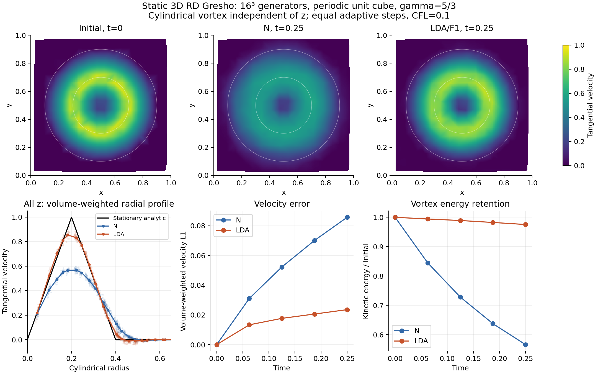

# AREPO-RD 3D moving-mesh development log

This is the shared, English-language record for 3D moving-mesh preparation,
implementation, reviews and experiments on the local Mac, Cuillin, COSMA and
other execution hosts. It is organized by development topic rather than host.

- Opened: 2026-10-11, at Zhenyu Wu's request.
- Date/time convention: Asia/Shanghai unless an entry states another time zone.
- Repository path: `dev_log/dev_log_3D_moving_mesh.md` on every host.
- Working rules: [AGENTS.md](../AGENTS.md).
- Project and Cuillin workflow: [context.md](context.md).
- Host references: [local Mac](context_localMac.md), [COSMA](context_cosma.md).
- Earlier 3D preparation: [log 3](RD_DEVELOPMENT_LOG_3_localMac.md), §§228–241.

Append entries with the date, author/model, execution host, source revision,
configuration, actual job/test status, evidence location and remaining work.
Distinguish plans, submitted/running jobs, completed runs and verified results.
Keep long derivations and campaign analyses in focused reports linked here.
Preserve earlier entries and authorship; add corrections with references to the
affected entry. When synchronizing concurrent work through Git, retain both
hosts' entries and evidence rather than overwriting one copy with the other.
Earlier logs retain their original numbering and text; they are not duplicated
or renumbered here. Host setup files continue to describe their own environments.

## Index

| Entry | Date | Subject | Execution host |
|---|---|---|---|
| 1 | 2026-10-11 | Current implementation, validated geometry evidence and Cuillin handoff | Local Mac; cluster work planned |
| 2 | 2026-10-14 | Cause of nonpositive interval volumes; high-precision audit and regularization controls | Local Mac |
| 3 | 2026-10-14 | AREPO paper/code CFL comparison and scope correction for the geometry diagnosis | Local Mac; offline kinematics |
| 4 | 2026-10-18 | Integrate the development checkpoint and start the dedicated 3D moving-mesh branch | Local Mac; Git operations |
| 5 | 2026-10-18 | Claude review of entries 1–4; face-connected change regions on archived first steps | Local Mac; offline analysis |
| 6 | 2026-10-18 | Progress review; independent face audit and multi-step controls capped at 2^-12 | Local Mac; offline and short native runs |
| 7 | 2026-10-18 | Low-resolution static 3D Gresho N/LDA physical check before moving development | Local Mac; native runs completed |
| 8 | 2026-10-18 | Static 3D Sedov failures separated into cold-solve and raw-pressure limits; user prioritizes the moving/hierarchy/MPI pipeline | Local Mac; four failed native attempts archived |
| 9 | 2026-10-18 | Morton Blob preparation and short static N/hierarchy/MPI checks | Local Mac; three short runs completed; 32³ IC only |
| 10 | 2026-10-19 | Local Blob runtime estimate from measured 16³ short checks | Local Mac; arithmetic extrapolation, no new run |
| 11 | 2026-10-19 | Recommend cluster campaigns and prepare a COSMA source handoff | Local Mac; documentation/publication, no cluster job |
| 12 | 2026-10-19 | COSMA static 3D Blob preparation and dependent submissions | COSMA; historical execution/publication record |
| 13 | 2026-10-19 | user correction — test Blob with both N and LDA | COSMA; historical execution/publication record |
| 14 | 2026-10-20 | COSMA execution audit — N completes; LDA stops at negative pressure | COSMA; historical execution/publication record |
| 15 | 2026-10-20 | Blob storage inventory for possible Mac analysis | COSMA; historical execution/publication record |
| 16 | 2026-10-20 | standalone initialization/analysis scripts and compact Mac bundles | COSMA; historical execution/publication record |
| 17 | 2026-10-20 | move compact downloads to cosma_runs and prepare Git publication | COSMA; historical execution/publication record |
| 18 | 2026-10-19 | static 3D mathematical supplement for final-thesis review | Local Mac; see dated entry for actual status |
| 19 | 2026-10-19 | current 2D/3D interfaces and consolidation direction | Local Mac; see dated entry for actual status |
| 20 | 2026-10-19 | first native integration of shared element interfaces | Local Mac; see dated entry for actual status |
| 21 | 2026-10-20 | independent analysis of the downloaded COSMA Blob results | Local Mac; see dated entry for actual status |
| 22 | 2026-10-20 | Blob N1 implementation and initial-condition diagnosis | Local Mac; see dated entry for actual status |
| 23 | 2026-10-22 | explicit check of the Blob temperature contrast | Local Mac; see dated entry for actual status |
| 24 | 2026-10-22 | compare the RD Blob setup with SWIFT and both papers | Local Mac; see dated entry for actual status |
| 25 | 2026-10-22 | proposed COSMA Blob comparison and mesh-convergence study | Local Mac; see dated entry for actual status |
| 26 | 2026-10-22 | Synchronize published COSMA history and prepare Mac interface/Blob publication | Local Mac; Git integration and publication checks |

## 1. 2026-10-11: current state and handoff to Cuillin

- **Author:** Codex (GPT-6), with Zhenyu Wu.
- **Execution host of the evidence below:** local Apple Silicon Mac.
- **Branch checked at this handoff:** `feature/ale-flip-conservation-hierarchy`.
- **Implementation checkpoint:** `57e1ae3` (native moving-tetra geometry diagnostic).
- **Mathematics checkpoint:** `90624a4` (moving-tetra Campoli/geometry oracle).

**Status:** M1 mathematics and M2 local diagnostic are complete within their
stated scopes. Native moving 3D RD is not implemented. Zhenyu intends to extend
testing on Cuillin; no cluster build, job submission or live cluster inspection
was performed while opening this log.

### 1.1 Implemented and validated foundations

Milestone labels follow Claude Code's
[3D moving-mesh plan](RD_3D_MOVING_MESH_PLAN_FOR_CODEX_20261011.md).
The user decisions below and current AGENTS.md supersede its earlier scaling
prerequisite and log destination.

| Component | Current evidence | Boundary |
|---|---|---|
| Static tetrahedral N/LDA | Native periodic, gas-only full meshes; equal steps and experimental frozen-dU hierarchy; small 1/2/4-rank gates | Does not establish moving geometry, moving hierarchy or moving MPI |
| Moving-tetra mathematics (M1) | Independent geometry identities and complete fixed-connectivity Campoli ledger model; five-component cavity-transfer models | Model/oracle evidence, not a native moving-RD fluid update |
| Native geometry diagnostic (M2) | Read-only standard moving Voronoi FV trajectories; periodic tetra registry, interval-volume and cavity statistics | Fresh, noncomoving gas-only runs; full mesh, equal adaptive steps, one rank |
| Moving N adapter (M3) | Not implemented | Controlled fixed-connectivity integration is the next solver milestone |
| Native 3D cavity transfer (M4) | Not implemented | Inversion, large-cavity and periodic winding policies remain open |
| Moving LDA, tetra HLLC-RD (M5/M6) | Not implemented | Shock robustness/positivity remain separate requirements |
| Moving interval hierarchy, MPI, lazy/restart | Not implemented | Static and 2D results do not validate these paths |

Static 3D details are in
[features and benchmarks](RD_3D_FEATURES_AND_BENCHMARKS_20261010.md) and
[examples/rd_3d](../examples/rd_3d/README.md). The final static feature campaign
contains 50 small 8³/16³ gates, including actual mixed bins and equal-bin
degeneration. Reduced SWIFT-family Sod/Gresho runs complete. Production cold
Sedov stops at the raw solve-compatibility audit and is unvalidated.
[Claude's review](RD_3D_EXTENSION_CLAUDE_REVIEW_20261010.md) identifies a scaling
problem in cold compatible systems; its independently scaled prototype later
encounters negative pressure. It is not a passed production shock benchmark.

**User decisions retained:** similarity rescaling is not a prerequisite for
moving-mesh preparation; production Euler/linear solves remain unscaled.
The 2D K-refactor trajectory-compatibility repair remains deferred. Keep the
current 2D arithmetic and explicit lazy-OFF baseline. No audit threshold,
primitive floor or default Config was changed to obtain these results.

### 1.2 M1: established geometry and ledger mathematics

See [moving geometry mathematics](RD_3D_MOVING_GEOMETRY_MATHEMATICS_20261011.md)
and historical log 3 §240. Key results are:

- Linear vertex trajectories give quadratic oriented face area vectors and
  cubic signed tetra volumes. Interval positivity requires endpoints and every
  real stationary point in the interval; old/mid/new probes alone are inadequate.
- Endpoint volume differences provide the ledger geometry. The element
  mesh-gradient/contour term requires exact time-mean face vectors, with the
  3D `1/3` factor; Campoli temporal mass uses `(V_old + V_new)/2`.
- The complete two-sweep periodic fixed-connectivity model conserves to
  round-off with exact mean vectors. The 27-node/162-tetra oracle gives
  conservation defect at most `1.322e-16`; its nonuniform midpoint-normal
  control gives `3.114e-9`.
- The independent moving-tetra/transfer oracle covers 300 moving tetrahedra,
  a hidden interval inversion, Galilean transport and 1026 five-component
  transfer cases, including 4-4 and larger cavities. It is part of `check_rd`.
- Full K is linear in the face vector, but spectral splitting and N/LDA
  distribution generally do not commute with time averaging. Mean-vector
  alpha is not a bound on the entire step's CFL coefficient. Frozen-stage
  identities do not prove exact nodal affine preservation of native RK2.

Local evidence: `../local_runs/rd_3d_moving_math_20261011_v3/`, relative to the
repository root on the Mac. This path is an evidence locator, not proof that
the archive is already present on Cuillin.

### 1.3 M2: real native trajectories and geometry hazards

See [native geometry diagnostic report](RD_3D_MOVING_GEOMETRY_DIAGNOSTIC_20261011.md)
and historical log 3 §241. Relevant implementation and reproduction entries:

- `src/mesh/rd_simplex_registry.{c,h}`: pure geometry, oriented periodic keys,
  cubic interval checks and connected change cavities.
- `src/mesh/rd_3d_geometry_diagnostics.c`: read-only native FV hooks.
- [Config_FV_geometry.sh](../examples/rd_3d/Config_FV_geometry.sh): explicit
  `RD_3D_GEOMETRY_DIAGNOSTICS`; this is standard FV, not moving RD.
- [run_3d_geometry_pilot.py](../tests/rd/run_3d_geometry_pilot.py): freeze,
  prepare, build, run and analyze the local pilot.
- [analyse_3d_geometry_pilot.py](../tests/rd/analyse_3d_geometry_pilot.py):
  independent periodic Delaunay/graph checks and scientific figures.
- [test_simplex_registry.py](../tests/rd/test_simplex_registry.py): standalone
  C-kernel checks, included in `make check_rd`.

The local pilot uses 4096 generators, a periodic unit cube, gamma=5/3,
standard quasi-Lagrangian velocities and CM/soundspeed/face-angle regularization
(`CellShapingSpeed=.5`, `CellMaxAngleFactor=2.25`). It compares CFL=.1/.3 on
initially uniform gas at rest on random points, smooth oblique advection,
z-invariant Gresho, KH-like shear and very short FV Sedov. There are ten physics
diagnostics totaling 134 steps and 8274 connected change cavities, plus an
injection probe and three diagnostic-OFF controls. Durations, actual timesteps,
seed/coordinates and injection normalization are specified in the report;
these are short functional diagnostics, not convergence or scaling campaigns.

| Initial condition | End time | New-tetra pullback inversions, CFL .1 / .3 | Largest cavity vertices, CFL .1 / .3 |
|---|---:|---:|---:|
| Uniform at rest, random points | .015625 | 4 / 15 | 110 / 1599 |
| Smooth oblique advection | .015625 | 0 / 0 | 0 / 0 |
| Gresho | .03125 | 0 / 0 | 44 / 106 |
| KH-like shear | .03125 | 0 / 1 | 34 / 488 |
| FV Sedov | .001 | 0 / 0 | 9 / 13 |

Counts are **element-interval occurrences**, not necessarily distinct tetrahedra.
Connected change cavities can combine several flips sharing vertices; they are
not the individual operations of AREPO's insertion/retriangulation algorithm.

The main hazards and geometry checks are:

1. There are 20 new-tetra pullback inversions, 23 old-connectivity interval
   inversions and three common-key orientation reversals. CFL=.1 still gives
   inversions in the random case. The worst measured `V_old/V_new` is `-6.23813`.
2. Five new-element Campoli temporal volumes are nonpositive, while every
   observed nodal temporal mass is positive. A nodal positivity check cannot
   replace an element-interval geometry acceptance policy.
3. The largest cavity has 1599/4096 vertices (39.038%). Five cavities have
   periodic winding cycles: two in random CFL=.3 and three in shear CFL=.3.
   They have no single coherent Euclidean unfolding; ordinary affine
   first-moment correction cannot simply be assumed for them.
4. Exact mean face vectors differ from midpoint vectors by up to `.00377676`
   relative to the largest old/mid/new face area. This is a geometry correction,
   not an estimate of fluid error. Independent Gauss swept-face GCL defect is
   at most `5.971e-17`, versus `1.436e-5` for midpoint sweep, with the report's
   stated normalization.
5. Signed box coverage defect is at most `1.044e-14`; cavity volume and
   non-winding first-moment defects are at most `2.825e-15` / `2.903e-15`.
   These signed-chain identities can hold despite inversion and do not prove
   positive geometry or positive fluid states.

The sliver diagnostic is `q=V/(sum face area)^(3/2)`, whose regular-tetra value
is `.05170027`; do not reuse the inconsistent `.0068` value from the earlier
plan. New-endpoint minimum q is `3.48944e-5`. No uncertain or hidden-between-
probes inversion was observed in these native pilots, but the manufactured
hidden-inversion oracle still demonstrates why full cubic interval checks are
needed. Near-zero classification is a diagnostic error policy, not a certified
exact orientation predicate.

### 1.4 Validation, provenance and retained failures

Local final archive: `../local_runs/rd_3d_geometry_20261011_v4/`.
Its native source was frozen from `90624a4` plus the diagnostic changes later
committed as `57e1ae3`; `final_source_audit.json` confirms the native source
matches that checkpoint. Final analysis scripts and hashes are recorded
separately because enriched event classification followed the build freeze.
The bundle preserves source/Config/header/binary hashes, linkage, inputs,
parameters, logs, run status and geometry records. The archive is not part of
the Git checkout and has not been transferred to Cuillin in this handoff.

- Full frozen `make check_rd` passes. The added registry suite checks 800
  intervals and 35 cavity models against independent calculations.
- All 43 invalid old/new chain events are independently rechecked using NumPy
  determinant coefficients and polynomial roots.
- Random/advection first-step old/new complete periodic key sets match an
  independent 27-image SciPy Delaunay reconstruction exactly. Independent
  graph traversal checks cavity sizes and winding on four pilot cases.
- All 14 final native attempts complete. Random/Gresho/Sedov CFL=.3 ON/OFF
  controls have byte-identical particle fields after ID sorting in all three
  snapshots and all nine particle datasets. This tests non-invasiveness on
  those three trajectories.
- 2D LDA/B Yee48 replays, dt=1/256 through 256 steps to t=1, match the five
  archived reference snapshots and all eleven particle datasets byte for byte.
  This is not a rerun of the entire 2D N/HLLC/hierarchy campaign.

Earlier diagnostic attempts remain archived: v1 fails macro-guard registration,
v2 fails compilation because of a `Nodes` symbol collision, and v3 completes
FV runs but fails coverage because deleted tetra vertex slots were counted.
The v4 filter uses AREPO's actual `DT[t].t[0]` deletion marker and checks each
opening box coverage. The geometry threshold was not loosened. These are
diagnostic setup/implementation failures; v3 geometry statistics are excluded
from physical conclusions. Entry registry drafts remain preserved separately.

### 1.5 Cuillin handoff: pending work

Zhenyu intends to continue testing on Cuillin. The following is a handoff plan,
not a record of completed cluster validation:

1. **Check the actual Cuillin checkout and environment.** Preserve existing
   changes, confirm branch/revision and use that host's `Makefile.systype`.
   The documented Cuillin path/workflow is in [context.md](context.md); its
   scheduler/module details must be checked on the host. Compile and run on
   compute nodes. Use the Cuillin workflow rather than LocalMac or COSMA settings.
2. **Adapt or replace the Mac campaign driver before Linux builds.** The
   current driver imports a helper that calls `otool`; its source-freeze step
   also copies the caller's ignored `Makefile.systype`. A Cuillin build needs
   Linux linkage/provenance (`ldd`) and the correct host configuration. Existing
   `build_case.sh`/Slurm wrappers are the Linux artifact route, but a 3D geometry
   campaign integration with them has not yet been validated.
3. **Begin with a one-rank parity pilot.** Run `check_rd` with the intended
   compute-node compiler/Python environment, then the small diagnostic and
   corresponding OFF controls. Explicitly use `--ntasks=1`; the existing
   `run_case.sbatch` default is four ranks, whereas this diagnostic supports one.
   Keep OMP and the selected BLAS backend at one thread. Record compiler,
   MPI/HDF5/BLAS, Python versions, generated headers, binary/linkage hashes,
   job IDs, actual timesteps and final status in the next shared-log entry.
4. **Fix comparison provenance before extending the campaign.** Reuse frozen
   IC/parameter definitions where comparing with the Mac, and state whether
   Sedov injection reuses the archived IC or is recomputed from a new native
   Voronoi-volume probe. Its FV injection is not median-dual normalization.
   ARM/Clang versus Linux/compiler/backend runs need explicit tolerances;
   do not require cross-platform byte equality or silently relabel changed ICs.
   The first-pair binary is a native ABI artifact; check byte order/layout on
   the reader's host rather than assuming an interchangeable restart format.
5. **Extend geometry measurements once the Linux pilot is verified.** Larger
   resolutions, more seeds/CFL values and longer durations belong on the cluster.
   Preserve full interval minima, element and nodal temporal masses, cavity
   size/touched fractions, winding and sliver distributions. Increasing rank
   count is not a supported way to scale this one-rank diagnostic.
6. **Keep solver design decisions separate from measurement.** Determine how
   to accept/reject an element interval and how to handle large/winding cavities
   before moving-RD reconnection transfer. Do not use absolute volumes, skip
   inverted elements or impose an arbitrary cavity cap as an unreviewed repair.
   A controlled fixed-connectivity Campoli moving-N adapter is the next native
   solver milestone; native 3D transfer, LDA/HLLC, moving hierarchy/MPI and lazy
   support follow their own implementation and validation gates.

No thesis, standalone solver, production scaling or cluster job state is changed
by opening this log. Future 3D moving-mesh entries, whether measurements, code
changes or reviews, belong here; earlier reports remain linked source evidence.

## 2. 2026-10-14: cause of nonpositive 3D volumes

- **Author:** Codex (GPT-6), with Zhenyu Wu.
- **Execution host:** local Apple Silicon Mac; one rank, OMP/BLAS threads=1.
- **Branch / analysis starting revision:** `feature/ale-flip-conservation-hierarchy` / `cb504ac`.
- **Native source:** frozen `57e1ae3` diagnostic artifact; reused without rebuilding.
- **Request:** investigate the cause before advancing the moving 3D solver.
- **Status:** offline audit and three small native controls completed. No cluster
  job submitted or production solver modification made.

Full results: [cause report](RD_3D_NONPOSITIVE_VOLUME_CAUSE_20261014.md).
Reproduction: [diagnostic audit script](../tests/rd/diagnose_3d_nonpositive_volumes.py).

The failures are real orientation crossings of thin tetrahedral vertex tuples
under finite linear drift, seen when old connectivity is carried forward or
new connectivity is pulled back. The diagnostic field `old_endpoint_negative`
means the **old** tetra at the **closing** time; it does not mean a negative
opening native tetrahedron. These measurements do not establish negative
native Voronoi cell volumes.

All 43 side-specific invalid records pass an independent 60-digit determinant
audit and have one sign-changing root within their step. Their negative minima
are at least `6.11679e8` times the diagnostic error estimate. Three old/new
orientation-reversal pairs make 40 distinct case/step/ID-tuple combinations;
these are not counts of individual flips. All 17 invalid records in the saved
first full pairs belong to changed or orientation-reversed connectivity.
There is no hidden-between-probes inversion in this native pilot, while the
manufactured hidden-inversion oracle remains relevant.

The earliest random-case old tetra has minimum altitude `5.67933e-5`, versus
Voronoi radii `.0329531`--`.0476321`. It crosses zero at `t=.000320812720`:
before either actual first step (`.0009765625` at CFL=.1, `.001953125` at .3)
ends. The source CFL/regularization criteria use Voronoi geometry/signal scales,
not this tetrahedron's altitude or cubic zero time.

| Fresh random-gas control, end t=.015625 | Steps | Old/new invalid records |
|---|---:|---:|
| CellShapingSpeed=.5, CFL=.3 | 8 | 16 / 15 |
| CellShapingSpeed=0, CFL=.3 | 8 | 0 / 0 |
| CellShapingSpeed=0, CFL=.1 | 16 | 0 / 0 |

The .5/.3 replay is byte-identical to the original in all nine particle datasets
and three snapshots. The .3 OFF control has the same actual timestep sequence;
the .1 OFF control has a different later adaptive schedule. Both OFF controls
have no reconnection over this short run, though their evolved mesh velocities
are small rather than exactly zero. This isolates regularization as the dominant
driver for this random-gas pilot. The shear event at CFL=.3, step 8, has zero
regularization correction and still crosses orientation; removing regularization
is therefore not a validated general remedy.

For the worst new tetra, `V_old/V_new=-6.23813080`, so its Campoli endpoint mean
is `-2.90095125e-8`. The five nonpositive new-element temporal volumes follow
from negative pullbacks; they are not Euler-scaling or Campoli arithmetic
failures. Positive nodal masses and signed coverage can mask negative element
contributions through summation/cancellation. Native moving RD is still absent.

Evidence is local: native controls in
`../local_runs/rd_3d_nonpositive_audit_20261014_v1/`; final offline audit in
`../local_runs/rd_3d_nonpositive_audit_20261014_v3/`, including snapshot-volume
and first-velocity checks. Earlier offline versions remain archived; the three
native controls were not repeated. Original M2 data remain untouched.
The report includes a version-controlled PNG/PDF of representative volume roots.

Next design boundary: distinguish old-connectivity geometry limits from the
acceptance/transfer policy for newly connected tetrahedra whose pullbacks cross
zero. No absolute-volume replacement, mass clipping, velocity/timestep change
or assertion relaxation has been introduced. M3 and Cuillin campaign adaptation
remain pending.

## 3. 2026-10-14: CFL reference audit and correction to the diagnosis

- **Author:** Codex (GPT-6), with Zhenyu Wu.
- **Execution host / starting revision:** local Mac / `a93fb87`.
- **Request:** check the AREPO paper's CFL condition and distinguish the
  Voronoi FV and Delaunay-based RD geometry requirements.
- **Status:** publication/source review and six first-step kinematic mesh
  comparisons completed. No new native fluid run, build or cluster job.
- **Evidence:** `../local_runs/rd_3d_cfl_reference_20261014_v1/`;
  [reproducer](../tests/rd/audit_3d_cfl_reference.py).

**Correction to entry 2's interpretation:** M2 uses standard FV timestep
selection, not RD's own spectral condition. Its invalid-volume records prove
hazards on those FV trajectories; they do **not** prove that a moving-RD
scheme obeying its own stability/geometry bounds would reproduce those events.
The actual geometric sign changes and regularization-control results in entry 2
remain valid. More suitable first-step limits remove the observed first-step
inversions in a frozen-velocity oracle.

### Paper versus public-code timestep

[Springel (2010), §§7.1--7.2](https://arxiv.org/html/0901.4107#S7) gives the
local moving-frame condition (126),
`dt_i = C_CFL R_i / (c_i + |u_i-w_i|)`, and the signal-travel extension
(128)--(130), `dt_i = C_CFL min(local_i, min_j r_ij/vsig_ij)`.
The paper distinguishes the global minimum in (127) from individual-step
selection. The stricter signal extension here is a comparison, not a claim
that equation (126) is an invalid global FV prescription.

The public source used by M2 has `TREE_BASED_TIMESTEPS`. It initializes the
local moving-frame bound, then uses **`r_ij + R_i`** in the pair travel time,
with matching radius terms in the tree-opening checks. That radius addition
is intentional in the source comment to avoid very short steps for nearby
generators; it is not the literal distance in paper (130). It must be identified
before describing a run as a test of the strict published signal condition.
See [tree code](../src/time_integration/timestep_treebased.c) and
[timestep selection](../src/time_integration/timestep.c).

Also, the first saved `VertexVelocity` is zero, whereas the final first-drift
mesh RMS is `.4620527`. The loop selects a step, then calls
`set_vertex_velocities()` again, enabling regularization once the time bin is
nonzero. Evaluating local (126) with the final drift velocity gives raw minimum
`.00912258`, versus the snapshot-based `.01368387`. At CFL=.1 the original
first h=`.0009765625` is slightly above the final-velocity local limit
`.000912258`; at .3 the original h satisfies the final-velocity local limit.
This ordering matters for an audit; it does not explain every interval failure.

### First-state comparison, actual power-of-two steps

For the original 4096-point random IC, the strict signal minimum is
`.000955549053` (pair IDs 723/3694). Existing static tetra RD assembles
`m_i=sum_T V_T/4` and `alpha_i=sum_T max_j[A_Tj*c/3]` for uniform gas at rest;
its raw minimum `m_i/alpha_i` is `.00143439074`.

| First-state bound | CFL | Allowed dt before quantization | Selected power-of-two h | Old/new interval inversions in the frozen-velocity mesh oracle |
|---|---:|---:|---:|---:|
| Public FV tree, snapshot velocity | .3 | `.00308160` | `.001953125` | 7 / 5 |
| Local paper (126), final drift velocity | .1 | `.000912258` | `.00048828125` | 2 / 0 |
| Strict paper (129)--(130) | .3 | `.000286665` | `.000244140625` | 0 / 0 |
| Strict paper (129)--(130) | .1 | `.0000955549` | `.00006103515625` | 0 / 0 |
| Current static-RD spectral bound | .3 | `.000430317` | `.000244140625` | 0 / 0 |
| Current static-RD spectral bound | .1 | `.000143439` | `.0001220703125` | 0 / 0 |

These are **first-state kinematic comparisons**, with original drift velocities
held fixed and periodic closing meshes rebuilt independently by SciPy. The
original h reproduces the native first-pair tetra counts and 7/5 invalid counts;
all six tested h have signed box coverage defects <=`2.221e-16` and no uncertain
intervals. They are not native evolutions with alternative CFL rules, and the
static-RD calculation is not an implemented or validated moving-RD bound.
Full time-dependent RD geometry, Campoli masses and spectral envelopes still
require separate analysis. Original M2 flags do not compile `RD_3D_STATIC`,
`RD_ALE_CFL_TIMESTEP` or `RESIDUAL_DISTRIBUTION`.

### Why FV and this RD formulation still differ

[Springel (2010), §2.3](https://arxiv.org/html/0901.4107#S2.SS3) describes
Delaunay topology changes while the dual Voronoi geometry changes continuously,
with a changing neighbour relation's face reaching zero area.
From this and our implementation, the relevant distinction is:

- FV evolves conserved content in persistent generator-associated **Voronoi
  cells**, using face fluxes. It does not require a particular old/new Delaunay
  tetrahedron to remain a positive fluid element throughout the full step.
- Our RD residuals and median-dual masses use **Delaunay simplices**. Carrying
  their basis across time adds interval-element and reconnection-transfer
  requirements. This concerns this formulation, not every possible RD method;
  other moving-simplex discretizations can share the same issue.

The correct next step is therefore to use an RD-consistent fluid bound and the
actual assigned mesh velocity, then measure remaining geometry failures with
the proposed transfer policy. Do not infer either that all previous failures
are unavoidable RD geometry problems, or that strict FV CFL guarantees positive
transported tetrahedra in general. Source and numerical solver behavior remain
unchanged by this review.

## 4. 2026-10-18: development checkpoint and dedicated 3D branch

- **Author:** Codex (GPT-6), with Zhenyu Wu.
- **Execution host:** local Apple Silicon Mac.
- **Source checkpoint:** `44479a1` (CFL review at the end of entry 3).
- **Authorization:** Zhenyu approved the branch reorganization and GitHub push.
- **Status:** local fast-forward integration and branch creation completed;
  this entry and the context updates are the documentation-only handoff.

The worktree was clean. `develop_pureC_RD` at `eacc3f9` was an ancestor of
`feature/ale-flip-conservation-hierarchy` at `44479a1`, with 58 intervening
commits and no develop-only commits. The refreshed remote develop checkpoint
was `94cd37a`, another three commits behind the local develop branch.

The approved organization is:

| Branch | Role |
|---|---|
| `develop_pureC_RD` | Integrated development line, fast-forwarded to the source checkpoint plus this shared handoff documentation |
| `feature/3d-moving-mesh` | Current branch for subsequent 3D moving-mesh preparation and implementation, starting from the same integrated checkpoint |
| `feature/ale-flip-conservation-hierarchy` | Retained at `44479a1` as the previous development checkpoint |

The original commits and hashes are retained; integration uses fast-forward
operations. No rebase, squash or history rewrite is involved. Publication
targets all three named branches on `origin`
(`https://github.com/ZhenyuWu1999/arepo.git`); the push outcome and remote heads
are verified after committing the handoff. Future work continues in this same
English log on every host.

This is a development checkpoint, not a new numerical validation result.
The deferred 2D arithmetic-compatibility issue, unvalidated cold Sedov and
pending native moving-3D adapter/geometry policy remain as documented above.
There is no solver, Config or test-result change and no new build or simulation.
Local run archives remain outside Git. Publishing the source does not transfer
those archives or update a Cuillin/COSMA checkout; host adaptation and actual
cluster tests remain pending.

## 5. 2026-10-18: Claude review of entries 1–4 and face-connected cavities

- **Author:** Claude Code (Opus 5.5), with Zhenyu Wu.
- **Execution host:** local Apple Silicon Mac; one process, OMP/BLAS threads=1.
- **Branch / revision reviewed:** `feature/3d-moving-mesh` / `3d72127`.
- **Request:** review Codex's 3D moving-mesh progress through entry 4.
- **Status:** source/report review and an offline analysis of the archived M2
  first mesh pairs. No build, native run, solver/test/Config change or cluster job.
- **Evidence:** `../local_runs/claude_3d_review3_20261018_v1/` (script, results,
  input/script hashes, README).

### 5.1 Checked without finding an error

- **Entry 4 Git facts.** `eacc3f9..44479a1` has 58 commits; `94cd37a` is three
  commits behind `eacc3f9`. `origin/feature/3d-moving-mesh` and
  `origin/develop_pureC_RD` are at `3d72127`; `origin/feature/ale-flip-conservation-hierarchy`
  is at `44479a1`. This records the push outcome that entry 4 left pending.
- **M1 identities, re-derived by hand:** the Simpson mean area vector;
  `M_T-V(1/2)=a2/4+3a3/8` and `M_T-∫V=a2/6+a3/4`; `dV/dt=(1/3)ΣN_i·w_i`;
  transport identity (1); the Galilean map; the Bernstein bound on the CFL
  coefficient; mode-1 transfer conservation.
- **Registry kernel** ([rd_simplex_registry.c](../src/mesh/rd_simplex_registry.c)):
  cubic coefficients, stationary-point roots, midpoint GCL defect `c3/4`,
  mean-normal correction `δu×δv/24`, and the Gauss swept-face sign convention.
- **CFL audit (entry 3).** Its static-RD bound uses the element-maximum face
  area, as the solver does ([rd_timestep.c](../src/hydro/rd_timestep.c), lines 79–94).
- **Tests.** `test_moving_tetrahedra.py` and `test_simplex_registry.py` pass at
  `3d72127` and reproduce the reported values (1026 transfer cases, 748 limited,
  conservation 6.083e-16; interval error 4.469e-15; cavity defect 2.578e-16).
  The rest of `make check_rd` was not rerun.

### 5.2 Finding: the reported cavity size comes from the merge rule

The registry joins all four vertices of each changed tetrahedron
(`rd_registry_compare`), so two changed regions touching at one vertex become
one cavity. An alternative joins changed old/new tetrahedra only when they share
a periodic triangle key. For the changed signed chain C = new − old, ∂C = 0 because
both endpoint meshes tile the box and unchanged simplices cancel. A boundary
face of one face-connected component cannot appear in another component, or the
two would have been joined. Each component therefore has zero boundary, and
identity (4) holds component by component.

Results on the archived first pairs, `v4`; vertex-rule numbers equal the native
`geometry_cavities.csv` first-step count and maximum in every run:

| Run (first step) | Vertex rule: cavities / largest | Face rule: regions / largest / p99 |
|---|---:|---:|
| random, CFL .1 | 136 / 110 | 332 / 10 / 7.0 |
| random, CFL .3 | 57 / 1599 | 543 / 13 / 10.0 |
| Gresho, CFL .1 | 56 / 36 | 81 / 10 / 8.4 |
| Gresho, CFL .3 | 66 / 99 | 159 / 10 / 9.4 |
| shear, CFL .1 | 55 / 26 | 92 / 8 / 8.0 |
| shear, CFL .3 | 42 / 488 | 278 / 20 / 15.5 |

Advection and Sedov have no first-step reconnection. Every face-connected region
unfolds consistently by minimum image (largest distance from its reference
vertex .232) and closes to round-off. Signed volume closes to ≤2.844e-15 relative
to Σ|V| and first moment to ≤2.756e-15 relative to Σ|V|×box, at both time levels.

- **Consequence for the M2 conclusion:** the 39.038% percolating cavity is a
  property of the merge rule, not of the reconnection. Three of the five native
  winding cavities are in step 1 (random 1599; shear 480, 488), where no
  face-connected region winds. The plan's percolation trigger for §11.4 should
  be re-evaluated with face-connected regions.
- **Consequence for transfer design:** a vertex can belong to up to five regions
  (random CFL .3; 643 of 2221 changed vertices are shared). Each region's δm at
  such a vertex must be accounted separately. Either partition the star mass `g_i`
  or apply the regions sequentially, and restate the `g_i+δm_i>0` condition
  accordingly.
- **Limits:** only first steps were archived. The two step-2 winding cavities
  (random 1499, shear 469) and all later steps need a native rerun with a
  face-connected registry.

### 5.3 Finding: inversion evidence at RD-sized steps is one frozen step

Entry 3 correctly limits M2's inversions to FV timesteps. Its RD-sized evidence
is one first step with frozen velocities. With `REGULARIZE_MESH_CM_DRIFT_USE_SOUNDSPEED`,
the regularization speed is `CellShapingSpeed×c` whatever the step
([set_vertex_velocities.c](../src/mesh/set_vertex_velocities.c)). That makes the
frozen-velocity oracle fair for the first step. It also means that relative
vertex speeds do not shrink with h. Delaunay sliver heights have no lower bound in
3D, so a CFL factor can reduce but not exclude interval inversions. The earliest
crossing in entry 2 (`t=.000320812720`) is only 1.31 times the RD-sized
`h=.000244140625`.

A multi-step measurement is cheap. Rerun the random and shear diagnostics at 16³
with the step capped at `2^-12` (`MaxSizeTimestep`) to their original end times.
M3 needs an explicit invalid-interval policy (abort with diagnostic) in any case.

### 5.4 Finding: the random-point IC dominates the hazards

Random points give 19 of the 20 new-pullback records and all 23 old-interval
records; entry 2's regularization-off control removes them. Among the
jittered-lattice cases only shear CFL .3 has one record. In random CFL .3, the
vertex-rule cavity maximum falls from 1599/1499 (steps 1–2) to 75–226
(steps 3–8). Report this start-up relaxation separately from later behaviour.
A relaxed or glass IC would represent production meshes better.

### 5.5 Documentation corrections and open items

- [M1 note](RD_3D_MOVING_GEOMETRY_MATHEMATICS_20261011.md) §6 still gives
  `q≈.0068` for a regular tetrahedron. Under its own definition the value is
  `.05170027`, as entry 1 and the M2 report state. The note is left unchanged here.
- The canonical [M2 report](RD_3D_MOVING_GEOMETRY_DIAGNOSTIC_20261011.md) is in
  Chinese. It predates the English-log rule, but readers of this log need an
  English summary or translation.
- Plan M0.2 is partial: only the Yee48 LDA/B replay is byte-identical. M0.3
  (2D gates B1.3/B1.4/B1.7) has no record, and user decision §11.1 is still open.

### 5.6 Status and recommended order

M1, M2 and the cause/CFL audits are complete within their stated scopes. M3–M6
and the Cuillin adaptation have not started; no technical change followed entry 3.

1. Start M3. Gates M3.1–M3.4 use fixed connectivity and need only the abort
   policy, not the transfer or inversion decisions.
2. In parallel, add face-connected regions to the registry, keeping the vertex
   rule as a reported comparison, and rerun M2. Also run the step-capped
   diagnostic of §5.3.
3. Take decisions §11.3 (inversion) and §11.4 (cavity) on that evidence before M4.

## 6. 2026-10-18: progress review, independent face audit and capped native controls

- **Author:** Codex (GPT-6), with Zhenyu Wu.
- **Execution host:** local Apple Silicon Mac; one rank, OMP/BLAS threads = 1.
- **Branch / HEAD:** `feature/3d-moving-mesh` / `3d72127`.
- **Native binary:** frozen `57e1ae3` diagnostic, reused without rebuilding.
- **Status:** source/review audit, two algebra tests, independent first-pair
  face analysis and two short native FV controls completed. No production
  solver/Config, thesis or cluster change; no M3 implementation.
- **Evidence:** `../local_runs/codex_3d_progress_review_20261018_v1/`.
- **Report:** [English progress review](RD_3D_MOVING_PROGRESS_REVIEW_20261018.md).

Claude's entry 5 was already uncommitted at entry to this task. It is retained
verbatim, with the entry tree diff and log hash archived before this addition.
The report also summarizes Claude's October 10 integration/extension reviews:
their 2D long-trajectory compatibility finding is accepted and user-deferred;
cold-system scaling and subsequent negative pressure remain separate limits.

### 6.1 Face-region result independently confirmed, transfer still coupled

The new [read-only audit](../tests/rd/audit_3d_face_components.py) uses a
face-incidence BFS, exact integer oriented-boundary cancellation and integer
periodic-image potentials. All 11 archived first pairs pass. Region counts,
maxima and shared-node multiplicities agree with Claude. Random CFL .3 has
543 face regions, maximum 13 vertices, instead of 57 vertex groups with maximum
1599. Maximum normalized volume/moment closure defects are `1.108e-15` and
`1.063e-15`; every face boundary cancels exactly and no face region winds.

The geometric correction is accepted: the 1599 size does not establish one
intrinsically large reconnection. However, random CFL .3 still has 643 shared
vertices, membership up to five; 338 vertices donate in one region and receive
in another. Joining face regions through shared nodes recovers exactly the
original vertex groups, including 1599. A five-component transfer needs a
partitioned or sequential mass/state ledger; signed-chain identities alone
do not establish its positivity. Later-step face/winding statistics remain
unmeasured, and the C diagnostic still uses vertex-connected groups.

### 6.2 The multi-step small-ceiling control still has random inversions

Following entry 5.3, two standard moving-FV 16³ CFL .3 runs reuse the frozen
diagnostic binary and original ICs, with only `MaxSizeTimestep=2^-12` changed
apart from isolated input/output paths. Both completed at that actual timestep:

| Run | End time | Steps | Old-forward invalid | New-pullback invalid |
|---|---:|---:|---:|---:|
| Random | .015625 | 64 | 2 | 1 |
| Shear | .03125 | 128 | 0 | 0 |

Random events occur in steps 35, 38 and 63. Direct 60-digit Decimal determinants
confirm all three, with magnitudes `4.24e8`–`3.35e9` times the uncertainty
estimate. All saved FV snapshot volumes and nodal temporal masses stay positive.
The invalid counts are reduced from the original random run's 16/15 at eight
larger steps, but they are not eliminated over the same end time.

This strengthens the limitation on entry 3: a safe first frozen step is not a
full-trajectory interval-positivity guarantee. The control uses a fixed ceiling
and FV timestep selection; it does not implement or disprove a dynamically
updated moving-RD spectral bound. Actual-velocity geometric checks and an
explicit invalid-interval policy remain necessary parts of the M3 design.

### 6.3 Status and next gates

Both `test_moving_tetrahedra.py` and `test_simplex_registry.py` pass and reproduce
Claude's values: transfer conservation `6.083e-16`, registry interval error
`4.469e-15`, cavity defect `2.578e-16`. Full `make check_rd` was not rerun.

M1/M2 are complete within their scopes. Native moving RD, native five-component
transfer, moving LDA/HLLC, moving hierarchy/MPI and Cuillin adaptation are still
pending. Source guards still require static 3D RD; the native transfer header
still has four-component arrays. Model tests do not change those boundaries.

The next solver milestone is controlled fixed-connectivity M3 with explicit
topology/invalid-interval rejection. Carry forward M1's correction to the
original plan's M3.4: exact nodal affine RK2 preservation is not proved;
analytic affine Reynolds checks and native accuracy diagnostics are distinct.
The latest requested 2D baseline matrix remains incomplete, although older
equal-/mixed-bin and no-transfer evidence exists. The M1 note's incorrect
regular-tetra `q≈.0068` is corrected to `.05170027`; the M2 report gains an
English interpretation update. Context files point to these corrections.

## 7. 2026-10-18: low-resolution static 3D Gresho physical check

- **Author:** Codex (GPT-6), with Zhenyu Wu.
- **Execution host:** local Apple Silicon Mac; two concurrent singleton runs,
  each with `OMP_NUM_THREADS=1` and `OPENBLAS_NUM_THREADS=1`.
- **Source:** `feature/3d-moving-mesh`, HEAD `3d72127`, frozen source archive
  including the recorded working files. Production `src/` has no working diff.
- **Request:** run a small actual static 3D problem, such as Gresho, before
  continuing moving-mesh development.
- **Status:** separate N and LDA builds and native runs completed with exit 0;
  analysis checks passed, PNG visually inspected, PDF exported. No solver,
  default Config or thesis change; no cluster job.
- **Evidence:** `../local_runs/rd_3d_static_gresho_20261018_v1/` contains the
  frozen source, configs, generated headers, binaries/linkage, compiler,
  hashes, parameters, IC, logs, five snapshots per run, analysis and driver.

### Setup and interpretation

This extends the earlier `t=.1` Gresho check to `t=.25` using the existing
repository IC: 4096 generators (`16³`), deterministic jittered lattice
(seed 928, ±.12 cell spacing per axis), periodic unit cube, gamma `5/3`,
rho=1, no bulk boost. The cylindrical vortex is independent of z and has
`v_phi=5r` for `r<.2`, `2-5r` for `.2<=r<.4`, and zero outside. It is evolved
with all five Euler components on the static 3D tetrahedral mesh; it is not
a test of arbitrary three-dimensional flow. The endpoint is about .20 of
one inner-core revolution.

N/lumped and LDA/F1 use `RD_RK2_TOTAL_RESIDUAL`, full meshes, equal adaptive
steps, `CourantFac=.1`, cap `1/2048`, unscaled production solves and existing
raw-state assertions. Both selected **2048 steps of `h=2^-13`**. Every snapshot
has unchanged coordinates and unit median-dual coverage; the reported tetra
count stays 28419. Each run saves t=0, .0625, .125, .1875 and .25.

### Results at t=.25

| Quantity | N | LDA/F1 |
|---|---:|---:|
| Volume-weighted full-vector velocity L1 | .0856480 | .0235345 |
| Volume-weighted pressure L1 | .0455891 | .0101242 |
| Volume-weighted density L1 | .00323056 | .00108099 |
| Kinetic energy / initial kinetic energy | .566279 | .975442 |
| Maximum normalized five-component conservation defect over saved states | 2.887e-15 | 1.998e-15 |
| Minimum density across reported stages | .992844 | .994448 |
| Minimum pressure across reported stages | 5.01560 | 5.00818 |
| Final maximum absolute z velocity (analytic value zero) | .030553 | .028665 |
| Wall time, seconds (concurrent runs; not a performance comparison) | 262.7 | 319.9 |

L1 weights are measured median-dual volumes `Masses/Density`, normalized by
their sum, and the reference is the stationary analytic state at each point.
Conservation covers mass, three momenta and total energy. Its component scale
is the initial sum of absolute conserved content, with at least total mass
for momentum components. All saved states and all reported stage minima have
positive density/pressure; no native numerical assertion fired. No positivity
theorem is inferred from this run.

LDA has about 3.64 times smaller velocity error and retains substantially more
vortex kinetic energy. N visibly broadens and damps the vortex; total energy
remains conserved as kinetic energy converts to internal energy. The nonzero
z velocity is a measured discretization error on the irregular 3D mesh and
must be retained in accuracy assessments. This is one low-resolution physical
check, not a convergence study or moving-mesh validation. No full algebra
suite was repeated because the numerical source was unchanged.

[PDF figure](figures/rd_3d_gresho_static_20261018/gresho_static_3d.pdf).
The xy panels linearly interpolate one nominal z plane (256 points); radial
profiles use all 4096 generators with volume-weighted bins. This figure does
not increase the simulation's spatial resolution. Native moving-3D M3/M4 and
Cuillin adaptation remain pending.

## 8. 2026-10-18: Sedov failure diagnosis and development priority

- **Author:** Codex (GPT-6), with Zhenyu Wu.
- **Execution host:** local Apple Silicon Mac; one rank, OMP/BLAS threads = 1.
- **Source / binaries:** `feature/3d-moving-mesh`, HEAD `3d72127`; reused the
  frozen N/LDA gamma5/3 builds of entry 7, with their source archive, headers,
  Config, linkage and hashes copied to the new evidence directory. Production
  source remains unchanged.
- **Status:** four native attempts executed and all failed diagnostically.
  The driver exits 2 for each failed two-case group; these are completed
  experiments, not passed Sedov simulations. No final blast profile exists.
- **Evidence:** `../local_runs/rd_3d_static_sedov_20261018_v1/`, including ICs,
  injection/verification metadata, parameters, stdout, return codes, native
  artifacts/source provenance, results and the archived driver.

### 8.1 Standard cold Sedov reproduces the solve-audit stop

Use the same 16³ jittered periodic unit cube as the prior benchmark and entry
7, gamma5/3, rho=1, velocity zero, ambient pressure `1e-6`, requested `t=.03`,
CFL .1 and cap `1/2048`. The nearest 15 vertices have constant specific
internal energy `279.16675756973734`. Their measured median-dual volume is
`.0035820883858286557`, giving hot-region energy exactly 1 to round-off.
Injection replaces their background energy; total initial energy is
`1.0000014946268676`. The IC file is identical to the archived October 10 IC.

| Method | Completed correctors | Last completed endpoint | Stop |
|---|---:|---:|---|
| N | 1 | 5.859375e-5 | Step 2, stage 0, tetra 47980, info=-3 |
| LDA | 0 | 0 | Step 1, stage 1, tetra 15669, info=-3 |

The tetra indices, stages, solve/conservation defects and product scales are
exactly equal to the October 10 native failures. N's solve defect is
`1.7196067948736992e-33` at scale `1.8192238353626902e-21`; LDA's is
`8.2850358085990926e-34` at scale `7.9781739900903924e-22`. In `rd_euler.c`,
info=-3 is the componentwise solve/conservation audit, not an invalid-state
return. All preceding reported stages have positive rho and pressure.
[Claude's earlier analysis](RD_3D_EXTENSION_CLAUDE_REVIEW_20261010.md#4-cold-sedov-root-cause-and-a-tested-remedy)
identifies poor scaling in these cold compatible systems; this replay confirms
the same native stop without changing scaling or tolerance.

### 8.2 A separately labelled ambient-pressure control exposes negative pressure

The additional control changes only the unheated ambient internal energy to
`p0/(gamma-1)` with `p0=1e-3`. Coordinates, density, zero velocity, heated IDs,
hot specific energy, algorithm, CFL and timestep cap are unchanged. The hot
energy remains 1 and total initial energy is `1.0014946268674`. This warmer
control is a different initial-value problem, not a repaired cold-Sedov pass.

| Method | Completed correctors | Last completed endpoint | First rejected raw state |
|---|---:|---:|---|
| N | 51 | .001669921875 | Next predictor, stage 0: ID 1673, rho=.00479701, p=-4.29021 |
| LDA | 0 | 0 | First corrector, stage 1: ID 1894, rho=1.19016, p=-.121931 |

The failing N step's printed sync time is `.00169922`; the LDA sync time is
`5.85937e-5`. Distinguish these from the last completed endpoints in the table.
N first selects `h=5.859375e-5` and later `2.9296875e-5`. The N failure is
at radius .09780, among the heated vertices; LDA fails at radius .19266.
`rd_static_validate_stage` rejects both directly from conserved content,
before primitive floors. The maximum normalized conservation defect across
the successfully reported stages is `5.100e-15`; this says nothing about the
admissibility of the subsequently rejected state. Only t=0 snapshots exist.

The cold-solve audit and strong-shock positivity are therefore distinct
observed limits. This test does not prove that HLLC is the only possible
remedy, nor does the 2D HLLC result validate an unimplemented 3D port. No
rescaling, tolerance relaxation, pressure floor or positivity repair was added.
No AREPO rebuild or repeated algebra suite was needed for these unchanged
binary runs.

### 8.3 User decision: finish the 3D mesh and execution pipeline first

After these tests, Zhenyu explicitly deferred 3D HLLC-RD and other shock
remedies. The development priority is mesh handling for moving RD, together
with hierarchical timesteps and MPI, so that the 3D workflow runs end to end.
Do not make cold Sedov success, HLLC-RD or solve rescaling a prerequisite for
that work. Keep the failed evidence as a known limitation.

Proceed through controlled fixed-connectivity moving N, reconnection geometry
and conservative five-component transfer, then moving hierarchical scheduling
and distributed mesh/ledger exchange. Use warm uniform states, smooth
advection and Gresho-style controls to check geometry, GCL, conservation,
equal-bin degeneration, mixed-bin behavior and 1/2/4-rank agreement. Existing
static hierarchy/MPI gates remain useful baselines but do not validate the
moving paths. Moving LDA and strong-shock improvements can be scheduled around
the pipeline work; the original plan's M6 HLLC stage does not block moving
hierarchy/MPI under this user decision. Cuillin adaptation remains pending.

## 9. 2026-10-18: Morton Blob preparation and short hierarchy/MPI checks

- **Author:** Codex (GPT-6), with Zhenyu Wu.
- **Execution host:** local Apple Silicon Mac; one or two MPI ranks,
  `OMP_NUM_THREADS=OPENBLAS_NUM_THREADS=1`, cases run sequentially.
- **Source / branch:** frozen `3d72127` plus recorded working files,
  `feature/3d-moving-mesh`. No production numerical source change.
- **Request:** identify useful 3D tests, especially Morton 2023's Blob test.
- **Status:** primary-paper/local-predecessor review completed; a new
  [driver](../tests/rd/run_3d_blob_pilot.py) and 16³/32³ ICs prepared. Three
  shortened static N/RK2 runs completed and analysis passed. The 32³ IC has
  not been evolved, and no cluster job or full Blob reproduction was run.
- **Report:** [3D test choices and Blob preparation](RD_3D_BLOB_PREPARATION_20261018.md).
- **Evidence:** `../local_runs/rd_3d_blob_20261018_v1/` and `..._v2/`.

The [paper, section 5.3.1](https://arxiv.org/html/2204.01757v2#S5.SS3.SSS1)
uses random vertices and N1, starting at 32³. Current AREPO 3D RD requires
the N/RK2 path; predictor-only mode is guarded out. The prepared test is
therefore a physical-setup adaptation and execution check, not a matched N1
reproduction. The predecessor's BLOB block supplies a periodic side-10 cube,
centre (2.5,5,5), radius 1, densities 100/10, uniform pressure 100, gamma5/3
and wind 6.15. These also resolve an inconsistent background-density number
in the paper's prose. Exact choices and source limitations are in the report.

The 16³ random realization contains 14 cloud nodes; the prepared 32³ candidate
has 140. Quantitative cloud disruption must not be inferred from the 16³
workflow check. Use `t_cr=2 R sqrt(chi)/v_wind=1.0283829789`, retaining the
factor two, and the paper's density/temperature cloud-mass selection for a
later physical comparison.

The initial v1 attempt targeted .1 t_cr at the predecessor's CFL .01. Its
equal-step run was intentionally interrupted at approximately t=.01569 to
keep local work bounded; the other two cases were not launched. It is an
incomplete resource-interrupted attempt, not a numerical failure or success.
v2 shortens the target to .01 t_cr with unchanged IC/CFL/algorithm; binary
reuse is documented with source/Config hash comparison and the original
`binary_source.tar`.

All three v2 runs reach t=.010283829789165462:

| Case | Conservation defect | Final min rho / p | Maximum bin ratio |
|---|---:|---:|---:|
| N equal steps, 1 rank | 6.061e-15 | 9.61214 / 93.7874 | 1 |
| N natural hierarchy, 1 rank | 3.614e-15 | 9.61127 / 93.7784 | 4 |
| N natural hierarchy, 2 ranks | 3.614e-15 | 9.61127 / 93.7784 | 4 |

There are three saved snapshots per case and 512 stage-1 records; equal steps
use h=2.0085605057e-5. All saved states are positive, coordinates unchanged,
dual coverage correct, and raw-state assertions do not fire. Hierarchy 1/2-rank
times agree exactly; maximum matched-ID field difference is 3.411e-15 with
component scale `max(1,abs(reference))`. The measured initial cloud mass is
450.43409; its threshold-selected final fraction is .99070635 in both
hierarchy runs and .99070226 with equal steps. These are early diagnostics,
not mixing/lifetime or temporal-accuracy results. Full algebra tests were not
repeated because no solver changed.

For this development phase, retain oblique smooth density advection as the
analytic geometry/conservation/rank-crossing gate, add explicitly z-dependent
smooth shear for three-dimensional dynamics, and use Blob as an integrated
physical test. Full-duration 32³-and-up Blob comparisons belong on the cluster
after confirming the method/IC matching choices. Moving Blob follows the
controlled moving uniform/advection gates; HLLC-RD remains deferred.

## 10. 2026-10-19: local Blob runtime budget

- **Author:** Codex (GPT-6), with Zhenyu Wu.
- **Host:** local Apple Silicon Mac; source branch `feature/3d-moving-mesh`,
  HEAD `3d72127`.
- **Status:** timing-record inspection and arithmetic extrapolation only.
  No build, native simulation, cluster job or numerical change.
- **Evidence:** `../local_runs/rd_3d_blob_runtime_estimate_20261019_v1/estimate.json`,
  including the hashed input results and explicit assumptions.

The completed 16³ checks to .01 t_cr took 68.90 s for equal steps on one rank,
30.85 s for natural hierarchy on one rank and 16.09 s for hierarchy on two
ranks. At unchanged CFL .01, approximate cost as linear in physical duration
and proportional to n^4: n^3 work per step and approximately n steps at fixed
duration. This is a heuristic, not measured resolution scaling; random-mesh
extrema, late-time waves and bin occupancy may alter it substantially.

| Resolution | Hierarchy, 2 ranks: 1 t_cr | 1.5 t_cr | 5 t_cr |
|---|---:|---:|---:|
| 16³ | 27 min | 40 min | 2.2 h |
| 32³ | 7.2 h | 10.7 h | 35.8 h |
| 64³ | 4.8 days | 7.2 days | 23.8 days |

For 32³ to 1.5 t_cr, the same extrapolation gives 20.6 h with single-rank
hierarchy and 45.9 h with single-rank equal steps. These are conditional
runtime budgets if the simulation remains numerically admissible, not a
guarantee of completion or a validated MPI scaling curve. No 32³ or late-time
timing measurement exists yet. A short 32³ calibration should precede a
long-duration commitment. The 16³ cloud contains only 14 nodes and is useful
for workflow checks; 32³ has 140 cloud nodes. Keep full-duration/resolution
campaigns on the cluster under the existing resource policy.

## 11. 2026-10-19: cluster recommendation and COSMA handoff

- **Author:** Codex (GPT-6), with Zhenyu Wu.
- **Execution host:** local Mac.
- **Source baseline:** `3d72127` on `feature/3d-moving-mesh`, plus the reviews,
  diagnostic drivers, small native results and documentation in entries 5–10.
- **User request:** add the cluster recommendation, commit and push the work
  to GitHub. Zhenyu will log into COSMA to check whether resources are usable.
- **Status:** source/documentation handoff; no COSMA connection, module or
  allocation check, build, submission or simulation was performed here. The
  recommendation is not a claim that COSMA is currently ready or a job queued.

### Recommended allocation of work

Keep the Mac for inexpensive algebra, IC inspection and short workflow checks.
Run the full 32³-and-up Blob evolution, resolution comparisons, long stability
tests and MPI scaling on a compute cluster. Entry 10's local estimates are
extrapolations, not COSMA timing or allocation requests. First measure a short
32³ case on the actual compute node; then choose rank count and wall time.

COSMA is now the intended next host, subject to Zhenyu's resource check.
The [COSMA context](context_cosma.md) records the historical compiler/module
recipe and batch wrappers. Recheck the account, partition, limits, storage and
modules rather than assuming the September setup remains available. Compile
and run through Slurm on compute nodes. Keep large artifacts/snapshots out of
the small home quota; use an available campaign location and unique directories.

### Suggested COSMA sequence

1. Fetch `feature/3d-moving-mesh`, inspect the COSMA Git status and preserve
   any uncommitted host work before integrating. The new source is published
   on this feature branch; the older develop checkpoint need not be silently
   advanced. Consult the actual fetched commit rather than a historical hash.
2. Rebuild natively using `SYSTYPE="COSMA"`, the checked module environment,
   and the tracked `build_case_cosma.sbatch`/`run_case_cosma.sbatch` provenance
   workflow. Never copy a Mac executable. Preserve Config, generated header,
   source revision, compiler, linkage, binary hash and parameters per case.
3. Adapt the Python campaign helpers before using their build action on Linux:
   the current shared helper calls `otool -L`; COSMA needs Linux linkage
   capture or its existing managed build wrapper. Generate ICs with available
   NumPy/h5py and record their versions/hashes. Local `../local_runs/` archives
   and the prepared 32³ IC are outside Git and are not transferred by a pull.
4. Repeat the short static 3D N/LDA feature gates and the Blob workflow check.
   Check equal-bin degeneration, actual mixed bins, five-component conservation,
   positive states and 1/2/4-rank agreement where configured. Cross-host
   comparisons use explicit tolerances, not bitwise equality between MKL and
   OpenBLAS. Static hierarchy/MPI is available; moving 3D paths remain pending.
5. Calibrate a short 32³ Blob run, then establish an equal-step static baseline
   before separate hierarchy/MPI comparisons. Use the generated Blob configs
   with gamma5/3; the generic `examples/rd_3d/` configs default to gamma1.4.
   Retain CFL .01 for the documented setup unless a separate study changes it.
   Choose an explicit Slurm wall time: the existing run wrapper's 20-minute
   default is not a validated budget for a full Blob run.
6. For the first physical comparison, target common output times such as .5,
   1 and 1.5 t_cr, with three orthogonal slices and threshold cloud-mass curves.
   Report the N/RK2 versus published N1 difference and actual cloud-node count;
   a 32³ setup is not yet a matched paper reproduction. Full evolution and
   breakup have not been tested by the .01 t_cr pilot.

Append COSMA adaptation, job IDs, execution hosts, actual states and results
to this same English log. Keep HLLC-RD/cold Sedov remedies deferred and continue
the mesh/moving-RD, hierarchy and MPI development priority from entry 8.

## 12. 2026-10-19: COSMA static 3D Blob preparation and dependent submissions

- **Author:** Codex (GPT-6), with Zhenyu Wu.
- **Preparation host:** `login5c.pri.cosma.local`; no AREPO compile/evolution
  on the login node. Compute hosts and native results remain pending.
- **Source:** `feature/3d-moving-mesh`, base `35ecccd`; production source
  unchanged. Frozen v2 includes the new cluster drivers, all source/config
  hashes and the host `Makefile.systype`. Source archive SHA256:
  `a64002b924c6c3166c94e655d61424a8d8d5bda2dad7293b4e74dff16f221afa`.
- **Request:** inspect the Mac development handoff and prepare/submit a static
  3D Blob test on COSMA, allowing hierarchical timesteps and MPI.
- **Evidence:**
  `/cosma/apps/do020/dc-wu8/arepo-rd/rd_3d_blob_20261019_v2/`;
  `campaign.json`, `source_provenance.json`, `preflight.json`,
  `submissions.json`, then per-job/per-case logs and results when executed.
- **Report:** [COSMA Blob setup and submission record](RD_3D_BLOB_COSMA_20261019.md).
- **Actual status:** prepared and queued, **not yet a native COSMA pass**.
  Build **12187116**, short gates **12187117**, calibration **12187118**,
  and calibration-dependent full submitter **12187119** are pending.
  The `ciuk2` reservation covers dine2 until 09:00 Europe/London today;
  Slurm currently estimates the build at 09:00, subject to scheduling changes.

The documented GNU14/OpenMPI5/parallel-HDF5/MKL modules and Python3.12.4
(NumPy2.0.0/h5py3.11.0) are available on this host. Build/run wrappers require
Slurm compute nodes and capture Linux linkage. All OMP/OpenBLAS/MKL threads
are 1. Apps storage holds the campaign; no Mac binary or untracked local IC
is assumed to have arrived through Git. Immutable binaries, headers, configs,
parameters and run provenance will be retained per configuration/case.

The 34 prepared cases include 22 warm N/LDA controls for equal-bin
hierarchy degeneration and actual mixed bins on 1/2/4 ranks, four 16³ Blob
gates to .01 t_cr, six 32³ calibrations to .001 t_cr, and two conditional
32³ long cases to **1.5 t_cr**. The random ICs contain 14/140 cloud nodes at
16³/32³. Blob retains gamma 5/3, CFL .01, rho=100/10, p=100, wind=6.15 and
`t_cr=2 R sqrt(10)/6.15`; it uses **N/lumped RK2, not published N1**. Full
N equal and natural-hierarchy runs use eight ranks each, separate directories,
and requested output spacing .05 t_cr including .5/1/1.5. The documented
method difference and experimental hierarchy accuracy limits remain.

Stages require successful prerequisites and their asserted analysis. The
full submitter chooses each case's wall time from twice its measured
same-method/rank projection plus 15 minutes, rounded up to five minutes;
it refuses budgets above dine2's three-day limit and prevents duplicates.
Actual long-job IDs will appear in `full_submissions.json` only after the
calibration succeeds. This is a queued conditional workflow, not a claim
that long runs have been submitted, completed or shown cloud disruption.

Python/shell syntax, all source/IC/parameter hashes, gamma/timestep flags,
and mock-only submission budgeting/duplicate/limit checks pass. Native
compilation, conserved totals, raw/saved positivity, actual bins/timesteps,
MPI/equal-bin comparisons and COSMA performance remain **unmeasured**.
No assertion was relaxed, and no production/shock/scaling/thesis change or
Git commit was made. The initial v1 archive is preserved; its pending jobs
12187098/12187099/12187100 were cancelled before execution after separating
concurrent full-run analysis files and freezing the final dispatcher in v2.
This is superseded preparation, not a numerical failure. Append actual
compute hosts/job outcomes and scientific results here after execution.

## 13. 2026-10-19: user correction — test Blob with both N and LDA

- **Author:** Codex (GPT-6), with Zhenyu Wu.
- **Preparation host:** `login5c.pri.cosma.local`; compute execution pending.
- **User decision:** Blob must test **both N and LDA**. Entry 12's N-only
  Blob matrix was incomplete for this requirement; its LDA cases were warm
  controls only. Keep that historical record and add the missing LDA Blob.
- **Source:** base `35ecccd`, branch `feature/3d-moving-mesh`; no numerical
  source changes. All `src/` hashes in the new LDA archive exactly match
  the frozen N campaign. New source archive SHA256:
  `7b8c949183ef4ef3c9d9bad00c0f4a572f0489bbc1958f788bbd9d1a105950a9`.
- **Evidence:**
  `/cosma/apps/do020/dc-wu8/arepo-rd/rd_3d_blob_20261019_lda_v1/`, including
  source archive/manifests, configs, ICs, parameters, `preflight.json` and
  `submissions.json`; native artifacts and results remain pending.
- **Status:** independent LDA chain submitted: build **12187273**, gates
  **12187274**, calibration **12187275**, conditional full submitter
  **12187276**. Original N chain **12187116–12187119** remains queued and
  uses its original frozen v2 drivers. Neither scheme has run on COSMA yet.

The campaign preparer now accepts `--schemes N LDA` (both by default), or a
single explicitly selected scheme. The submitted LDA campaign uses
`--schemes LDA` so each scheme's Blob gates, timing and long submissions
have their own success dependencies and output/result paths. N's existing
chain is retained. No long job is submitted from the other scheme's timing
or taken as evidence of the other scheme's success.

LDA uses the existing `LDA_SCHEME` / `RD_RK2_TOTAL_RESIDUAL` / F1 path, with
separate equal and natural-hierarchy configs. The same physical Blob IC and
settings as N are used: 32³ nodes, 140 cloud nodes, gamma 5/3, CFL .01,
wind 6.15, pressure 100, rho 100/10, `t_cr=2 R sqrt(10)/6.15`, target 1.5 t_cr and
requested output spacing .05 t_cr. Both 16³ and 32³ **particle datasets** are
exactly equal to N's archived ICs, including coordinates, IDs, densities,
velocities and specific energies. Each method's MPI tests compare ranks
within that method; N and LDA are not required to give the same trajectory.

The added LDA matrix has 23 cases: 11 warm controls, four 16³ Blob checks
(equal np1; hierarchy np1/2/4) to .01 t_cr, six 32³ calibrations (equal np1/8;
hierarchy np1/2/4/8) to .001 t_cr, and two conditional full cases (equal and
hierarchy, np8 each) to 1.5 t_cr. Together the active campaigns now target
**N equal, N hierarchy, LDA equal, LDA hierarchy** at common physical outputs.
The three-day budget guard and per-method/rank calibration rule are unchanged.

The generic Blob hierarchy assertion now checks actual mixed bins for LDA
as well as N. Conservation, positivity and rank tolerances are unchanged;
no floor, blending, scaling or numerical fallback was added. LDA stability
and long-time admissibility must be measured independently. Its F1/hierarchy
accuracy limitations remain those in the reviewed baseline, rather than a
new time-order claim based on the RK2 flag.

Completed preparation checks: syntax; all 23 IC/parameter hashes; exact
LDA/gamma/timestep flags; 15/6/2 group counts; identical 16³/32³ physical IC
arrays and all solver source hashes versus N; and a temporary mock-only
check that the dispatcher selects the two LDA full cases with their own
calibration rows. No real submission was made by the mock check. Actual
Slurm submission occurred afterward and is recorded by the four IDs above.
Native compilation, raw/saved positivity, conservation, actual bins, MPI
agreement and timing remain unmeasured. No Git commit or thesis edit.

## 14. 2026-10-20: COSMA execution audit — N completes; LDA stops at negative pressure

- **Author:** Codex (GPT-6), with Zhenyu Wu.
- **Audit host/date:** `login5c.pri.cosma.local`, 2026-10-20 at approximately
  07:03–07:08 Europe/London. Actual compute execution was on
  `gc001.pri.cosma.local`, 2026-10-19.
- **Source:** base `35ecccd` on `feature/3d-moving-mesh`; frozen N-v2 and
  LDA-v1 archives from entries 12–13, with identical solver source/physical
  IC arrays and their separate recorded archive/binary hashes. No new
  numerical source, configuration, threshold or parameter change.
- **Evidence:** the two apps campaign roots in entries 12–13; Slurm
  accounting, `full_submissions.json`, per-run `run_status.json`, native
  `output/arepo-*.log`, N `analysis.json` and saved snapshots.
- **Current queue:** empty for this user. All eight build/gate/calibration/
  dispatch jobs completed successfully; four long jobs executed and ended.
  No new run, restart or resubmission was requested or performed in this audit.

| Full case, 32³ / 8 ranks | Job | Actual Slurm status | Elapsed | Endpoint / stop |
| --- | --- | --- | --- | --- |
| N equal | 12187329 | COMPLETED, 0:0 | 05:10:44 | 1.5 t_cr, analysis passed |
| N natural hierarchy | 12187330 | COMPLETED, 0:0 | 02:49:59 | 1.5 t_cr, analysis passed |
| LDA equal | 12187332 | FAILED, 1:0 | 00:06:23 | raw stage-1 negative pressure at .02142333984375 t_cr |
| LDA natural hierarchy | 12187333 | FAILED, 1:0 | 00:03:30 | raw stage-1 negative pressure at .02142333984375 t_cr |

### Native preparation gates and N full runs

N preparation jobs 12187116–12187119 and LDA jobs 12187273–12187276 all
completed. The N root's 26 short cases and six calibrations pass; the LDA
root's 15 short cases and six calibrations pass. Maximum scaled rank/equal-bin
field differences are 1.2222e-14 in N's 32³ calibration and 1.7337e-14 in
LDA's. These short rank checks do not certify the later failed LDA evolution.

All full cases use the identical random side-10 periodic cube, seed 68315,
32768 generators, 140 initial cloud nodes, centre(2.5,5,5), radius 1,
rho_cloud/wind=100/10, p=100, gamma 5/3, vx_wind=6.15 and CFL .01.
`t_cr=1.0283829789165462`; actual N final time is
`1.5425744683748193=1.5 t_cr`, independently checked in both final HDF5
headers. Mesh coordinates remain fixed. Config flags and exact headers are
in each artifact: N/lumped or LDA/F1 with `RD_RK2_TOTAL_RESIDUAL`, equal steps
or natural `RD_HIERARCHICAL_TIMESTEPS`, and unchanged raw-state assertions.
This does not establish formal temporal order or moving-3D support.

Both N cases save 31 snapshots and report131072 stage-1 records. N equal's
actual step is approximately 1.1768909213e-5 (subtraction-roundoff min/max in
`analysis.json`); hierarchy reaches actual bin ratio 8, rather than an equal-bin
degeneration. Analysis passes fixed coordinates, positive finite saved states,
dual coverage and five-component conservation. Maximum snapshot normalized
conservation defects are **8.42995e-14** (equal) and **3.68044e-14** (hierarchy),
using extensive mass/three momenta/energy, median-dual `Masses/Density`,
componentwise absolute initial content and total mass as momentum scale floor.
At the final snapshot, min rho/p are 8.83711955/71.09158543 (equal) and
8.83702587/71.08843824 (hierarchy). No raw-stage positivity assertion fired.
The observed elapsed ratio is 1.828 for this one pair at eight ranks; it is
not a general MPI scaling/efficiency result.

The threshold cloud mass (`rho>64`, `p/rho<9`) starts at 420.972805764 and is
zero in both N final snapshots. First saved zero is near 1.05 t_cr, not an
exact disruption time. Requested .5/1 snapshots are not exactly coincident:
actual normalized times are .5000038147/1.0000076294 (equal) and
.5000610352/1.0001220703 (hierarchy). Use actual saved times in physical
comparisons. At this resolution, with no material tracer, neither a zero
threshold mass nor a completed run establishes converged cloud mixing or a
matched reproduction of the published N1 experiment.

### LDA's first rejected states

Both LDA native logs identify `rd_static_validate_stage`, stage 1, ID 14151,
at sync-point1872. The full-run dyadic timeline gives raw sync time
**.022031398046857161=.02142333984375 t_cr**. There are 1871 prior stage-1
records; the last reported stage-1 time is .022019629137644096, or
.021411895751953125 t_cr. For hierarchy, a stage record need not be a globally
synchronized completed interval. Both failed runs save only `snap_000.hdf5`;
there is no later saved profile or full-run passing analysis.

| LDA case | Rejected rho | Rejected raw pressure | Maximum actual bin ratio |
| --- | --- | --- | --- |
| Equal | 2.7419081441624558 | -5.0089129123616971e-5 | 1 |
| Hierarchy | 2.7064776249856886 | -.03303868560543384 | 8 |

The validator computes pressure directly from conserved mass, three momenta,
energy and median-dual volume before accepting the stage. These are numerical
admissibility failures; `MPI_ABORT` follows that intentional fail-fast stop.
The immediate recorded cause is negative pressure. Its deeper mechanism is
not diagnosed by this status inspection. IC ID 14151 is an ambient node at
(3.543844133611583,4.927265014250266,4.815061744870591), radius 1.0625926367
from the initial cloud centre, initial rho 10. The LDA full runs both started
09:08:00; hierarchy stopped09:11:30 and equal09:14:23. Preserve these failed
attempts for a subsequent positivity/oscillation diagnosis. No floors,
assertion relaxation, scheme blending, timestep repair or rerun was added.

## 15. 2026-10-20: Blob storage inventory for possible Mac analysis

- **Author:** Codex (GPT-6), with Zhenyu Wu; inventory host `login5c`.
- **Source/evidence:** unchanged frozen 35ecccd campaigns from entries 12–14;
  the two apps roots and a read-only regular-file size/snapshot inventory.
- **Status:** data located and sized; no copy, deletion, compression,
  simulation or solver edit performed. Mac access/free space was not checked.
- **Details:** [storage inventory and Mac suitability](RD_3D_BLOB_COSMA_20261019.md#storage-inventory-and-mac-analysis-suitability-2026-10-20).

Under `/cosma/apps/do020/dc-wu8/arepo-rd/`, N's
`rd_3d_blob_20261019_v2` has 2410306537 logical file bytes and LDA's
`rd_3d_blob_20261019_lda_v1` has 572749293 bytes:2.778 GiB combined.
N's two full cases each have 31 HDF5 snapshots, approximately 2.894 MiB per
snapshot; their62 snapshots total 179.444 MiB. Each failed full LDA case has
only its initial snapshot. A core selection including full snapshots,
inputs/configs/JSON/provenance and LDA failure logs is 198.684 MiB(150 files),
without creating a new bundle. Complete archives remain on COSMA.

The documented M4/16-GB Mac is suitable for sequential HDF5 slice/profile/
cloud-mass analysis. Use matched IDs, actual saved times and median-dual
`Masses/Density` weights. This is an analysis/transfer recommendation, not a
claim that data is already present on the Mac or that a physical result is
converged. N long results and the failed LDA evidence retain their entry 14
status. No native check or rebuild is needed for this read-only inventory.

## 16. 2026-10-20: standalone initialization/analysis scripts and compact Mac bundles

- **Author:** Codex (GPT-6), with Zhenyu Wu; preparation/validation on login5c.
- **Request:** explain the multi-GiB archive sizes and retain only necessary
  initialization/analysis scripts for local use.
- **Source/evidence:** new `tests/rd/blob_tools/` utilities; unchanged native
  solver base 35ecccd and N-v2/LDA-v1 outputs from entries 12–15. No default
  Config, production source, native output or failed evidence was removed.
- **Artifacts:** under `/cosma/apps/do020/dc-wu8/arepo-rd/`,
  `blob3d_scripts_20261020_v1.tar.gz` (160123 bytes, about 156.4 KiB) and
  `blob3d_mac_analysis_20261020_v1.tar.gz` (170099139 bytes, about 162.2 MiB),
  plus unpacked trees and archive checksum sidecars. No Mac transfer performed.
- **Details:** [compact package record](RD_3D_BLOB_COSMA_20261019.md#compact-mac-packages-created-2026-10-20).

The former holds two standalone Python entry points, exact configs and small
status/provenance metadata; the latter adds all62 successful N full snapshots,
two initial failed-LDA snapshots, one original32³ IC, compressed LDA failure
logs and portable CSV/JSON analysis. Large CPU/timestep logs, restart files,
source copies, solver executables and objects are omitted from downloads.
Full original archives remain on COSMA with their original scientific status.
`make_ic.py` and `analyse.py` use NumPy/h5py, with Matplotlib optional for plots;
there is no repository or historical Sedov/campaign import dependency.

Validation against actual data:16³/32³ particle arrays and Header attributes
reproduce the originals, and overwrite is refused. All N cloud histories,
endpoints and normalized conserved defects match native analysis. Failed LDA
runs stay labelled failed with only initial data. Both tar archives passed
complete streaming checksums. Extracted analysis ran outside the repository
and reproduced its summary, including successful optional PNG/PDF plotting.
Evidence: `dev_log/BLOB_PORTABLE_CHECKS_20261020.json`. No native solver rebuild,
new Slurm job, numerical rerun, assertion relaxation or Git commit occurred.

## 17. 2026-10-20: move compact downloads to cosma_runs and prepare Git publication

- **Author:** Codex (GPT-6), with Zhenyu Wu; execution host login5c.
- **User authorization:** move both compact archives into `cosma_runs`, then
  commit and push the Blob-related code and documentation.
- **Source/target:** checked-out `feature/3d-moving-mesh`, base 35ecccd;
  fetched `origin/feature/3d-moving-mesh` matched before publication.
- **Archive status:** both `.tar.gz` files and their checksum sidecars moved
  from apps to `/cosma/home/do020/dc-wu8/arepo_rd/cosma_runs/`, the pre-existing
  sibling of the repository. SHA256 was checked before/after; bytes unchanged.
  Full originals and unpacked analysis trees remain in apps. No Mac download.
- **Publication scope:** Blob COSMA preparation/build/run/analysis and
  conditional-submit code, standalone IC/analysis/export utilities,
  verification JSON, focused report and project/host contexts/shared log.
  Binary archives and native simulation output remain outside this Git repo.
- **Evidence:** moved checksum sidecars, `BLOB_PORTABLE_CHECKS_20261020.json`,
  [relocation/publication record](RD_3D_BLOB_COSMA_20261019.md#archive-relocation-and-git-publication-2026-10-20),
  and the eventual commit/push result. Per-commit authorship credits Zhenyu Wu
  and Codex (GPT-6), with the existing co-author trailer convention.

The first move preflight stopped before moving any file because the login
system Python lacks `hashlib.file_digest`. A streaming SHA256 implementation
then completed and verified both moves. This is a recovered environment/API
setup issue; no archive or simulation was changed by the failed preflight.
The source and results remain those of entries 12–16. Syntax, staged-scope,
link/whitespace and checksum checks are the publication gates; the earlier
native/portable validation is retained without a redundant solver rerun.

Publication reconciliation (2026-10-22): the already published COSMA entries 12--17 retain their numbers. The following Mac entries, originally numbered 12--19 before synchronization, are now 18--25; their dates and scientific records are retained and local references are updated.

## 18. 2026-10-19: static 3D mathematical supplement for final-thesis review

- **Author:** Codex (GPT-6), with Zhenyu Wu.
- **Execution host:** local Apple Silicon Mac; documentation and PDF checks.
- **Source baseline inspected:** `35ecccd160834e45c921d77d9761d015fc4306d3`
  on `feature/3d-moving-mesh`; the AREPO working tree was clean at entry.
- **User request:** write static 3D mathematics in the initially empty
  `/Users/zhenyuwu/Desktop/MyThesis/supplementary_doc/`, following the thesis
  format, for Zhenyu's review and eventual final-thesis preparation; update
  this log and AGENTS.md to maintain the follow-up.
- **Cluster status, reported by Zhenyu:** COSMA Blob N and LDA tests have
  been submitted, with results pending. No job IDs, resolution/ranks, source
  revision or completed evolution were supplied. No live cluster query was
  performed, and no COSMA numerical result is inferred here.
- **Status:** separate English mathematical review draft written, compiled
  with MacTeX/TeX Live and visually checked. No solver, Config, hydrodynamic
  build/run, existing thesis chapter or main thesis source was changed.

### Review document and mathematical scope

The supplementary project contains `static_3d_rd.tex` (entry point),
`static_3d_mathematics.tex` (mathematical chapter),
`review_and_provenance.tex` (evidence boundaries and review work), a selected
`references.bib`, a README and `static_3d_rd.pdf`. The thesis's
`customisations.sty` and `ChicagoReedweb.bst` are copied unchanged into this
independent directory. It follows the existing A4/12pt book layout, margins,
line spacing, section typography, numbered equations and author-year citations;
the title identifies it as a draft rather than a thesis submission.

The chapter derives:

1. Tetra determinant/orientation, inward area vectors, barycentric gradients,
   affine identities, scalar Galerkin weights and the median-dual volume.
   It separates the spatial face-area/3 factor from the temporal volume/4.
2. Five-component ideal-gas Euler fluxes, quadratic Roe parameters, the exact
   integrated P1-Z residual and its shared-face cancellation. P1-Z spatial
   interpolation is explicitly distinguished from the temporal nodal-U mass.
3. The complete 5x5 directional Jacobian and spectral projectors including
   both shear modes; N/LDA solves, ordered beta matrices, singular compatibility
   and the rank-four zero-velocity case. An inverse denotes a solve, and a
   successful least-squares return is not a conservation proof.
4. N/lumped and mixed-stage LDA/F1 total-residual updates, the conservative
   temporal lumped fallback on rank-deficient elements, and the implemented
   half-increment corrector. N reduces to fixed-mesh Heun. The exact LDA/F1
   difference from Heun is `(I - D^{-1} M*) delta_U`; this term must be retained
   in a temporal consistency argument. No new 3D F1 time-order claim is made.
5. The actual complete-star Roe spectral CFL, hierarchy clocks/live predictors,
   opening/closing half-weight deposits, zero-sum F1-minus-lumped correction,
   and equal-bin reduction. Global hierarchical cancellation is conditional on
   matching frozen face histories and closed nested intervals; it is not a
   theorem for arbitrary bin changes or a multirate accuracy proof.
6. Unique tetra ownership, primary/ghost reverse assembly, all five MPI ledger
   components and the static limit required of a future moving implementation.

The appendix distinguishes the existing small static feature/Gresho/Blob
checks from unresolved Sedov positivity/solve issues, temporal accuracy and
large-scale performance. It records the newly reported COSMA submissions
without using them as results. Published N1 and the local N/RK2 Blob pilot
remain distinct methods.

### Verification and final-thesis follow-up

Source correspondence was checked against `rd_euler.c`, `rd_linalg.c`,
`rd_state.c`, `rd_timestep.c`, `rd_simplex_geometry.c` and the static 3D adapter
in `residual_distribution_solver.c`, with the existing kernel/feature reports
and thesis notation as references. Compilation uses the installed MacTeX
toolchain through the LaTeX compile skill; BibTeX and cross-references resolve.
The final PDF is rendered for visual inspection, including the long Jacobian,
temporal-mass equations and appendix paths. Minor underfull spacing diagnostics
are typographical; there are no unresolved references or overfull boxes in
the final build. No hydrodynamic rerun is warranted for documentation alone.
Evidence is archived at
`../local_runs/rd_3d_static_thesis_draft_20261019_v1/`: compiler diagnostics,
rendered pages/contact sheets, original-thesis source hashes and document
verification/manifest. These are local review artifacts, not numerical gates.

This is now an explicit follow-up for the final thesis: Zhenyu reviews the
math, subsequent revisions reconcile the implementation and available COSMA
results, and only a further explicit request authorizes integration into
existing thesis chapters. Priority questions are P1-Z versus nodal-U temporal
consistency, the 3D F1 target/refinement protocol, mixed-bin accuracy and
closed-interval scheduling. Continue to keep positivity, conservation,
convergence, MPI agreement and performance as separate claims.

`AGENTS.md` and the shared/Mac/COSMA contexts now retain this workflow and the
user-reported job status. The supplementary directory is outside the AREPO
repository: a Git pull synchronizes this shared record, not the LaTeX/PDF
files on the Mac. No new commit/push or cluster action was requested for this
documentation turn.

## 19. 2026-10-19: current 2D/3D interfaces and consolidation direction

- **Author:** Codex (GPT-6), with Zhenyu Wu.
- **Execution host:** local Mac; source inspection, no build or simulation.
- **Source:** `35ecccd160834e45c921d77d9761d015fc4306d3`, branch
  `feature/3d-moving-mesh`; entry 18's uncommitted documentation is preserved.
- **User question:** whether 2D and 3D are implemented together and whether a
  unified interface would improve the design. This entry is an assessment and
  proposal, not an implemented refactor or a new numerical validation.

The implementation is partially unified. `rd_euler_spectral_matrix(ndim, ...)`
is called by both native dimensions. `rd_upwind_solve(n, ...)` supplies their
4x4/5x5 LU/SVD policy. `rd_dimensions.h` separates spatial dimension, vertex
count, variable count and energy index; the stage/ownership/ledger/hierarchy
orchestration is substantially shared, with explicit dimensional branches.

The complete N/LDA pure kernels in `rd_euler.c` support ndim=2 and 3 and are
tested in both dimensions, but the native 2D adapter still assembles Roe
states, RHSs, distributions and temporal terms inline in
`residual_distribution_solver.c`. The native 3D adapter calls the pure kernels.
Likewise the generic static geometry utility supports triangles/tetrahedra,
but native 2D retains `triangle_get_normals_area` while 3D calls
`rd_simplex_geometry(3, ...)`. The current native tetra spectral-CFL routine is
3D-specific. Moving geometry/transfer remains a separate 2D implementation;
native moving-3D RD is pending. The mature 2D configurations also include
Gauss-contour/ALE/B/HLLC paths not supported by the static tetra adapter.

Recommended direction: present a common element input/output contract for
states, geometry, spatial totals, nodal contributions, temporal actions and
diagnostics, while keeping dimension-specific geometry and explicit numerical
policies behind it. Keep timestep factors and primary/ghost ledger assembly
outside the pure spatial kernel. In particular, do not silently substitute
the 3D Roe-residual kernel for the 2D Gauss-contour method, or equate a static
triangle/tetra interface with validated moving geometry.

Begin with thin adapters around the current backends; only then consolidate
truly equivalent static Roe N/LDA operations in a separately validated change.
Use clear measure/face-measure names at the interface rather than exposing the
legacy `triangle_normals.area` field, which stores volume in 3D. Preserve the
current arithmetic and compare against an explicitly frozen pre-refactor
baseline, including long moving LDA/B trajectories, stage conservation,
rank-deficient solves and static hierarchy/MPI gates. The
[earlier K-refactor audit](RD_2D_REFACTOR_REPRODUCIBILITY_AUDIT_20261010.md)
shows why a formula-preserving extraction alone cannot establish trajectory
compatibility. That historical repair remains deferred; it is not newly made
a prerequisite for controlled 3D moving development. A full rewrite is not
required before the next native moving-3D milestone.

## 20. 2026-10-19: first native integration of shared element interfaces

- **Author:** Codex (GPT-6), with Zhenyu Wu.
- **Execution host:** local Apple Silicon Mac; native builds and short runs.
- **Authorization:** Zhenyu agreed to continue interface consolidation from
  entry 19. The pre-existing documentation changes are preserved.
- **Baseline:** `35ecccd160834e45c921d77d9761d015fc4306d3` on
  `feature/3d-moving-mesh`; both baseline and candidate are frozen independently.
- **Status:** the first common boundary is integrated and validated. No new
  residual/mass method, native moving-3D solver, cluster action or thesis edit.
- **Report:** [shared element interface](RD_ELEMENT_INTERFACE_20261019.md).
- **Evidence:** `../local_runs/rd_element_interface_20261019_v1/`, including
  `source_equivalence.json`, `verification.json`, exact compiler/build/linkage/
  binary provenance, copied inputs, parameters, logs and snapshots.

`src/hydro/rd_element.h/.c` provides borrowed geometry/state views, explicit
static Roe N/LDA selection, component-first residual output and the final
stage-flux contract. The existing Euler kernels retain their vertex-first
ABI and arithmetic. The adapter converts layout, forwards diagnostics and
preserves rank-deficient temporal output for the caller's existing lumped
fallback. Native 2D reads the geometry view while retaining its existing
inline numerical assembly, including Gauss/ALE/B/HLLC branches. Native static
3D calls the Roe adapter. Both now use `rd_deposit_element()` for local and
remote primary updates, fixed-boundary absorption and live predictor deposits.
Half-weight hierarchy deposits and full-interval predictors remain separate
arguments. Ownership, exchanges and reverse addition stay with AREPO.

`Makefile` links the module; `defines_extra` registers its guard. The first
`candidate_v1` native build failed only because that guard had not yet been
registered. Its build failure is retained, with no native evolution. The
corrected `candidate_v2` supplies the verified numerical source. Short HLLC
control parameters were preflight-corrected to keep their maximum step below
the requested .005 runtime before execution; the earlier parameters remain
archived. No numerical assertion was loosened.

The full `make check_rd` passes. The simplex test now checks exact adapter
layout identity in 700 independent triangle/tetra N/LDA/F1 cases, including
70 zero-velocity cases, untouched unused temporal buffers and malformed
contract rejection. Existing independent flux/geometry/spectral/F1 oracles
remain in place.

Native evidence comprises **62 before/after pairs, 124 completed executions**:

- 50 static 3D cases per source: 8³/16³ N/LDA, singular solves, always-SVD,
  actual smaller steps, equal-bin reduction, controlled/natural mixed bins,
  and MPI on 1/2/4 ranks.
- 12 2D cases per source: moving N/LDA/B Yee48 to t=1; static N/LDA controlled
  hierarchy on two ranks; static equal-step Gauss LDA; short static/moving
  HLLC uniform/Sedov controls. Moving LDA/B each complete 256 steps with five
  outputs, including the long-trajectory compatibility gate missed by the
  earlier K extraction.

The independent audit verifies dtype/shape and the actual bytes of all
**1726 ID-sorted PartType0 arrays in 200 snapshot pairs**. Every pair is
byte-identical, including coordinates. Synchronization time/step sequences
and deterministic RK/hierarchy/stage diagnostics also match. The candidate
3D suite independently retains conservation <=2.443e-15, coverage defect
<=1.111e-16, uniform defect <=6.662e-16 and MPI/equal-bin field difference
<=8.882e-15. Natural pressure-patch star ratios are 2 on all tested rank counts.
Both thread limits are one; at most two cases run concurrently (eight ranks
when both use four ranks), and builds use four workers.

**Preserved limitation:** the shortened moving HLLC Sedov configuration,
which does not enable `RD_ALE_FLIP_TRANSFER`, has normalized saved-total drift
3.095e-3 at .005 on both sources. Its byte-identical result is an interface
regression pass, not a passed conservative moving-blast benchmark or a new
transfer fix. The other tested 2D saved-total drifts are <=4.340e-15.

A source audit confirms that the 2D numerical block is unchanged after
substituting geometry-view field names and that the extracted deposit retains
the old arithmetic tokens. `rd_euler.c`, `rd_linalg.c`, `rd_state.c`,
`rd_timestep.c` and `rd_simplex_geometry.c` are unchanged. The working numerical
sources match the frozen candidate. This does not establish every compiler or
untested configuration, and does not repair the deferred historical
pre-`dd7a31b` trajectory compatibility issue.

The API and the remaining backend boundaries are documented in the report,
AGENTS.md and shared/Mac contexts. A later moving-3D backend can use the same
views and ledger boundary while implementing its own geometry/GCL/transfer
policy. No requirement for a full 2D rewrite is added to the next controlled
moving-3D milestone. COSMA Blob N/LDA results remain pending as reported by
Zhenyu; no cluster outputs were inspected in this local interface task.

## 21. 2026-10-20: independent analysis of the downloaded COSMA Blob results

- **Author:** Codex (GPT-6), with Zhenyu Wu.
- **Execution host:** local Mac for extraction, independent snapshot analysis
  and plotting; hydrodynamic jobs ran on COSMA on 2026-10-19.
- **Request:** analyse the downloaded N-scheme 3D Blob outputs in
  `/Users/zhenyuwu/arepo_rd/cosma_runs/`. Both N methods and failed LDA
  controls were present. No new cluster action or hydrodynamic rerun.
- **Source:** supplied frozen manifests identify `35ecccd160834e45c921d77d9761d015fc4306d3`;
  all 170 source/build hashes per campaign match that commit. This predates
  entry 20's uncommitted Mac interface changes, which are preserved. The
  local checkout remains on `feature/3d-moving-mesh`.
- **Report:** [COSMA Blob analysis](RD_3D_BLOB_COSMA_ANALYSIS_20261020.md).
- **Evidence:** extracted bundles in `../cosma_runs/`; import manifest and
  independent results in `../local_runs/rd_3d_blob_cosma_analysis_20261020_v1/`.
  `analysis_v4/` is the accepted complete analysis. Compact data and inspected
  PNG/SVG figures are retained in `dev_log/figures/rd_3d_blob_cosma_20261020/`.

Archive hashes and all supplied file checksums pass (168 data-bundle files,
96 scripts-bundle files). Build/runtime Config, generated header, parameters,
binary-hash records and exit statuses agree. The stack records GCC 14.1,
OpenMPI 5.0.3, parallel HDF5 1.14.4 and MKL, with OMP/OPENBLAS/MKL threads one.
Snapshot Git headers are unknown; the report retains the separate provenance.
Executables, frozen source tar bytes and full N logs were not downloaded.
Therefore full N stage counts/star ratios are provided aggregates, while
snapshot conservation/positivity/cloud evolution and raw LDA failures were
independently checked. Decompressed LDA log hashes also match their records.

**Completed N result:** jobs 12187329 (equal) and 12187330 (hierarchy), eight
ranks on `gc001.pri.cosma.local`, 32768 random vertices, 140 initial cloud
nodes, static periodic box 10, gamma 5/3, density contrast 10, pressure 100 and
wind 6.15. The method is N/lumped RK2, not the paper's N1. Both exit zero with
31 snapshots through 1.5 t_cr = .9375 t_KH. Actual output times differ except
at 0, .75, 1.100006103515625 and 1.5 t_cr. The equal run reports 131072
stage-1 events at dt about 1.1768909213e-5; hierarchy reports the same event
count and maximum local-star ratio 8, not equal element work.

Independent extensive mass/momentum/energy defects are <=8.430e-14 (equal)
and <=3.681e-14 (hierarchy), with the momentum normalization floor stated in
the report. All saved states remain finite and positive: minimum rho
4.27288/4.26427 and minimum p 30.97646/30.94698 across the histories.
Coordinates are byte-identical; median-dual weights Masses/Density remain
fixed to <=8.882e-16 relative change and cover the box. Snapshot Voronoi
Volume is not used for the RD weights. These output checks do not replace
a raw per-stage/tetrahedron audit.

**Physical limitation:** threshold cloud mass (rho>64 and p/rho<9) falls to
.3764 at about .5 t_cr, .1453 at .75, and .003118 near 1. It becomes zero
between about 1 and 1.05 t_cr. The 50% crossing is bracketed by .40 and .45
t_cr; scalar-curve interpolation gives .404206/.404284. The threshold is
controlled by density in all saved states. Final rho_max remains 32.69/32.70,
and temperature-only selected mass is about 742: zero threshold mass does not
mean vanished gas or lost total mass. No material tracer exists.

Inspected density/pressure/Mach maps show initial compression, downstream
acceleration and diffuse broadening, with no resolved fragmentation or fine
KH roll-up. The nominal cloud diameter spans only 6.4 mean spacings.
Morton's lowest-resolution N1 cloud lasts substantially longer; the report
compares the same time units and criterion against the primary paper.
Correct median-dual weights and time conversion do not remove that gap.
High numerical diffusion is plausible, but a controlled method/setup and
resolution/timestep comparison is required to identify its contribution.
This run is not a quantitative N1 reproduction or a converged cloud lifetime.

**Hierarchy comparison:** endpoint relative volume L1 density/pressure
differences are 8.265e-6/9.165e-6; velocity RMS/wind is 5.960e-6. Density L1
normalized by the initial cloud density-excess mass is 2.264e-4. Other times
use explicitly labelled extensive-Q interpolation, except exact common
outputs. Equal and hierarchy share the rapid erosion, so hierarchy is not
its leading apparent cause. Recorded wrapper times are 18639.88/10194.70 s
(5.178/2.832 h): observed ratio 1.8284, 45.31% lower wall time. One eight-rank
pair is not a scaling or repeatability study. Raw snapshots of the supplied
earlier 1/2/4-rank gate summaries are absent from the download.

**LDA control failures:** jobs 12187332/12187333 both exit 1 at sync 1872,
t/t_cr about .02142334, stage-1 raw-corrector negative pressure at ID 14151.
Equal has rho 2.741908, p=-5.008913e-5; hierarchy rho 2.706478, p=-.03303869.
That initially wind-side node lies just outside the downstream cloud surface.
The equal dt is below the last recorded spectral CFL bound by a factor .9023.
Last diagnostics show no SVD fallback and spatial conservation defects near
1e-15. This is a positivity failure despite satisfying the reported bound,
not evidence uniquely implicating hierarchy or the cold-Sedov solve audit.
The lone initial snapshot in each LDA case is not an evolved test pass.

`tests/rd/analyse_3d_blob_bundle.py` independently validates the snapshots,
provenance and supplied cloud curves and generates the figures/CSV/JSON.
Analysis_v1 stopped on a comma in a log-field parser; v2 stopped on a
Matplotlib API argument after completing the numerical analysis; v3 completed
the first figures; final v4 corrects the layout and adds pressure/Mach maps.
No analysis attempt ran hydrodynamics or changed the inputs. The original
archives remain unchanged. Shared/Mac/COSMA contexts now record the inspected
results rather than inferring success from submission. No solver/default
Config, thesis document, commit or GitHub push is changed by this task.

## 22. 2026-10-20: Blob N1 implementation and initial-condition diagnosis

- **Author:** Codex (GPT-6), with Zhenyu Wu.
- **Execution host:** local Mac; source inspection, compiled element probes,
  independent full-mesh replays and one short native control. No cluster action.
- **Request:** investigate early cloud-mass decline, focusing on current
  3D N/RK2 versus the predecessor N1, IC consistency and Braspenning (2023),
  and produce 2D sections. Zhenyu also notes the lack of pure-LDA Blob results
  in Morton (2023); no LDA repair is requested.
- **Sources:** COSMA numerical base `35ecccd160834e45c921d77d9761d015fc4306d3`;
  predecessor `adfbe55586fc926f1911dbecfbdb915c8f667c11`. Local branch remains
  `feature/3d-moving-mesh`; the earlier uncommitted interface work is preserved.
- **Report:** [N1/Blob diagnosis](RD_3D_BLOB_N1_DIAGNOSIS_20261020.md).
- **Evidence:** `../local_runs/rd_3d_blob_n1_audit_20261020_v1/`, with frozen
  sources, compiler/config/binary/linkage records, numerical probes and native
  outputs. `portable_reproduction/` reruns the retained diagnostic scripts.
- **Portable tools:** `tests/rd/blob_n1_diagnosis/`; compact results/figures in
  `dev_log/figures/rd_3d_blob_n1_diagnosis_20261020/`. Both thread limits one;
  at most two single-threaded numerical processes overlap.

**ICs and geometry:** the actual compiled predecessor BLOB function agrees
with all 32768 initial nodal states to floating-point accuracy. Density 100/10,
pressure 100, gamma 5/3, wind 6.15, center/radius and periodic cube are the
same. The precise CGAL/random realization used for the publication is absent.
Reconstructed periodic Qhull gives 221713 tetrahedra, volume 1000 and median
duals within 2.665e-15 relative error of the native snapshot. A well-integrated
initial mass does not resolve the 140-node cloud interface.

**Spatial implementation:** the old MAG is twice triangular face area, so
its explicit .5 multiplying the N fluctuation correctly compensates the
geometry convention. It is not a coefficient missing in the port. Directly
executed old/new kernels agree on all 221713 initial elements to 1.790e-12
scaled nodal residual difference. An additional 8260 sampled/random/evolved
element comparisons agree to <=6.037e-13. Full-mesh normal/volume/face checks
also agree; no current SVD is used there. No extra spatial viscosity or
residual multiplier is found.

**Time integration/assembly:** predecessor N1 is forward Euler; the current
fixed-dual N/lumped update reduces to Heun, as does the old N2 formula. An
independent C full-mesh assembly evolves four actual COSMA-sized steps and
eight half-steps. A source/config-verified Mac binary (SHA256 `1fdd74e8...`)
completes the matching one-rank native control to t=4.707563685225889e-5,
five outputs. All 168 source files and Makefile/defines_extra match the COSMA
base; Config matches exactly. Native versus replay density relative volume
L1 is <=1.833e-16. FE versus Heun at this very short endpoint is 1.063e-9;
Heun dt versus dt/2 is 1.421e-13. This excludes a tested assembly multiplier
error, not long-time N1/RK2 differences or MPI scaling.

The CFL labels do not imply equal steps: exact-area reconstruction of the
old max-area/max-speed formula gives 9.968e-6, versus the current directional
bound 1.3043e-5 and quantized dt 1.17689e-5. The available old main loop also
resets NEXT_DT inside each vertex iteration, retaining the last candidate
rather than the global minimum. Its potential consequence is measured for
the current input order, not asserted as the paper's actual timestep history.
Do not copy that loop or assume this checkout is the publication executable.

**Shared contact limitation:** nodal p=100 does not make the P1-Z pressure
uniform between unequal-density vertices. At equal common velocity, the
high/low midpoint p is 136.9626 for contrast 10; with the actual wind jump,
the initial central XY reconstructed p reaches about 196.77. Native initial
nodal pressure is still 100. Exact-rest isobaric tetra probes have nonzero N
mass residuals for one/three dense vertices. Tiny-common-velocity comparisons
show the predecessor shares this response to <=6.896e-14 absolute difference.
This is an inherited contact-representation/diffusion mechanism, not an
identified new RK2 regression or a quantified cause of the published gap.
New barycentric P1-Z density/pressure/vx sections and line profiles make that
distinction explicit. They are sections through the 3D runs, not 2D tests.

**Reference interpretation:** the primary Fig. 20 SVG red N32 curve was traced
using its axis ticks. Half mass is about .70677 in its displayed t/t_KH,
versus .25263 here. A fitted time stretch 2.867 makes the curve shapes close,
but does not establish a valid conversion or prove a publication error.
Original run/configuration/analysis provenance remains absent. The literal
axis discrepancy persists; the stronger inference that the current port is
more spatially dissipative is not established. Alternative mass estimators
on the current data move half time only from about .390 to .422 t_cr.

**Braspenning comparison:** its Mach1.5/contrast10 case differs in cloud node
density, a four-times-longer periodic tunnel, rho_cloud/3 threshold and
radius-based t_cc (half the current diameter-based t_cr). At wind n32 its
cloud sampling implies about 1373 nodes versus 140 here. Recomputing the
rho_cloud/3 diagnostic delays current half mass from .40421 to .63688 t_cr,
and zero to (1.45,1.50] t_cr. These differences matter for cross-paper
comparison, but do not explain Morton, whose stated threshold already matches.

Morton's Blob section shows N1 and notes similar second-order/blended results;
it does not demonstrate a separate pure-LDA pass. Current LDA/F1 failure is
therefore an additional limitation, not a demonstrated publication regression.
Old clipping policies also prevent inferring raw positivity from a surviving
old run. Mesh/moving-3D, hierarchy and MPI remain the priority.

All retained portable diagnostics were executed again in a fresh external
directory. The first plotting attempt's mathtext failure and later layouts
are preserved; no hydrodynamic evolution failed in this follow-up. No full
local lifetime study, production solver/default Config edit, thesis change,
commit or push accompanies it. The next discriminating work is a controlled
full N1/same-mesh/actual-dt comparison on compute nodes and retrieval of the
original Fig. 20 time/weight calculation. The unique cause remains unresolved;
no coefficient is changed to force agreement.

## 23. 2026-10-22: explicit check of the Blob temperature contrast

- **Author:** Codex (GPT-6), with Zhenyu Wu.
- **Execution host:** local Mac; read-only source and HDF5 inspection, with
  `OMP_NUM_THREADS=1` and `OPENBLAS_NUM_THREADS=1`. No hydrodynamic rerun.
- **Request:** clarify the absence of Fourier heat conduction in the Euler
  equations and check why `make_ic.py` does not explicitly assign
  `T_wind/T_cloud = rho_cloud/rho_wind = chi`.
- **Source:** checkout `feature/3d-moving-mesh` at `35ecccd16083`, with the
  existing uncommitted interface/analysis work preserved. The downloaded
  COSMA runs use the separately verified source provenance from entry 21.
- **Evidence:** existing
  `../cosma_runs/blob3d_mac_analysis_20261020_v1/scripts/make_ic.py`,
  `inputs/blob32.hdf5` and all four cases' `snapshots/snap_000.hdf5` under
  that bundle. The script also matches the scripts-only bundle byte-for-byte.

The generator assigns density 100 in the cloud and 10 in the wind, then
specific internal energy `u = 100 / ((gamma - 1) * rho)`, with gamma=5/3.
Thus nodal pressure is 100 in both phases, u_cloud=1.5 and u_wind=15.
For the same constant mean molecular weight, the ideal-gas relation
`T = (gamma - 1) * mu * m_p * u / k_B` gives T_wind/T_cloud=10.
Temperature is implicit in the supplied internal energy; there is no missing
independent temperature assignment. Values of p/rho (1 and 10 in code units)
are temperature proxies, not temperatures in kelvin.

An independent read of the 32768-node IC (140 cloud nodes) and all four
zero-time native snapshots confirms these densities and internal energies.
The IC pressure reconstruction is exactly 100 in double precision; the
largest absolute nodal pressure discrepancy in the native initial snapshots
is 8.527e-14. Each snapshot has mean u_wind/u_cloud=10 to roundoff.
`READ_MASS_AS_DENSITY_IN_INPUT` is enabled: the IC's Masses dataset carries
nodal density, and RD initialization converts it using the median-dual
volume. InitGasTemp, MinGasTemp and MinEgySpec are zero, consistent with the
observed preservation of the supplied internal energies.

The inviscid Euler equations have no Fourier heat-flux term. The previous
conversation's internal-energy equation with `-div(q)` describes an extension
with conduction and should have been labelled accordingly. The source paper's
discussion concerns unresolved physical thermal exchange and numerical
mixing in non-radiative, non-conducting simulations; entropy production in
shocks remains possible. This check establishes the nodal initial thermal
balance only. It does not remove entry 22's P1-Z contact-representation issue
or explain the published cloud-lifetime discrepancy. No IC, archived script,
solver, default configuration or thesis file is changed.

## 24. 2026-10-22: compare the RD Blob setup with SWIFT and both papers

- **Author:** Codex (GPT-6), with Zhenyu Wu.
- **Execution host:** local Mac; source/primary-literature inspection and
  lightweight existing-IC/coordinate analysis, both thread limits one.
- **Source:** AREPO HEAD `35ecccd16083` on `feature/3d-moving-mesh`, with
  previous uncommitted work preserved; predecessor `adfbe55586fc`; clean
  local SWIFT `8dc43c3c1f08`; downloaded upstream SWIFT sources pinned at
  `4a7fadaf4a0e23ed60dcddb29d17cca7d8a7182c` (2026-10-21).
- **Report:** [reference setup comparison](RD_3D_BLOB_REFERENCE_SETUPS_20261022.md).
- **Evidence:** `../local_runs/rd_3d_blob_setup_comparison_20261022_v1/`,
  with copied/pinned sources, checksums, paper HTML, source-audit results and
  independently derived comparison values. No build or hydrodynamic run.

The current campaign follows the available Morton BLOB function, not a
matched Braspenning reproduction. It has the same nodal 100/10 densities,
p=100, radius 1 and box 10 as the predecessor. The actual wind Mach number
is 1.506436 rather than exactly 1.5, a 0.429% offset shared with that source.
Braspenning's long tunnel has box/radius dimensions 40x10x10, enhanced cloud
point number density by chi, a rho_cloud/3 dense-gas criterion and a
radius-based t_cc. The present run uses a cube, uniform random point density,
the Morton combined density/temperature cut and diameter-based t_cr. At
wind n=32/chi=10, the reference sampling implies about 1373 cloud nodes
versus the current measured 140; this remains a geometric estimate.

SWIFT provides a dedicated `examples/HydroTests/BlobTest_Braspenning2022/`
directory with official IC URLs, parameter file and analysis script. Its
analysis directly confirms the lower density threshold and radius clock.
The separate generic `BlobTest_3D/makeIC.py` is not a paper reproduction:
its BCC argument n gives only n^3/4 points per unit cube for even n, and its
nominal Mach argument does not equal v/sqrt(gamma*(gamma-1)*u) as written.
These source observations must not be attributed to the dedicated paper ICs.
The publication reports SWIFT 0.9.0; current example defaults alone do not
recover every original run parameter.

Official n=32 chi=10/100 HDF5 access fails with TLS timeouts; an IPv4 retry
also times out with zero bytes. No official particle count, absolute thermal
state or exact coordinate realization is claimed from those files. All
source downloads from pinned GitHub URLs succeed. The preserved report
distinguishes source-confirmed settings, estimates and missing IC evidence.

Consistent clocks give t_cr=2 t_cc and t_KH=3.2 t_cc. Entry 22's current
half-mass values become .8084 t_cc (Morton cut) or 1.2738 t_cc (Braspenning
cut); the traced Morton n32 point is about 2.262 t_cc. A changed diagnostic
on the current run is not a matched reference experiment and does not solve
the remaining Morton discrepancy. Keep that source/setup control distinct
from a future long-box, enhanced-cloud-resolution Braspenning control.
Shared/Mac handoff contexts link this comparison. No cluster job, solver/IC
change, thesis edit, commit or push accompanies this task.

## 25. 2026-10-22: proposed COSMA Blob comparison and mesh-convergence study

- **Author:** Codex (GPT-6), with Zhenyu Wu.
- **Execution host:** local Mac; documentation and targeted source/literature
  inspection. AREPO remains on `feature/3d-moving-mesh`, HEAD `35ecccd16083`,
  with the existing uncommitted work preserved.
- **Request:** recommend a subsequent Braspenning comparison on COSMA,
  explicitly study mesh shape and resolution sensitivity, and retain the
  numerical values discussed in the conversation for the cluster handoff.
- **Plan:** [proposed COSMA campaign](RD_3D_BLOB_COSMA_PLAN_20261022.md).
- **Evidence:** entries 21--24, their linked reports and
  `../local_runs/rd_3d_blob_setup_comparison_20261022_v1/`. New resolution-count
  rows below are analytic sampling estimates, not native runs or measurements
  of the inaccessible official HDF5 files.
- **Status:** proposed work only. No IC adapter, new solver/configuration,
  build, cluster submission, thesis edit, commit or push in this task.

### Numerical reference to carry to COSMA

| Item | Current downloaded campaign / available Morton source | Braspenning reference |
| --- | --- | --- |
| Density contrast chi | 10; rho_cloud=100, rho_wind=10 | 10 and 100 |
| Gamma and thermal balance | gamma=5/3, nodal p=100 in both phases | gamma=5/3 analysis; equal initial thermal pressure |
| Specific internal energies | u_cloud=1.5, u_wind=15 | preserve the official IC's units and values; T_wind/T_cloud=chi |
| Wind sound speed / speed | c_s=4.082482905; v=6.15 | v=1.5*c_s |
| Actual wind Mach | 1.506436192, 0.429% above 1.5 | 1.5 |
| Exact Mach-1.5 alternative at current p/rho | v=6.123724357; proposed separate control only | do not replace the Morton control's 6.15 silently |
| Box dimensions / R_cloud | 10x10x10; current R=1 and box=10 | 40x10x10; published R=0.1 and box=4x1x1 |
| Boundaries | periodic in all three directions | periodic in all three directions |
| Point sampling | uniformly random, seed 68315, no cloud number-density enhancement | grid sampling; cloud point number density enhanced by about chi |
| Total nodes at wind n=32 | 32768 measured | about 132307 at chi=10; 144661 at chi=100, estimated |
| Cloud nodes at wind n=32 | 140 measured | about 1373 at chi=10; 13726 at chi=100, estimated |
| R_cloud / mean internal spacing, wind n=32 | 3.2 | about 6.89 at chi=10; 14.85 at chi=100, estimated |
| Native cloud criterion | rho>64 and p/rho<9, equivalent to Morton rho>0.64*rho_cloud and T<0.9*T_wind | rho>rho_cloud/3; no temperature cut for this dense-gas diagnostic |
| Integration in comparison | current static N/lumped RK2; Morton figures N1 | identify the selected SWIFT/FV method and its actual settings |

All four downloaded initial native snapshots retain p=100 to maximum
absolute error 8.53e-14. This is a nodal thermal-balance check, not an
inter-element contact-preservation result. The official reference HDF5
download timed out from the Mac in entry 24; absolute reference thermal
values and measured reference point counts still need verification.

For the current R=1, chi=10, v=6.15, t_cc=0.5141914895,
t_cr=1.0283829789 and t_KH=1.6454127663 in code time. At fixed R, chi and v,
**t_cr=2*t_cc and t_KH=3.2*t_cc**. Keep measured and traced histories distinct:

| History / diagnostic | Previously measured or traced half-mass time | In radius-based t_cc |
| --- | --- | --- |
| Current N/equal, Morton combined cut | 0.404206 t_cr, interpolated between saved states | 0.8084 t_cc |
| Same current run, rho>rho_cloud/3 | about 0.63688 t_cr, interpolated | 1.2738 t_cc |
| Morton Fig. 20 n=32 N1 | about 0.70677 t_KH, traced from the published SVG | about 2.262 t_cc |

The downloaded endpoint is 1.5 t_cr=3 t_cc. Its eight-rank measured wall
times are 5.178 h equal and 2.832 h hierarchy (ratio 1.828). They do not
predict cost or MPI scaling for the new long-box/denser-cloud geometry.

For planning only, the reference sampling gives
N_cloud ~ chi*(4*pi/3)*(0.1*n)^3 and
N_total ~ 4*n^3+(chi-1)*(4*pi/3)*(0.1*n)^3:

| Wind n | Estimated total, chi=10 | Estimated cloud, chi=10 | Estimated total, chi=100 | Estimated cloud, chi=100 |
| --- | ---: | ---: | ---: | ---: |
| 16 | 16538 | 172 | 18083 | 1716 |
| 32 | 132307 | 1373 | 144661 | 13726 |
| 64 | 1058459 | 10981 | 1157285 | 109807 |
| 128 | 8467669 | 87845 | 9258276 | 878453 |

Integer grid construction and the spherical cut alter actual counts. Even
n=64 needs a measured memory/timestep/wall-time pilot; n=128 is conditional
on that calibration, not a ready allocation request.

### Recommended order and convergence interpretation

1. Obtain/checksum the dedicated SWIFT `BlobTest_Braspenning2022` ICs and
   implement an explicit density-to-median-dual RD adaptation. First validate
   the rectangular periodic domain on short uniform/smooth and n=16 Blob
   gates, including 1/2/4 ranks. Source inspection finds native LONG_X support,
   unfolded periodic geometry and coverage against the three box extents;
   the existing cubic Blob driver is not a validated long-box runner.
2. Run chi=10, n=32 N/RK2 equal as the first reference; calibrate to .05 t_cc,
   then stage the physical run through 1, 5 and 10 t_cc as resources allow.
   Keep the existing Morton cube/source comparison separate. Native 3D
   currently requires RK2, so N1 needs an audited adapter/replay rather than
   simply disabling the RK2 flag. Pure LDA is not a required production sweep.
3. At fixed cloud-enhanced sampling, compare the official grid with explicit
   jittered-grid and random/glass variants. Use at least three fixed seeds
   for disordered n=32 families before enlarging the matrix. Record cloud
   mass quadrature, co-spherical degeneracies, periodic phase/alignment and
   tetrahedral volume, altitude, dihedral-angle and sliver-quality statistics.
   Add a no-wind isobaric contact control; distinguish inherited P1-Z startup
   pressure structure from an IC error or wind-driven mixing.
4. Refine one fixed generation family through n=16,32,64 initially; reserve
   n=128 for calibrated resources. The n=16 result is mainly a coarse control;
   two useful levels establish a trend, not asymptotic convergence. Compare
   resolution changes to seed scatter and dt/dt/2 sensitivity. Extend chi=100
   after its own low-resolution loading/positivity gate. Pair hierarchy and
   rank checks only on selected cases rather than multiplying the full sweep.
5. Compare native dense-gas and intermediate-temperature diagnostics, matched
   sections and fixed-scale coarse-grained results separately. Transverse
   32-bin coarse-graining in the long box means 128x32x32 bins. Keep definitions,
   actual output times, temperature convention and initial normalization
   fixed. Conservation, raw positivity, MPI agreement, morphology and
   physical convergence remain separate checks; no tracer currently identifies
   the surviving original cloud material.

[Braspenning sections 3.1, 3.4 and 4](https://arxiv.org/html/2203.13915v2#S3.SS1)
show diagnostic/method/chi-dependent convergence behavior, including apparently
converged dense-gas curves for several methods. Thus the proposed motivation
is sensitivity to mesh/resolution and unresolved mixing, not an assertion
that every version of this problem necessarily fails to converge. Coarse-grained
agreement is also distinct from microscopic thermal mixing. The detailed
plan records required measurements, resource calibration and return artifacts.

## 26. 2026-10-22: synchronize COSMA history and publish the Mac checkpoint

- **Author:** Codex (GPT-6), with Zhenyu Wu; execution host local Mac.
- **Authorization:** Zhenyu requests committing and pushing the accumulated
  work to GitHub on the current `feature/3d-moving-mesh` branch.
- **Incoming history:** fetching origin discovers COSMA commit
  `37f320b963bad83238df216f6b3d143e7d50a0ae`, beyond the Mac's `35ecccd`.
  Preserve the Mac tree in a named Git stash and a separate path-hash/patch
  archive, fast-forward to the published commit, then reapply and reconcile
  the four shared context/log conflicts. No remote history is overwritten.
- **Numbering:** published COSMA entries 12--17 retain their numbers and
  text. Unpublished Mac entries 12--19 become 18--25; their dates, evidence
  and conclusions are retained. Update index, links and textual references.
  Older COSMA pending/transfer statements are explicitly historical.
- **Commits:** `7ab92cdce3eb8394e1ebe1b2d7c8aadfa93d754f` contains the shared
  RD element interface/build/test changes and interface report. A separate
  documentation/analysis commit contains the remaining Blob evidence,
  reproducible tools, figures, thesis-supplement instructions and staged
  COSMA proposal. Both follow the per-commit human/agent author convention.
- **Preflight evidence:**
  `../local_runs/rd_git_publication_20261022_v1/`, with all three original
  context/log versions, original patch and hashes, and reconciliation script.

All 11 build/numerical/test hashes match the frozen candidate previously
validated by `make check_rd` and 62 native before/after pairs (200 snapshot
pairs, 1726 byte-identical arrays). No new numerical modification or native
rerun is required for this publication. All 57 original non-Markdown changed
or new paths retain their bytes across synchronization. Python/JSON parsing,
local documentation targets, shared-log anchors, staged scope and whitespace
are checked before the final commit. The temporary validation-script failures
were an overly strong whole-file prefix assumption about an expanded log
index and a heading-slug checker that collapsed repeated spaces; both were
corrected without changing numerical files or published COSMA entry bodies.

The full staged whitespace scan also identifies generated CSV CRLF endings
and Matplotlib SVG path-line spaces. Preserve those archived artifact bytes
and checksums; the source/document whitespace check excludes only these
generated CSV/SVG files and passes. This is not a numerical-test exception.

Raw COSMA bundles, native binaries and Mac thesis supplement files remain
outside this repository; their existing paths/provenance are retained. No
new simulation, Slurm submission, convergence result or moving-3D capability
is claimed. The Git push outcome and final hashes are verified separately
against the remote branch after publication.
